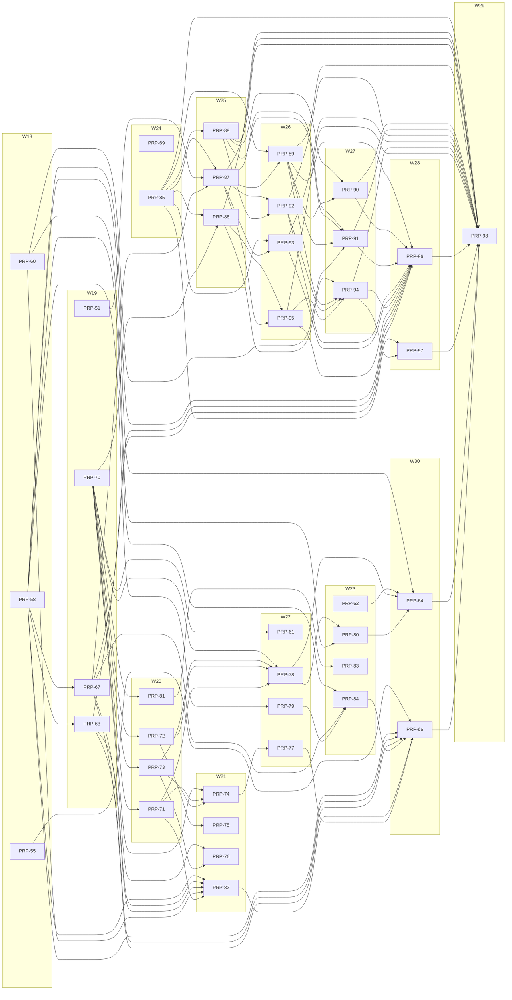

# Execution plan: parallel build, waves W19 to W30

This plan covers every PRP that is not shipped. Waves W11 to W18 are done; the
remaining waves were re-planned on 2026-11-16 when the owner restored the
original product scope (decisions D13 and D14 in `docs/DECISIONS-LOG.md`):
W19 to W23 add back the original features, W24 to W29 add multi-cloud hosting,
W30 is the operator-attended live gates. Shared rules, file-ownership tiers,
commands and traps are in `PRPs/reference/parallel-build-reference.md`; read
that first.

The tables, graph and prompts between the markers below are generated by
`python scripts/prp_execution_plan.py --write` from the PRP files. Edit the PRPs
or the script, not the generated block.

## How to run a wave

1. Start one fresh Claude Code session per PRP in the wave (WIP limit 4), each
   in its own worktree, with the kickoff prompt from the last section.
2. Only one session per wave may run `docker compose` or `make stack-up`: the
   "Holds stack" column names it. The others test against in-memory fakes.
3. Merge in the order of the wave table, top to bottom. `main` requires an
   up-to-date branch and has no merge queue, so each later PRP rebases,
   regenerates its Tier-3 files (`openapi.json`, `docs/reference`, the PRP
   index and status table), waits for CI and then merges. Items marked
   `[serial-after: PRP-NN]` are done after that PRP merged.
4. Run the integration check below on `main` after the last merge of the wave.
5. Do not start the next wave until the check passes and the wave gate holds.

## Integration check after every wave

```bash
git switch main && git pull
uv sync && pnpm install
uv run ruff check . && uv run ruff format --check . && uv run pyright
uv run pytest -q
python packages/contracts/scripts/generate.py --check
pnpm --filter @neurosphere/frontend lint
pnpm --filter @neurosphere/frontend typecheck
pnpm --filter @neurosphere/frontend test
pnpm --filter @neurosphere/frontend build
pnpm --filter @neurosphere/frontend test:e2e
python scripts/validate_planning.py && python scripts/prp_status.py --check
python scripts/prp_execution_plan.py --check
powershell -NoProfile -ExecutionPolicy Bypass -File ~/.claude/hooks/verify-gates.ps1 -Mode full
# From W12 on (after PRP-38): the real stack, one session at a time. PRP-38's
# completion note carries the exact command if it changed this one.
make stack-up && uv run pytest -q -m integration tests/integration/real_stack && make stack-down
```

A failure is fixed on `main` (or by reverting the offending merge) before the
next wave starts. Report failures with the output; do not start the next wave
on a red `main`.

<!-- execution-plan:begin -->

## Waves and merge order

### W18

| Merge | PRP | Model | Review | Blocked by | Serial-after items | Holds stack | Branch |
|---|---|---|---|---|---|---|---|
| 1 | [PRP-58: Hosted data path](backlog/PRP-58-hosted-data-path-and-environment-hardening.md) | sonnet | required | none | - | - | `prp-58-hosted-data-path` |
| 2 | [PRP-55: Real deploy apply](backlog/PRP-55-real-deploy-apply.md) | opus | required | none | PRP-58 | - | `prp-55-real-deploy-apply` |
| 3 | [PRP-60: Search indexing hardening](backlog/PRP-60-search-indexing-hardening.md) | sonnet | required | none | PRP-44, PRP-55 | - | `prp-60-search-indexing-hardening` |

Gate before the next wave: An operator can register a producer and a connector in the UI; hosted IaC builds offline with the connector roles.

### W19

| Merge | PRP | Model | Review | Blocked by | Serial-after items | Holds stack | Branch |
|---|---|---|---|---|---|---|---|
| 1 | [PRP-63: Delivery pipeline to the hosted environment](backlog/PRP-63-delivery-pipeline-to-hosted.md) | sonnet | required | PRP-58 | - | - | `prp-63-delivery-pipeline` |
| 2 | [PRP-67: Hosted environment hardening](backlog/PRP-67-hosted-environment-hardening.md) | sonnet | required | PRP-58 | - | - | `prp-67-hosted-hardening` |
| 3 | [PRP-51: Composition and API hygiene](backlog/PRP-51-composition-and-api-hygiene.md) | sonnet | required | none | PRP-67 | - | `prp-51-composition-hygiene` |
| 4 | [PRP-70: Contracts revision for the restored original scope](backlog/PRP-70-contracts-revision-restored-scope.md) | opus | required | none | - | - | `prp-70-contracts-restored-scope` |

Gate before the next wave: Main deploys to the hosted Azure environment by pipeline (dry run green; first live run needs the operator). Restored-scope contracts reviewed (Opus).

### W20

| Merge | PRP | Model | Review | Blocked by | Serial-after items | Holds stack | Branch |
|---|---|---|---|---|---|---|---|
| 1 | [PRP-71: Realistic seeded world and the local "everything on" demo profile](backlog/PRP-71-realistic-seeded-world-and-demo-profile.md) | sonnet | required | PRP-70 | PRP-78 | yes | `prp-71-demo-world-and-profile` |
| 2 | [PRP-72: Agent and tool recommender (matcher, API, feedback)](backlog/PRP-72-agent-and-tool-recommender-backend.md) | sonnet | required | PRP-70 | - | - | `prp-72-agent-tool-recommender` |
| 3 | [PRP-73: Graph access and sensitivity questions](backlog/PRP-73-graph-access-and-sensitivity-questions.md) | sonnet | required | PRP-70 | - | - | `prp-73-graph-access-questions` |
| 4 | [PRP-81: Compliance mappings for SOC 2, ISO 27001, GDPR and NIST 800-53](backlog/PRP-81-compliance-mappings-soc2-iso27001-gdpr.md) | sonnet | required | PRP-70 | - | - | `prp-81-compliance-mappings` |

Gate before the next wave: `make demo-up` brings up a seeded world where every nav entry shows data; a task returns ranked agents with an explanation; a sensitivity question returns the agents that touch that data.

### W21

| Merge | PRP | Model | Review | Blocked by | Serial-after items | Holds stack | Branch |
|---|---|---|---|---|---|---|---|
| 1 | [PRP-74: Live map topology backend (services and tools, facets, topology push, search, impact)](backlog/PRP-74-live-map-topology-backend.md) | sonnet | required | PRP-70, PRP-71, PRP-73 | - | - | `prp-74-live-map-topology-backend` |
| 2 | [PRP-75: "Find an agent" page and recommendation metrics](backlog/PRP-75-find-an-agent-ui-and-recommendation-metrics.md) | sonnet | required | PRP-72 | - | - | `prp-75-find-an-agent-ui` |
| 3 | [PRP-76: Catalog registration completeness](backlog/PRP-76-catalog-registration-completeness.md) | sonnet | required | PRP-70, PRP-73 | - | - | `prp-76-catalog-registration-completeness` |
| 4 | [PRP-82: Hosted Azure profile with everything on, seeded and checked](backlog/PRP-82-hosted-profile-everything-on.md) | sonnet | required | PRP-58, PRP-63, PRP-67, PRP-60, PRP-71 | PRP-67 | - | `prp-82-hosted-everything-on` |

Gate before the next wave: The hosted profile renders with everything on (offline build); Find an agent, catalog history and undeclared agents work on the local stack; the map shows services and tools and receives topology pushes.

### W22

| Merge | PRP | Model | Review | Blocked by | Serial-after items | Holds stack | Branch |
|---|---|---|---|---|---|---|---|
| 1 | [PRP-61: Configuration detections and shadow-AI discovery](backlog/PRP-61-configuration-detections-and-shadow-ai-discovery.md) | sonnet | required | PRP-70 | PRP-56 | - | `prp-61-detections` |
| 2 | [PRP-77: Live map filters, search and incident view](backlog/PRP-77-live-map-filters-search-and-incident-view.md) | sonnet | required | PRP-74 | - | - | `prp-77-live-map-filters-search-incident` |
| 3 | [PRP-78: Copilot graph, timeline and recommender tools, tool-call audit, demo-profile copilot](backlog/PRP-78-copilot-graph-timeline-and-recommender-tools.md) | opus | required | PRP-70, PRP-73, PRP-72, PRP-71 | PRP-71, PRP-78 | - | `prp-78-copilot-graph-tools` |
| 4 | [PRP-79: Agent SDK and telemetry onboarding](backlog/PRP-79-agent-sdk-and-telemetry-onboarding.md) | sonnet | required | PRP-58 | PRP-78 | - | `prp-79-agent-sdk-onboarding` |

Gate before the next wave: The map filters, searches and highlights incident impact; the copilot answers graph, timeline and recommend questions with citations (owner decision on the recorded mode applied); the agent SDK quickstart works against the local stack.

### W23

| Merge | PRP | Model | Review | Blocked by | Serial-after items | Holds stack | Branch |
|---|---|---|---|---|---|---|---|
| 1 | [PRP-62: AWS Bedrock reference connector (metadata only)](backlog/PRP-62-aws-bedrock-reference-connector.md) | sonnet | required | none | - | - | `prp-62-aws-bedrock-connector` |
| 2 | [PRP-83: Data-subject requests, legal holds and residency](backlog/PRP-83-data-subject-requests-and-residency.md) | sonnet | required | PRP-81 | - | - | `prp-83-dsr-and-residency` |
| 3 | [PRP-84: Ingest throughput, back-pressure, autoscaling and end-to-end latency measurement](backlog/PRP-84-ingest-throughput-and-autoscaling.md) | sonnet | required | PRP-58, PRP-67, PRP-79 | PRP-82 | - | `prp-84-ingest-throughput` |
| 4 | [PRP-80: Copilot docs retrieval, telemetry summaries and the groundedness set](backlog/PRP-80-copilot-docs-retrieval-and-groundedness.md) | opus | required | PRP-78, PRP-60 | PRP-84 | - | `prp-80-copilot-docs-retrieval` |

Gate before the next wave: Copilot retrieval and the groundedness set pass on the recorded transport; data-subject requests can be submitted; ingest back-pressure and autoscaling render in the chart.

### W24

| Merge | PRP | Model | Review | Blocked by | Serial-after items | Holds stack | Branch |
|---|---|---|---|---|---|---|---|
| 1 | [PRP-69: Private-network MCP servers (per-server SSRF override)](backlog/PRP-69-mcp-private-network-servers.md) | opus | required | none | PRP-67 | - | `prp-69-mcp-private-network` |
| 2 | [PRP-85: Deployment target, neutral ports and the adapter boundary (multi-cloud foundation)](backlog/PRP-85-deployment-target-ports-and-adapter-boundary.md) | opus | required | none | - | - | `prp-85-deployment-target-ports` |

Gate before the next wave: Owner has confirmed the multi-cloud decisions listed in PRP-85; the adapter boundary test is in CI with its known-leaks list.

### W25

| Merge | PRP | Model | Review | Blocked by | Serial-after items | Holds stack | Branch |
|---|---|---|---|---|---|---|---|
| 1 | [PRP-86: Contracts for platforms (capability-matrix platform dimension, deployment target, credential-reference kinds)](backlog/PRP-86-contracts-platform-dimension-and-credential-kinds.md) | opus | required | PRP-85, PRP-70 | - | - | `prp-86-contracts-platform` |
| 2 | [PRP-88: Worker composition seam, event consumer and object store ports](backlog/PRP-88-worker-composition-seam-event-and-object-ports.md) | sonnet | required | PRP-85 | PRP-85 | yes | `prp-88-worker-seam-event-object-ports` |
| 3 | [PRP-87: API composition seam and adapter-package scaffolding (no Azure behaviour change)](backlog/PRP-87-api-composition-seam-and-adapter-packages.md) | opus | required | PRP-85, PRP-51, PRP-67 | PRP-87 | - | `prp-87-api-composition-seam` |

Gate before the next wave: API and worker composition go through the backend seam with no Azure behaviour change (existing suites and the real-stack job green).

### W26

| Merge | PRP | Model | Review | Blocked by | Serial-after items | Holds stack | Branch |
|---|---|---|---|---|---|---|---|
| 1 | [PRP-89: PostgreSQL foundation, catalog and the security-critical stores](backlog/PRP-89-postgres-foundation-catalog-and-security-stores.md) | opus | required | PRP-85, PRP-87 | PRP-87 | - | `prp-89-postgres-foundation` |
| 2 | [PRP-92: Kafka event streaming and S3 and GCS object storage](backlog/PRP-92-kafka-and-object-store-adapters.md) | sonnet | required | PRP-87, PRP-88 | PRP-87, PRP-89 | - | `prp-92-kafka-and-object-store-adapters` |
| 3 | [PRP-93: Generic OIDC identity beside Entra (API, workers and frontend)](backlog/PRP-93-generic-oidc-identity.md) | opus | required | PRP-85, PRP-87 | PRP-87, PRP-89 | - | `prp-93-generic-oidc` |
| 4 | [PRP-95: Model endpoints, OTLP telemetry and portable analytics](backlog/PRP-95-model-telemetry-and-analytics-adapters.md) | sonnet | required | PRP-86, PRP-87 | PRP-87 | - | `prp-95-model-telemetry-and-analytics-adapters` |

Gate before the next wave: PostgreSQL catalog and security stores, Kafka and object-store adapters, generic OIDC and the model adapters pass their conformance suites in containers.

### W27

| Merge | PRP | Model | Review | Blocked by | Serial-after items | Holds stack | Branch |
|---|---|---|---|---|---|---|---|
| 1 | [PRP-90: PostgreSQL data-plane stores](backlog/PRP-90-postgres-data-plane-stores.md) | sonnet | required | PRP-88, PRP-89 | PRP-87 | - | `prp-90-postgres-data-plane-stores` |
| 2 | [PRP-91: PostgreSQL control-plane stores and full-text search](backlog/PRP-91-postgres-control-plane-stores-and-search.md) | sonnet | required | PRP-87, PRP-88, PRP-89, PRP-60 | PRP-90 | - | `prp-91-postgres-control-plane-stores-and-search` |
| 3 | [PRP-94: Secret readers and workload identity for AWS, GCP and Kubernetes](backlog/PRP-94-secret-readers-and-workload-identity.md) | opus | required | PRP-86, PRP-89, PRP-92, PRP-95 | - | - | `prp-94-secret-readers` |

Gate before the next wave: Every store Protocol has a PostgreSQL implementation that passes the same conformance checks as the Cosmos one; secret readers and workload identity pass theirs.

### W28

| Merge | PRP | Model | Review | Blocked by | Serial-after items | Holds stack | Branch |
|---|---|---|---|---|---|---|---|
| 1 | [PRP-96: Helm for four platforms, portable compose profile, on-prem reference and air-gap bundle](backlog/PRP-96-helm-for-four-platforms-and-on-prem-reference.md) | sonnet | required | PRP-89, PRP-90, PRP-91, PRP-92, PRP-93, PRP-94, PRP-95, PRP-58, PRP-63, PRP-67 | - | - | `prp-96-helm-for-four-platforms-and-on-prem-reference` |
| 2 | [PRP-97: Reference Terraform for AWS and GCP](backlog/PRP-97-terraform-reference-for-aws-and-gcp.md) | sonnet | required | PRP-85, PRP-94 | PRP-87, PRP-96 | - | `prp-97-terraform-reference-for-aws-and-gcp` |

Gate before the next wave: The chart renders for all four platforms and the Azure manifests are byte-identical to before; the on-prem reference installs on a local cluster; AWS and GCP Terraform validates.

### W29

| Merge | PRP | Model | Review | Blocked by | Serial-after items | Holds stack | Branch |
|---|---|---|---|---|---|---|---|
| 1 | [PRP-98: Conformance matrix, DR and RPO/RTO per target, live-gate scripts, closing the ratchet](backlog/PRP-98-conformance-matrix-dr-and-multicloud-live-gates.md) | sonnet | required | PRP-85, PRP-86, PRP-87, PRP-88, PRP-89, PRP-90, PRP-91, PRP-92, PRP-93, PRP-94, PRP-95, PRP-96, PRP-97, PRP-64, PRP-66 | - | - | `prp-98-conformance-matrix-dr-and-multicloud-live-gates` |

Gate before the next wave: No Azure import remains outside adapter modules; the conformance matrix is published; per-target RPO/RTO are documented as unmeasured targets.

### W30

| Merge | PRP | Model | Review | Blocked by | Serial-after items | Holds stack | Branch |
|---|---|---|---|---|---|---|---|
| 1 | [PRP-64: Live gates campaign, Azure service gates (operator-attended)](backlog/PRP-64-live-gates-campaign.md) | sonnet | required | PRP-58, PRP-62, PRP-78, PRP-80 | - | - | `prp-64-live-gates` |
| 2 | [PRP-66: Operations and sign-off gates (operator-attended)](backlog/PRP-66-operations-and-sign-off-gates.md) | sonnet | required | PRP-55, PRP-58, PRP-63, PRP-67, PRP-84, PRP-82, PRP-77 | PRP-64 | - | `prp-66-operations-gates` |

Gate before the next wave: Every gate has evidence or is recorded OPEN with its reason.

## Dependency graph



Arrows are logical dependencies (`depends_on`). Waves also order PRPs that only share files; those have no arrow.

## Tier-1 file owners per wave

A Tier-1 file has one owner per wave. Any other PRP touches it only in a `[serial-after]` item.

| Wave | PRP | Tier-1 files it owns |
|---|---|---|
| W18 | PRP-55 | `packages/core/neurosphere_core/stores/containers.py`<br>`infra/compose/cosmos-containers.json`<br>`services/workers/neurosphere_workers/runtime/factories.py` |
| W18 | PRP-58 | `infra/demo/main.bicep`<br>`infra/appservice/main.bicep`<br>`infra/helm/**`<br>`docker-compose.yml` |
| W18 | PRP-60 | `services/api/neurosphere_api/runtime/builders/search.py` |
| W19 | PRP-51 | `services/api/neurosphere_api/runtime/builders/__init__.py`<br>`services/api/neurosphere_api/routers.py` |
| W19 | PRP-63 | `.github/workflows/deploy-hosted.yml`<br>`.github/workflows/release.yml` |
| W19 | PRP-67 | `infra/demo/**`<br>`infra/appservice/main.bicep`<br>`infra/helm/**` |
| W19 | PRP-70 | `packages/contracts/schemas/**` |
| W20 | PRP-71 | `docker-compose.yml`<br>`Makefile` |
| W20 | PRP-72 | `packages/core/neurosphere_core/stores/containers.py`<br>`infra/compose/cosmos-containers.json`<br>`infra/demo/modules/cosmos-data.bicep`<br>`services/api/neurosphere_api/runtime/builders/data.py` |
| W21 | PRP-76 | `packages/core/neurosphere_core/stores/containers.py`<br>`infra/compose/cosmos-containers.json`<br>`infra/demo/modules/cosmos-data.bicep` |
| W21 | PRP-82 | `infra/demo/main.bicep`<br>`infra/appservice/main.bicep` |
| W22 | PRP-78 | `services/api/neurosphere_api/runtime/builders/copilot.py`<br>`docker-compose.yml`<br>`Makefile` |
| W22 | PRP-79 | `pyproject.toml`<br>`uv.lock`<br>`docs/licenses.md`<br>`docs/adr/0002-stack-pins.md`<br>`services/api/Dockerfile`<br>`services/api/Dockerfile.dev`<br>`services/workers/Dockerfile`<br>`services/workers/Dockerfile.dev`<br>`scripts/sandbox/Dockerfile.seed` |
| W23 | PRP-62 | `pyproject.toml`<br>`uv.lock`<br>`docs/licenses.md`<br>`docs/adr/0002-stack-pins.md`<br>`services/api/Dockerfile`<br>`services/api/Dockerfile.dev`<br>`services/workers/Dockerfile`<br>`services/workers/Dockerfile.dev`<br>`scripts/sandbox/Dockerfile.seed` |
| W23 | PRP-83 | `infra/bicep/modules/cosmos.bicep`<br>`infra/bicep/modules/storage.bicep`<br>`infra/bicep/modules/eventhubs.bicep`<br>`infra/bicep/modules/search.bicep`<br>`infra/bicep/modules/main.bicep` |
| W23 | PRP-84 | `infra/helm/**` |
| W25 | PRP-86 | `packages/contracts/schemas/**` |
| W25 | PRP-87 | `services/api/neurosphere_api/runtime/builders/*.py`<br>`services/api/neurosphere_api/runtime/compose.py`<br>`pyproject.toml`<br>`uv.lock`<br>`docs/licenses.md`<br>`docs/adr/0002-stack-pins.md` |
| W25 | PRP-88 | `services/workers/neurosphere_workers/runtime/factories.py` |
| W26 | PRP-89 | `.github/workflows/portable-conformance.yml` |
| W26 | PRP-93 | `frontend/src/app/Providers.tsx`<br>`frontend/src/app/App.tsx`<br>`frontend/tests/mock-api/server.ts`<br>`frontend/package.json`<br>`pnpm-lock.yaml`<br>`docs/licenses.md`<br>`docs/adr/0002-stack-pins.md` |
| W27 | PRP-91 | `services/api/neurosphere_api/runtime/builders/search.py` |
| W28 | PRP-96 | `infra/helm/**`<br>`docker-compose.yml`<br>`Makefile` |

## Kickoff prompts

Paste one into a fresh Claude Code session started at the repo root.

### PRP-55 (W18)

```text
/prp:prp-execute PRPs/backlog/PRP-55-real-deploy-apply.md

Context for this run: wave W18 of PRPs/EXECUTION-PLAN.md, branch prp-55-real-deploy-apply cut from origin/main, implementer model opus, review required. Read PRPs/reference/parallel-build-reference.md first, then the PRP. No PRP in this wave is assigned the compose stack: do not run docker compose or make stack-up unless I confirm no other session is using it. Edit only the files in the PRP's Ownership block; add lines only to Tier-2 registries; leave Tier-3 generated files for the final close-out commit after rebasing on main. Do any [serial-after] item only after the named PRP has merged. No live or paid call without NS_LIVE_APPROVED=1 and my approval in this session; record what did not run as OPEN. Finish with the PRP's Validation gates, show their output, open the PR and report what works, what is partial and what is open.
```

### PRP-58 (W18)

```text
/prp:prp-execute PRPs/backlog/PRP-58-hosted-data-path-and-environment-hardening.md

Context for this run: wave W18 of PRPs/EXECUTION-PLAN.md, branch prp-58-hosted-data-path cut from origin/main, implementer model sonnet, review required. Read PRPs/reference/parallel-build-reference.md first, then the PRP. No PRP in this wave is assigned the compose stack: do not run docker compose or make stack-up unless I confirm no other session is using it. Edit only the files in the PRP's Ownership block; add lines only to Tier-2 registries; leave Tier-3 generated files for the final close-out commit after rebasing on main. Do any [serial-after] item only after the named PRP has merged. No live or paid call without NS_LIVE_APPROVED=1 and my approval in this session; record what did not run as OPEN. Finish with the PRP's Validation gates, show their output, open the PR and report what works, what is partial and what is open.
```

### PRP-60 (W18)

```text
/prp:prp-execute PRPs/backlog/PRP-60-search-indexing-hardening.md

Context for this run: wave W18 of PRPs/EXECUTION-PLAN.md, branch prp-60-search-indexing-hardening cut from origin/main, implementer model sonnet, review required. Read PRPs/reference/parallel-build-reference.md first, then the PRP. No PRP in this wave is assigned the compose stack: do not run docker compose or make stack-up unless I confirm no other session is using it. Edit only the files in the PRP's Ownership block; add lines only to Tier-2 registries; leave Tier-3 generated files for the final close-out commit after rebasing on main. Do any [serial-after] item only after the named PRP has merged. No live or paid call without NS_LIVE_APPROVED=1 and my approval in this session; record what did not run as OPEN. Finish with the PRP's Validation gates, show their output, open the PR and report what works, what is partial and what is open.
```

### PRP-51 (W19)

```text
/prp:prp-execute PRPs/backlog/PRP-51-composition-and-api-hygiene.md

Context for this run: wave W19 of PRPs/EXECUTION-PLAN.md, branch prp-51-composition-hygiene cut from origin/main, implementer model sonnet, review required. Read PRPs/reference/parallel-build-reference.md first, then the PRP. No PRP in this wave is assigned the compose stack: do not run docker compose or make stack-up unless I confirm no other session is using it. Edit only the files in the PRP's Ownership block; add lines only to Tier-2 registries; leave Tier-3 generated files for the final close-out commit after rebasing on main. Do any [serial-after] item only after the named PRP has merged. No live or paid call without NS_LIVE_APPROVED=1 and my approval in this session; record what did not run as OPEN. Finish with the PRP's Validation gates, show their output, open the PR and report what works, what is partial and what is open.
```

### PRP-63 (W19)

```text
/prp:prp-execute PRPs/backlog/PRP-63-delivery-pipeline-to-hosted.md

Context for this run: wave W19 of PRPs/EXECUTION-PLAN.md, branch prp-63-delivery-pipeline cut from origin/main, implementer model sonnet, review required. Read PRPs/reference/parallel-build-reference.md first, then the PRP. Before anything else confirm that PRP-58 are in PRPs/shipped/ on origin/main; if not, stop and say so. No PRP in this wave is assigned the compose stack: do not run docker compose or make stack-up unless I confirm no other session is using it. Edit only the files in the PRP's Ownership block; add lines only to Tier-2 registries; leave Tier-3 generated files for the final close-out commit after rebasing on main. Do any [serial-after] item only after the named PRP has merged. No live or paid call without NS_LIVE_APPROVED=1 and my approval in this session; record what did not run as OPEN. Finish with the PRP's Validation gates, show their output, open the PR and report what works, what is partial and what is open.
```

### PRP-67 (W19)

```text
/prp:prp-execute PRPs/backlog/PRP-67-hosted-environment-hardening.md

Context for this run: wave W19 of PRPs/EXECUTION-PLAN.md, branch prp-67-hosted-hardening cut from origin/main, implementer model sonnet, review required. Read PRPs/reference/parallel-build-reference.md first, then the PRP. Before anything else confirm that PRP-58 are in PRPs/shipped/ on origin/main; if not, stop and say so. No PRP in this wave is assigned the compose stack: do not run docker compose or make stack-up unless I confirm no other session is using it. Edit only the files in the PRP's Ownership block; add lines only to Tier-2 registries; leave Tier-3 generated files for the final close-out commit after rebasing on main. Do any [serial-after] item only after the named PRP has merged. No live or paid call without NS_LIVE_APPROVED=1 and my approval in this session; record what did not run as OPEN. Finish with the PRP's Validation gates, show their output, open the PR and report what works, what is partial and what is open.
```

### PRP-70 (W19)

```text
/prp:prp-execute PRPs/backlog/PRP-70-contracts-revision-restored-scope.md

Context for this run: wave W19 of PRPs/EXECUTION-PLAN.md, branch prp-70-contracts-restored-scope cut from origin/main, implementer model opus, review required. Read PRPs/reference/parallel-build-reference.md first, then the PRP. No PRP in this wave is assigned the compose stack: do not run docker compose or make stack-up unless I confirm no other session is using it. Edit only the files in the PRP's Ownership block; add lines only to Tier-2 registries; leave Tier-3 generated files for the final close-out commit after rebasing on main. Do any [serial-after] item only after the named PRP has merged. No live or paid call without NS_LIVE_APPROVED=1 and my approval in this session; record what did not run as OPEN. Finish with the PRP's Validation gates, show their output, open the PR and report what works, what is partial and what is open.
```

### PRP-71 (W20)

```text
/prp:prp-execute PRPs/backlog/PRP-71-realistic-seeded-world-and-demo-profile.md

Context for this run: wave W20 of PRPs/EXECUTION-PLAN.md, branch prp-71-demo-world-and-profile cut from origin/main, implementer model sonnet, review required. Read PRPs/reference/parallel-build-reference.md first, then the PRP. Before anything else confirm that PRP-70 are in PRPs/shipped/ on origin/main; if not, stop and say so. You hold the compose stack for this wave. Edit only the files in the PRP's Ownership block; add lines only to Tier-2 registries; leave Tier-3 generated files for the final close-out commit after rebasing on main. Do any [serial-after] item only after the named PRP has merged. No live or paid call without NS_LIVE_APPROVED=1 and my approval in this session; record what did not run as OPEN. Finish with the PRP's Validation gates, show their output, open the PR and report what works, what is partial and what is open.
```

### PRP-72 (W20)

```text
/prp:prp-execute PRPs/backlog/PRP-72-agent-and-tool-recommender-backend.md

Context for this run: wave W20 of PRPs/EXECUTION-PLAN.md, branch prp-72-agent-tool-recommender cut from origin/main, implementer model sonnet, review required. Read PRPs/reference/parallel-build-reference.md first, then the PRP. Before anything else confirm that PRP-70 are in PRPs/shipped/ on origin/main; if not, stop and say so. PRP-71 holds the compose stack in this wave: do not run docker compose or make stack-up. Edit only the files in the PRP's Ownership block; add lines only to Tier-2 registries; leave Tier-3 generated files for the final close-out commit after rebasing on main. Do any [serial-after] item only after the named PRP has merged. No live or paid call without NS_LIVE_APPROVED=1 and my approval in this session; record what did not run as OPEN. Finish with the PRP's Validation gates, show their output, open the PR and report what works, what is partial and what is open.
```

### PRP-73 (W20)

```text
/prp:prp-execute PRPs/backlog/PRP-73-graph-access-and-sensitivity-questions.md

Context for this run: wave W20 of PRPs/EXECUTION-PLAN.md, branch prp-73-graph-access-questions cut from origin/main, implementer model sonnet, review required. Read PRPs/reference/parallel-build-reference.md first, then the PRP. Before anything else confirm that PRP-70 are in PRPs/shipped/ on origin/main; if not, stop and say so. PRP-71 holds the compose stack in this wave: do not run docker compose or make stack-up. Edit only the files in the PRP's Ownership block; add lines only to Tier-2 registries; leave Tier-3 generated files for the final close-out commit after rebasing on main. Do any [serial-after] item only after the named PRP has merged. No live or paid call without NS_LIVE_APPROVED=1 and my approval in this session; record what did not run as OPEN. Finish with the PRP's Validation gates, show their output, open the PR and report what works, what is partial and what is open.
```

### PRP-81 (W20)

```text
/prp:prp-execute PRPs/backlog/PRP-81-compliance-mappings-soc2-iso27001-gdpr.md

Context for this run: wave W20 of PRPs/EXECUTION-PLAN.md, branch prp-81-compliance-mappings cut from origin/main, implementer model sonnet, review required. Read PRPs/reference/parallel-build-reference.md first, then the PRP. Before anything else confirm that PRP-70 are in PRPs/shipped/ on origin/main; if not, stop and say so. PRP-71 holds the compose stack in this wave: do not run docker compose or make stack-up. Edit only the files in the PRP's Ownership block; add lines only to Tier-2 registries; leave Tier-3 generated files for the final close-out commit after rebasing on main. Do any [serial-after] item only after the named PRP has merged. No live or paid call without NS_LIVE_APPROVED=1 and my approval in this session; record what did not run as OPEN. Finish with the PRP's Validation gates, show their output, open the PR and report what works, what is partial and what is open.
```

### PRP-74 (W21)

```text
/prp:prp-execute PRPs/backlog/PRP-74-live-map-topology-backend.md

Context for this run: wave W21 of PRPs/EXECUTION-PLAN.md, branch prp-74-live-map-topology-backend cut from origin/main, implementer model sonnet, review required. Read PRPs/reference/parallel-build-reference.md first, then the PRP. Before anything else confirm that PRP-70, PRP-71, PRP-73 are in PRPs/shipped/ on origin/main; if not, stop and say so. No PRP in this wave is assigned the compose stack: do not run docker compose or make stack-up unless I confirm no other session is using it. Edit only the files in the PRP's Ownership block; add lines only to Tier-2 registries; leave Tier-3 generated files for the final close-out commit after rebasing on main. Do any [serial-after] item only after the named PRP has merged. No live or paid call without NS_LIVE_APPROVED=1 and my approval in this session; record what did not run as OPEN. Finish with the PRP's Validation gates, show their output, open the PR and report what works, what is partial and what is open.
```

### PRP-75 (W21)

```text
/prp:prp-execute PRPs/backlog/PRP-75-find-an-agent-ui-and-recommendation-metrics.md

Context for this run: wave W21 of PRPs/EXECUTION-PLAN.md, branch prp-75-find-an-agent-ui cut from origin/main, implementer model sonnet, review required. Read PRPs/reference/parallel-build-reference.md first, then the PRP. Before anything else confirm that PRP-72 are in PRPs/shipped/ on origin/main; if not, stop and say so. No PRP in this wave is assigned the compose stack: do not run docker compose or make stack-up unless I confirm no other session is using it. Edit only the files in the PRP's Ownership block; add lines only to Tier-2 registries; leave Tier-3 generated files for the final close-out commit after rebasing on main. Do any [serial-after] item only after the named PRP has merged. No live or paid call without NS_LIVE_APPROVED=1 and my approval in this session; record what did not run as OPEN. Finish with the PRP's Validation gates, show their output, open the PR and report what works, what is partial and what is open.
```

### PRP-76 (W21)

```text
/prp:prp-execute PRPs/backlog/PRP-76-catalog-registration-completeness.md

Context for this run: wave W21 of PRPs/EXECUTION-PLAN.md, branch prp-76-catalog-registration-completeness cut from origin/main, implementer model sonnet, review required. Read PRPs/reference/parallel-build-reference.md first, then the PRP. Before anything else confirm that PRP-70, PRP-73 are in PRPs/shipped/ on origin/main; if not, stop and say so. No PRP in this wave is assigned the compose stack: do not run docker compose or make stack-up unless I confirm no other session is using it. Edit only the files in the PRP's Ownership block; add lines only to Tier-2 registries; leave Tier-3 generated files for the final close-out commit after rebasing on main. Do any [serial-after] item only after the named PRP has merged. No live or paid call without NS_LIVE_APPROVED=1 and my approval in this session; record what did not run as OPEN. Finish with the PRP's Validation gates, show their output, open the PR and report what works, what is partial and what is open.
```

### PRP-82 (W21)

```text
/prp:prp-execute PRPs/backlog/PRP-82-hosted-profile-everything-on.md

Context for this run: wave W21 of PRPs/EXECUTION-PLAN.md, branch prp-82-hosted-everything-on cut from origin/main, implementer model sonnet, review required. Read PRPs/reference/parallel-build-reference.md first, then the PRP. Before anything else confirm that PRP-58, PRP-63, PRP-67, PRP-60, PRP-71 are in PRPs/shipped/ on origin/main; if not, stop and say so. No PRP in this wave is assigned the compose stack: do not run docker compose or make stack-up unless I confirm no other session is using it. Edit only the files in the PRP's Ownership block; add lines only to Tier-2 registries; leave Tier-3 generated files for the final close-out commit after rebasing on main. Do any [serial-after] item only after the named PRP has merged. No live or paid call without NS_LIVE_APPROVED=1 and my approval in this session; record what did not run as OPEN. Finish with the PRP's Validation gates, show their output, open the PR and report what works, what is partial and what is open.
```

### PRP-61 (W22)

```text
/prp:prp-execute PRPs/backlog/PRP-61-configuration-detections-and-shadow-ai-discovery.md

Context for this run: wave W22 of PRPs/EXECUTION-PLAN.md, branch prp-61-detections cut from origin/main, implementer model sonnet, review required. Read PRPs/reference/parallel-build-reference.md first, then the PRP. Before anything else confirm that PRP-70 are in PRPs/shipped/ on origin/main; if not, stop and say so. No PRP in this wave is assigned the compose stack: do not run docker compose or make stack-up unless I confirm no other session is using it. Edit only the files in the PRP's Ownership block; add lines only to Tier-2 registries; leave Tier-3 generated files for the final close-out commit after rebasing on main. Do any [serial-after] item only after the named PRP has merged. No live or paid call without NS_LIVE_APPROVED=1 and my approval in this session; record what did not run as OPEN. Finish with the PRP's Validation gates, show their output, open the PR and report what works, what is partial and what is open.
```

### PRP-77 (W22)

```text
/prp:prp-execute PRPs/backlog/PRP-77-live-map-filters-search-and-incident-view.md

Context for this run: wave W22 of PRPs/EXECUTION-PLAN.md, branch prp-77-live-map-filters-search-incident cut from origin/main, implementer model sonnet, review required. Read PRPs/reference/parallel-build-reference.md first, then the PRP. Before anything else confirm that PRP-74 are in PRPs/shipped/ on origin/main; if not, stop and say so. No PRP in this wave is assigned the compose stack: do not run docker compose or make stack-up unless I confirm no other session is using it. Edit only the files in the PRP's Ownership block; add lines only to Tier-2 registries; leave Tier-3 generated files for the final close-out commit after rebasing on main. Do any [serial-after] item only after the named PRP has merged. No live or paid call without NS_LIVE_APPROVED=1 and my approval in this session; record what did not run as OPEN. Finish with the PRP's Validation gates, show their output, open the PR and report what works, what is partial and what is open.
```

### PRP-78 (W22)

```text
/prp:prp-execute PRPs/backlog/PRP-78-copilot-graph-timeline-and-recommender-tools.md

Context for this run: wave W22 of PRPs/EXECUTION-PLAN.md, branch prp-78-copilot-graph-tools cut from origin/main, implementer model opus, review required. Read PRPs/reference/parallel-build-reference.md first, then the PRP. Before anything else confirm that PRP-70, PRP-73, PRP-72, PRP-71 are in PRPs/shipped/ on origin/main; if not, stop and say so. No PRP in this wave is assigned the compose stack: do not run docker compose or make stack-up unless I confirm no other session is using it. Edit only the files in the PRP's Ownership block; add lines only to Tier-2 registries; leave Tier-3 generated files for the final close-out commit after rebasing on main. Do any [serial-after] item only after the named PRP has merged. No live or paid call without NS_LIVE_APPROVED=1 and my approval in this session; record what did not run as OPEN. Finish with the PRP's Validation gates, show their output, open the PR and report what works, what is partial and what is open.
```

### PRP-79 (W22)

```text
/prp:prp-execute PRPs/backlog/PRP-79-agent-sdk-and-telemetry-onboarding.md

Context for this run: wave W22 of PRPs/EXECUTION-PLAN.md, branch prp-79-agent-sdk-onboarding cut from origin/main, implementer model sonnet, review required. Read PRPs/reference/parallel-build-reference.md first, then the PRP. Before anything else confirm that PRP-58 are in PRPs/shipped/ on origin/main; if not, stop and say so. No PRP in this wave is assigned the compose stack: do not run docker compose or make stack-up unless I confirm no other session is using it. Edit only the files in the PRP's Ownership block; add lines only to Tier-2 registries; leave Tier-3 generated files for the final close-out commit after rebasing on main. Do any [serial-after] item only after the named PRP has merged. No live or paid call without NS_LIVE_APPROVED=1 and my approval in this session; record what did not run as OPEN. Finish with the PRP's Validation gates, show their output, open the PR and report what works, what is partial and what is open.
```

### PRP-62 (W23)

```text
/prp:prp-execute PRPs/backlog/PRP-62-aws-bedrock-reference-connector.md

Context for this run: wave W23 of PRPs/EXECUTION-PLAN.md, branch prp-62-aws-bedrock-connector cut from origin/main, implementer model sonnet, review required. Read PRPs/reference/parallel-build-reference.md first, then the PRP. No PRP in this wave is assigned the compose stack: do not run docker compose or make stack-up unless I confirm no other session is using it. Edit only the files in the PRP's Ownership block; add lines only to Tier-2 registries; leave Tier-3 generated files for the final close-out commit after rebasing on main. Do any [serial-after] item only after the named PRP has merged. No live or paid call without NS_LIVE_APPROVED=1 and my approval in this session; record what did not run as OPEN. Finish with the PRP's Validation gates, show their output, open the PR and report what works, what is partial and what is open.
```

### PRP-80 (W23)

```text
/prp:prp-execute PRPs/backlog/PRP-80-copilot-docs-retrieval-and-groundedness.md

Context for this run: wave W23 of PRPs/EXECUTION-PLAN.md, branch prp-80-copilot-docs-retrieval cut from origin/main, implementer model opus, review required. Read PRPs/reference/parallel-build-reference.md first, then the PRP. Before anything else confirm that PRP-78, PRP-60 are in PRPs/shipped/ on origin/main; if not, stop and say so. No PRP in this wave is assigned the compose stack: do not run docker compose or make stack-up unless I confirm no other session is using it. Edit only the files in the PRP's Ownership block; add lines only to Tier-2 registries; leave Tier-3 generated files for the final close-out commit after rebasing on main. Do any [serial-after] item only after the named PRP has merged. No live or paid call without NS_LIVE_APPROVED=1 and my approval in this session; record what did not run as OPEN. Finish with the PRP's Validation gates, show their output, open the PR and report what works, what is partial and what is open.
```

### PRP-83 (W23)

```text
/prp:prp-execute PRPs/backlog/PRP-83-data-subject-requests-and-residency.md

Context for this run: wave W23 of PRPs/EXECUTION-PLAN.md, branch prp-83-dsr-and-residency cut from origin/main, implementer model sonnet, review required. Read PRPs/reference/parallel-build-reference.md first, then the PRP. Before anything else confirm that PRP-81 are in PRPs/shipped/ on origin/main; if not, stop and say so. No PRP in this wave is assigned the compose stack: do not run docker compose or make stack-up unless I confirm no other session is using it. Edit only the files in the PRP's Ownership block; add lines only to Tier-2 registries; leave Tier-3 generated files for the final close-out commit after rebasing on main. Do any [serial-after] item only after the named PRP has merged. No live or paid call without NS_LIVE_APPROVED=1 and my approval in this session; record what did not run as OPEN. Finish with the PRP's Validation gates, show their output, open the PR and report what works, what is partial and what is open.
```

### PRP-84 (W23)

```text
/prp:prp-execute PRPs/backlog/PRP-84-ingest-throughput-and-autoscaling.md

Context for this run: wave W23 of PRPs/EXECUTION-PLAN.md, branch prp-84-ingest-throughput cut from origin/main, implementer model sonnet, review required. Read PRPs/reference/parallel-build-reference.md first, then the PRP. Before anything else confirm that PRP-58, PRP-67, PRP-79 are in PRPs/shipped/ on origin/main; if not, stop and say so. No PRP in this wave is assigned the compose stack: do not run docker compose or make stack-up unless I confirm no other session is using it. Edit only the files in the PRP's Ownership block; add lines only to Tier-2 registries; leave Tier-3 generated files for the final close-out commit after rebasing on main. Do any [serial-after] item only after the named PRP has merged. No live or paid call without NS_LIVE_APPROVED=1 and my approval in this session; record what did not run as OPEN. Finish with the PRP's Validation gates, show their output, open the PR and report what works, what is partial and what is open.
```

### PRP-69 (W24)

```text
/prp:prp-execute PRPs/backlog/PRP-69-mcp-private-network-servers.md

Context for this run: wave W24 of PRPs/EXECUTION-PLAN.md, branch prp-69-mcp-private-network cut from origin/main, implementer model opus, review required. Read PRPs/reference/parallel-build-reference.md first, then the PRP. No PRP in this wave is assigned the compose stack: do not run docker compose or make stack-up unless I confirm no other session is using it. Edit only the files in the PRP's Ownership block; add lines only to Tier-2 registries; leave Tier-3 generated files for the final close-out commit after rebasing on main. Do any [serial-after] item only after the named PRP has merged. No live or paid call without NS_LIVE_APPROVED=1 and my approval in this session; record what did not run as OPEN. Finish with the PRP's Validation gates, show their output, open the PR and report what works, what is partial and what is open.
```

### PRP-85 (W24)

```text
/prp:prp-execute PRPs/backlog/PRP-85-deployment-target-ports-and-adapter-boundary.md

Context for this run: wave W24 of PRPs/EXECUTION-PLAN.md, branch prp-85-deployment-target-ports cut from origin/main, implementer model opus, review required. Read PRPs/reference/parallel-build-reference.md first, then the PRP. No PRP in this wave is assigned the compose stack: do not run docker compose or make stack-up unless I confirm no other session is using it. Edit only the files in the PRP's Ownership block; add lines only to Tier-2 registries; leave Tier-3 generated files for the final close-out commit after rebasing on main. Do any [serial-after] item only after the named PRP has merged. No live or paid call without NS_LIVE_APPROVED=1 and my approval in this session; record what did not run as OPEN. Finish with the PRP's Validation gates, show their output, open the PR and report what works, what is partial and what is open.
```

### PRP-86 (W25)

```text
/prp:prp-execute PRPs/backlog/PRP-86-contracts-platform-dimension-and-credential-kinds.md

Context for this run: wave W25 of PRPs/EXECUTION-PLAN.md, branch prp-86-contracts-platform cut from origin/main, implementer model opus, review required. Read PRPs/reference/parallel-build-reference.md first, then the PRP. Before anything else confirm that PRP-85, PRP-70 are in PRPs/shipped/ on origin/main; if not, stop and say so. PRP-88 holds the compose stack in this wave: do not run docker compose or make stack-up. Edit only the files in the PRP's Ownership block; add lines only to Tier-2 registries; leave Tier-3 generated files for the final close-out commit after rebasing on main. Do any [serial-after] item only after the named PRP has merged. No live or paid call without NS_LIVE_APPROVED=1 and my approval in this session; record what did not run as OPEN. Finish with the PRP's Validation gates, show their output, open the PR and report what works, what is partial and what is open.
```

### PRP-87 (W25)

```text
/prp:prp-execute PRPs/backlog/PRP-87-api-composition-seam-and-adapter-packages.md

Context for this run: wave W25 of PRPs/EXECUTION-PLAN.md, branch prp-87-api-composition-seam cut from origin/main, implementer model opus, review required. Read PRPs/reference/parallel-build-reference.md first, then the PRP. Before anything else confirm that PRP-85, PRP-51, PRP-67 are in PRPs/shipped/ on origin/main; if not, stop and say so. PRP-88 holds the compose stack in this wave: do not run docker compose or make stack-up. Edit only the files in the PRP's Ownership block; add lines only to Tier-2 registries; leave Tier-3 generated files for the final close-out commit after rebasing on main. Do any [serial-after] item only after the named PRP has merged. No live or paid call without NS_LIVE_APPROVED=1 and my approval in this session; record what did not run as OPEN. Finish with the PRP's Validation gates, show their output, open the PR and report what works, what is partial and what is open.
```

### PRP-88 (W25)

```text
/prp:prp-execute PRPs/backlog/PRP-88-worker-composition-seam-event-and-object-ports.md

Context for this run: wave W25 of PRPs/EXECUTION-PLAN.md, branch prp-88-worker-seam-event-object-ports cut from origin/main, implementer model sonnet, review required. Read PRPs/reference/parallel-build-reference.md first, then the PRP. Before anything else confirm that PRP-85 are in PRPs/shipped/ on origin/main; if not, stop and say so. You hold the compose stack for this wave. Edit only the files in the PRP's Ownership block; add lines only to Tier-2 registries; leave Tier-3 generated files for the final close-out commit after rebasing on main. Do any [serial-after] item only after the named PRP has merged. No live or paid call without NS_LIVE_APPROVED=1 and my approval in this session; record what did not run as OPEN. Finish with the PRP's Validation gates, show their output, open the PR and report what works, what is partial and what is open.
```

### PRP-89 (W26)

```text
/prp:prp-execute PRPs/backlog/PRP-89-postgres-foundation-catalog-and-security-stores.md

Context for this run: wave W26 of PRPs/EXECUTION-PLAN.md, branch prp-89-postgres-foundation cut from origin/main, implementer model opus, review required. Read PRPs/reference/parallel-build-reference.md first, then the PRP. Before anything else confirm that PRP-85, PRP-87 are in PRPs/shipped/ on origin/main; if not, stop and say so. No PRP in this wave is assigned the compose stack: do not run docker compose or make stack-up unless I confirm no other session is using it. Edit only the files in the PRP's Ownership block; add lines only to Tier-2 registries; leave Tier-3 generated files for the final close-out commit after rebasing on main. Do any [serial-after] item only after the named PRP has merged. No live or paid call without NS_LIVE_APPROVED=1 and my approval in this session; record what did not run as OPEN. Finish with the PRP's Validation gates, show their output, open the PR and report what works, what is partial and what is open.
```

### PRP-92 (W26)

```text
/prp:prp-execute PRPs/backlog/PRP-92-kafka-and-object-store-adapters.md

Context for this run: wave W26 of PRPs/EXECUTION-PLAN.md, branch prp-92-kafka-and-object-store-adapters cut from origin/main, implementer model sonnet, review required. Read PRPs/reference/parallel-build-reference.md first, then the PRP. Before anything else confirm that PRP-87, PRP-88 are in PRPs/shipped/ on origin/main; if not, stop and say so. No PRP in this wave is assigned the compose stack: do not run docker compose or make stack-up unless I confirm no other session is using it. Edit only the files in the PRP's Ownership block; add lines only to Tier-2 registries; leave Tier-3 generated files for the final close-out commit after rebasing on main. Do any [serial-after] item only after the named PRP has merged. No live or paid call without NS_LIVE_APPROVED=1 and my approval in this session; record what did not run as OPEN. Finish with the PRP's Validation gates, show their output, open the PR and report what works, what is partial and what is open.
```

### PRP-93 (W26)

```text
/prp:prp-execute PRPs/backlog/PRP-93-generic-oidc-identity.md

Context for this run: wave W26 of PRPs/EXECUTION-PLAN.md, branch prp-93-generic-oidc cut from origin/main, implementer model opus, review required. Read PRPs/reference/parallel-build-reference.md first, then the PRP. Before anything else confirm that PRP-85, PRP-87 are in PRPs/shipped/ on origin/main; if not, stop and say so. No PRP in this wave is assigned the compose stack: do not run docker compose or make stack-up unless I confirm no other session is using it. Edit only the files in the PRP's Ownership block; add lines only to Tier-2 registries; leave Tier-3 generated files for the final close-out commit after rebasing on main. Do any [serial-after] item only after the named PRP has merged. No live or paid call without NS_LIVE_APPROVED=1 and my approval in this session; record what did not run as OPEN. Finish with the PRP's Validation gates, show their output, open the PR and report what works, what is partial and what is open.
```

### PRP-95 (W26)

```text
/prp:prp-execute PRPs/backlog/PRP-95-model-telemetry-and-analytics-adapters.md

Context for this run: wave W26 of PRPs/EXECUTION-PLAN.md, branch prp-95-model-telemetry-and-analytics-adapters cut from origin/main, implementer model sonnet, review required. Read PRPs/reference/parallel-build-reference.md first, then the PRP. Before anything else confirm that PRP-86, PRP-87 are in PRPs/shipped/ on origin/main; if not, stop and say so. No PRP in this wave is assigned the compose stack: do not run docker compose or make stack-up unless I confirm no other session is using it. Edit only the files in the PRP's Ownership block; add lines only to Tier-2 registries; leave Tier-3 generated files for the final close-out commit after rebasing on main. Do any [serial-after] item only after the named PRP has merged. No live or paid call without NS_LIVE_APPROVED=1 and my approval in this session; record what did not run as OPEN. Finish with the PRP's Validation gates, show their output, open the PR and report what works, what is partial and what is open.
```

### PRP-90 (W27)

```text
/prp:prp-execute PRPs/backlog/PRP-90-postgres-data-plane-stores.md

Context for this run: wave W27 of PRPs/EXECUTION-PLAN.md, branch prp-90-postgres-data-plane-stores cut from origin/main, implementer model sonnet, review required. Read PRPs/reference/parallel-build-reference.md first, then the PRP. Before anything else confirm that PRP-88, PRP-89 are in PRPs/shipped/ on origin/main; if not, stop and say so. No PRP in this wave is assigned the compose stack: do not run docker compose or make stack-up unless I confirm no other session is using it. Edit only the files in the PRP's Ownership block; add lines only to Tier-2 registries; leave Tier-3 generated files for the final close-out commit after rebasing on main. Do any [serial-after] item only after the named PRP has merged. No live or paid call without NS_LIVE_APPROVED=1 and my approval in this session; record what did not run as OPEN. Finish with the PRP's Validation gates, show their output, open the PR and report what works, what is partial and what is open.
```

### PRP-91 (W27)

```text
/prp:prp-execute PRPs/backlog/PRP-91-postgres-control-plane-stores-and-search.md

Context for this run: wave W27 of PRPs/EXECUTION-PLAN.md, branch prp-91-postgres-control-plane-stores-and-search cut from origin/main, implementer model sonnet, review required. Read PRPs/reference/parallel-build-reference.md first, then the PRP. Before anything else confirm that PRP-87, PRP-88, PRP-89, PRP-60 are in PRPs/shipped/ on origin/main; if not, stop and say so. No PRP in this wave is assigned the compose stack: do not run docker compose or make stack-up unless I confirm no other session is using it. Edit only the files in the PRP's Ownership block; add lines only to Tier-2 registries; leave Tier-3 generated files for the final close-out commit after rebasing on main. Do any [serial-after] item only after the named PRP has merged. No live or paid call without NS_LIVE_APPROVED=1 and my approval in this session; record what did not run as OPEN. Finish with the PRP's Validation gates, show their output, open the PR and report what works, what is partial and what is open.
```

### PRP-94 (W27)

```text
/prp:prp-execute PRPs/backlog/PRP-94-secret-readers-and-workload-identity.md

Context for this run: wave W27 of PRPs/EXECUTION-PLAN.md, branch prp-94-secret-readers cut from origin/main, implementer model opus, review required. Read PRPs/reference/parallel-build-reference.md first, then the PRP. Before anything else confirm that PRP-86, PRP-89, PRP-92, PRP-95 are in PRPs/shipped/ on origin/main; if not, stop and say so. No PRP in this wave is assigned the compose stack: do not run docker compose or make stack-up unless I confirm no other session is using it. Edit only the files in the PRP's Ownership block; add lines only to Tier-2 registries; leave Tier-3 generated files for the final close-out commit after rebasing on main. Do any [serial-after] item only after the named PRP has merged. No live or paid call without NS_LIVE_APPROVED=1 and my approval in this session; record what did not run as OPEN. Finish with the PRP's Validation gates, show their output, open the PR and report what works, what is partial and what is open.
```

### PRP-96 (W28)

```text
/prp:prp-execute PRPs/backlog/PRP-96-helm-for-four-platforms-and-on-prem-reference.md

Context for this run: wave W28 of PRPs/EXECUTION-PLAN.md, branch prp-96-helm-for-four-platforms-and-on-prem-reference cut from origin/main, implementer model sonnet, review required. Read PRPs/reference/parallel-build-reference.md first, then the PRP. Before anything else confirm that PRP-89, PRP-90, PRP-91, PRP-92, PRP-93, PRP-94, PRP-95, PRP-58, PRP-63, PRP-67 are in PRPs/shipped/ on origin/main; if not, stop and say so. No PRP in this wave is assigned the compose stack: do not run docker compose or make stack-up unless I confirm no other session is using it. Edit only the files in the PRP's Ownership block; add lines only to Tier-2 registries; leave Tier-3 generated files for the final close-out commit after rebasing on main. Do any [serial-after] item only after the named PRP has merged. No live or paid call without NS_LIVE_APPROVED=1 and my approval in this session; record what did not run as OPEN. Finish with the PRP's Validation gates, show their output, open the PR and report what works, what is partial and what is open.
```

### PRP-97 (W28)

```text
/prp:prp-execute PRPs/backlog/PRP-97-terraform-reference-for-aws-and-gcp.md

Context for this run: wave W28 of PRPs/EXECUTION-PLAN.md, branch prp-97-terraform-reference-for-aws-and-gcp cut from origin/main, implementer model sonnet, review required. Read PRPs/reference/parallel-build-reference.md first, then the PRP. Before anything else confirm that PRP-85, PRP-94 are in PRPs/shipped/ on origin/main; if not, stop and say so. No PRP in this wave is assigned the compose stack: do not run docker compose or make stack-up unless I confirm no other session is using it. Edit only the files in the PRP's Ownership block; add lines only to Tier-2 registries; leave Tier-3 generated files for the final close-out commit after rebasing on main. Do any [serial-after] item only after the named PRP has merged. No live or paid call without NS_LIVE_APPROVED=1 and my approval in this session; record what did not run as OPEN. Finish with the PRP's Validation gates, show their output, open the PR and report what works, what is partial and what is open.
```

### PRP-98 (W29)

```text
/prp:prp-execute PRPs/backlog/PRP-98-conformance-matrix-dr-and-multicloud-live-gates.md

Context for this run: wave W29 of PRPs/EXECUTION-PLAN.md, branch prp-98-conformance-matrix-dr-and-multicloud-live-gates cut from origin/main, implementer model sonnet, review required. Read PRPs/reference/parallel-build-reference.md first, then the PRP. Before anything else confirm that PRP-85, PRP-86, PRP-87, PRP-88, PRP-89, PRP-90, PRP-91, PRP-92, PRP-93, PRP-94, PRP-95, PRP-96, PRP-97, PRP-64, PRP-66 are in PRPs/shipped/ on origin/main; if not, stop and say so. You hold the compose stack for this wave. Edit only the files in the PRP's Ownership block; add lines only to Tier-2 registries; leave Tier-3 generated files for the final close-out commit after rebasing on main. Do any [serial-after] item only after the named PRP has merged. No live or paid call without NS_LIVE_APPROVED=1 and my approval in this session; record what did not run as OPEN. Finish with the PRP's Validation gates, show their output, open the PR and report what works, what is partial and what is open.
```

### PRP-64 (W30)

```text
/prp:prp-execute PRPs/backlog/PRP-64-live-gates-campaign.md

Context for this run: wave W30 of PRPs/EXECUTION-PLAN.md, branch prp-64-live-gates cut from origin/main, implementer model sonnet, review required. Read PRPs/reference/parallel-build-reference.md first, then the PRP. Before anything else confirm that PRP-58, PRP-62, PRP-78, PRP-80 are in PRPs/shipped/ on origin/main; if not, stop and say so. No PRP in this wave is assigned the compose stack: do not run docker compose or make stack-up unless I confirm no other session is using it. Edit only the files in the PRP's Ownership block; add lines only to Tier-2 registries; leave Tier-3 generated files for the final close-out commit after rebasing on main. Do any [serial-after] item only after the named PRP has merged. No live or paid call without NS_LIVE_APPROVED=1 and my approval in this session; record what did not run as OPEN. Finish with the PRP's Validation gates, show their output, open the PR and report what works, what is partial and what is open.
```

### PRP-66 (W30)

```text
/prp:prp-execute PRPs/backlog/PRP-66-operations-and-sign-off-gates.md

Context for this run: wave W30 of PRPs/EXECUTION-PLAN.md, branch prp-66-operations-gates cut from origin/main, implementer model sonnet, review required. Read PRPs/reference/parallel-build-reference.md first, then the PRP. Before anything else confirm that PRP-55, PRP-58, PRP-63, PRP-67, PRP-84, PRP-82, PRP-77 are in PRPs/shipped/ on origin/main; if not, stop and say so. No PRP in this wave is assigned the compose stack: do not run docker compose or make stack-up unless I confirm no other session is using it. Edit only the files in the PRP's Ownership block; add lines only to Tier-2 registries; leave Tier-3 generated files for the final close-out commit after rebasing on main. Do any [serial-after] item only after the named PRP has merged. No live or paid call without NS_LIVE_APPROVED=1 and my approval in this session; record what did not run as OPEN. Finish with the PRP's Validation gates, show their output, open the PR and report what works, what is partial and what is open.
```

<!-- execution-plan:end -->
