# Execution plan: parallel build, waves W18b to W39

This plan covers every PRP that is not shipped. Waves W11 to W18 are done. The
remaining waves were re-planned on 2026-11-16 (decisions D13 to D18 in
`docs/DECISIONS-LOG.md`): W19 to W24 restore the original features and build
the governance core up to the north-star scenario (PRP-109), which is the
product definition of done; W25 to W33 add enforcement depth, estate coverage,
identity, Purview and Unity Catalog, risk, incidents and the live gates; W34 to
W39 add multi-cloud hosting. W18b was inserted on 2026-11-17 (decision D20) and
runs first: Entra-based administrators, real tenant data in the hosted
environment and grouped navigation. Shared rules, file-ownership tiers, commands and
traps are in `PRPs/reference/parallel-build-reference.md`; read that first.

The tables, graph and prompts between the markers below are generated by
`python scripts/prp_execution_plan.py --write` from the PRP files. Edit the PRPs
or the script, not the generated block.

## How to run a wave

1. Start one fresh Claude Code session per PRP in the wave (WIP limit 4), each
   in its own worktree, with the kickoff prompt from the last section.
2. Only one session per wave may run `docker compose` or `make stack-up`: the
   "Holds stack" column names it. The others test against in-memory fakes.
3. Merge in the order of the wave table, top to bottom. `main` requires an
   up-to-date branch and has no merge queue, so each later PRP rebases,
   regenerates its Tier-3 files (`openapi.json`, `docs/reference`, the PRP
   index and status table), waits for CI and then merges. Items marked
   `[serial-after: PRP-NN]` are done after that PRP merged.
4. Run the integration check below on `main` after the last merge of the wave.
5. Do not start the next wave until the check passes and the wave gate holds.

## Integration check after every wave

```bash
git switch main && git pull
uv sync && pnpm install
uv run ruff check . && uv run ruff format --check . && uv run pyright
uv run pytest -q
python packages/contracts/scripts/generate.py --check
pnpm --filter @neurosphere/frontend lint
pnpm --filter @neurosphere/frontend typecheck
pnpm --filter @neurosphere/frontend test
pnpm --filter @neurosphere/frontend build
pnpm --filter @neurosphere/frontend test:e2e
python scripts/validate_planning.py && python scripts/prp_status.py --check
python scripts/prp_execution_plan.py --check
powershell -NoProfile -ExecutionPolicy Bypass -File ~/.claude/hooks/verify-gates.ps1 -Mode full
# From W12 on (after PRP-38): the real stack, one session at a time. PRP-38's
# completion note carries the exact command if it changed this one.
make stack-up && uv run pytest -q -m integration tests/integration/real_stack && make stack-down
```

A failure is fixed on `main` (or by reverting the offending merge) before the
next wave starts. Report failures with the output; do not start the next wave
on a red `main`.

<!-- execution-plan:begin -->

## Waves and merge order

### W18b

| Merge | PRP | Model | Review | Blocked by | Serial-after items | Holds stack | Branch |
|---|---|---|---|---|---|---|---|
| 1 | [PRP-139: Hosted environment shows the tenant it is deployed to (real sources on, synthetic data out)](backlog/PRP-139-hosted-environment-real-tenant-data.md) | sonnet | required | none | - | - | `prp-139-hosted-real-tenant-data` |
| 2 | [PRP-140: Navigation grouping (reviewed groups, a separate Admin group, collapsible sections)](backlog/PRP-140-navigation-grouping.md) | sonnet | none | none | PRP-140 | - | `prp-140-navigation-grouping` |

Gate before the next wave: The owner signs in to the hosted environment with Entra and opens every Admin page with no script-made grant; the hosted environment shows records from the tenant for the connected sources and no synthetic data (live gate, operator-run); the navigation shows collapsible groups with an Admin group.

### W19

| Merge | PRP | Model | Review | Blocked by | Serial-after items | Holds stack | Branch |
|---|---|---|---|---|---|---|---|
| 1 | [PRP-67: Hosted environment hardening](backlog/PRP-67-hosted-environment-hardening.md) | sonnet | required | none | - | - | `prp-67-hosted-hardening` |
| 2 | [PRP-137: Telemetry agent identity resolution (external id to canonical agent id)](backlog/PRP-137-telemetry-agent-identity-resolution.md) | sonnet | required | none | - | - | `prp-137-agent-identity-resolution` |

Gate before the next wave: Hosted hardening and the restored-scope contracts are merged (contracts reviewed, Opus), including tool and service identity on the telemetry event; observed agents resolve to catalog entries.

### W20

| Merge | PRP | Model | Review | Blocked by | Serial-after items | Holds stack | Branch |
|---|---|---|---|---|---|---|---|
| 1 | [PRP-71: Realistic seeded world and the local "everything on" demo profile](backlog/PRP-71-realistic-seeded-world-and-demo-profile.md) | sonnet | required | none | PRP-78 | yes | `prp-71-demo-world-and-profile` |
| 2 | [PRP-72: Agent and tool recommender (matcher, API, feedback)](backlog/PRP-72-agent-and-tool-recommender-backend.md) | sonnet | required | none | - | - | `prp-72-agent-tool-recommender` |
| 3 | [PRP-73: Graph access and sensitivity questions](backlog/PRP-73-graph-access-and-sensitivity-questions.md) | sonnet | required | none | - | - | `prp-73-graph-access-questions` |
| 4 | [PRP-99: Governance contracts A (interaction audit, policy, notifications, approval)](backlog/PRP-99-governance-contracts-a.md) | opus | required | none | - | - | `prp-99-governance-contracts-a` |
| 5 | [PRP-141: Azure Monitor AI call telemetry reader (Log Analytics and workspace-based Application Insights)](backlog/PRP-141-azure-monitor-ai-call-telemetry-reader.md) | sonnet | required | PRP-139, PRP-137 | PRP-99 | yes | `prp-141-azure-monitor-ai-telemetry` |

Gate before the next wave: `make demo-up` brings up a seeded world where every nav entry shows data; a task returns ranked agents with an explanation; a sensitivity question returns the agents that touch that data; governance contracts A reviewed (Opus).

### W21

| Merge | PRP | Model | Review | Blocked by | Serial-after items | Holds stack | Branch |
|---|---|---|---|---|---|---|---|
| 1 | [PRP-82: Hosted Azure profile with everything on, against real tenant data, and checked](backlog/PRP-82-hosted-profile-everything-on.md) | sonnet | required | PRP-67, PRP-139 | PRP-67 | - | `prp-82-hosted-everything-on` |
| 2 | [PRP-101: Sensitive-information detectors and typed redaction (pure core library)](backlog/PRP-101-sensitive-information-detectors-and-redaction.md) | opus | required | PRP-99 | - | - | `prp-101-detectors-and-redaction` |
| 3 | [PRP-102: Encrypted interaction store, retention and legal hold](backlog/PRP-102-encrypted-interaction-store-and-retention.md) | opus | required | PRP-99 | PRP-107 | - | `prp-102-encrypted-interaction-store` |
| 4 | [PRP-105: Governance policy engine core (definitions, evaluator, violations, exceptions, decide)](backlog/PRP-105-policy-engine-core.md) | opus | required | PRP-99, PRP-73 | PRP-102 | yes | `prp-105-policy-engine-core` |

Gate before the next wave: The hosted profile renders with everything on (offline build); detectors are measured on the synthetic corpus; the content store round-trips encrypted; a policy flags a graph violation locally.

### W22

| Merge | PRP | Model | Review | Blocked by | Serial-after items | Holds stack | Branch |
|---|---|---|---|---|---|---|---|
| 1 | [PRP-100: Telemetry tool and service identity, and per-tool and per-service aggregates](backlog/PRP-100-telemetry-tool-service-identity-and-aggregates.md) | sonnet | required | PRP-71 | - | - | `prp-100-telemetry-tool-service-identity` |
| 2 | [PRP-74: Live map topology backend (services and tools, facets, topology push, search, impact)](backlog/PRP-74-live-map-topology-backend.md) | sonnet | required | PRP-71, PRP-73, PRP-100, PRP-137 | PRP-100 | - | `prp-74-live-map-topology-backend` |
| 3 | [PRP-103: Interaction capture policy and the ingest-edge capture path](backlog/PRP-103-interaction-capture-policy-and-edge.md) | opus | required | PRP-99, PRP-101, PRP-102 | PRP-103, PRP-107 | - | `prp-103-capture-policy-and-edge` |
| 4 | [PRP-107: Notification channels and subscriptions (a notification that reaches a person)](backlog/PRP-107-notification-channels-and-subscriptions.md) | sonnet | required | PRP-99, PRP-102, PRP-105 | PRP-103, PRP-107 | - | `prp-107-notification-channels` |

Gate before the next wave: Tools and services have real aggregates and appear on the map; capture works at the edge with all six metadata-only guards still failing closed when it is off; a notification is delivered to a local sink.

### W23

| Merge | PRP | Model | Review | Blocked by | Serial-after items | Holds stack | Branch |
|---|---|---|---|---|---|---|---|
| 1 | [PRP-78: Copilot graph, timeline and recommender tools, tool-call audit, demo-profile copilot](backlog/PRP-78-copilot-graph-timeline-and-recommender-tools.md) | opus | required | PRP-73, PRP-72, PRP-71 | PRP-71 | - | `prp-78-copilot-graph-tools` |
| 2 | [PRP-104: Interaction explorer, audited content reads and export](backlog/PRP-104-interaction-explorer-and-export.md) | opus | required | PRP-99, PRP-102, PRP-103, PRP-105 | - | - | `prp-104-interaction-explorer` |
| 3 | [PRP-108: Agent approval gate and platform-control actions (the fix goes through approval)](backlog/PRP-108-agent-approval-gate-and-platform-control-actions.md) | opus | required | PRP-99, PRP-105, PRP-103 | - | - | `prp-108-platform-control` |
| 4 | [PRP-106: Governance policy, violations and exceptions UI](backlog/PRP-106-policy-violations-and-exceptions-ui.md) | sonnet | required | PRP-105 | PRP-108 | - | `prp-106-policy-ui` |

Gate before the next wave: An investigator can explore and export with reads audited before decryption; policies and violations are usable in the UI; an agent version is approved through the action executor; the copilot answers graph, timeline and recommend questions.

### W24

| Merge | PRP | Model | Review | Blocked by | Serial-after items | Holds stack | Branch |
|---|---|---|---|---|---|---|---|
| 1 | [PRP-75: "Find an agent" page and recommendation metrics](backlog/PRP-75-find-an-agent-ui-and-recommendation-metrics.md) | sonnet | required | PRP-72 | - | - | `prp-75-find-an-agent-ui` |
| 2 | [PRP-76: Catalog registration completeness](backlog/PRP-76-catalog-registration-completeness.md) | sonnet | required | PRP-73, PRP-108, PRP-105 | - | - | `prp-76-catalog-registration-completeness` |
| 3 | [PRP-77: Live map filters, search and incident view](backlog/PRP-77-live-map-filters-search-and-incident-view.md) | sonnet | required | PRP-74 | - | - | `prp-77-live-map-filters-search-incident` |
| 4 | [PRP-109: North-star scenario acceptance (the governance definition of done)](backlog/PRP-109-north-star-scenario-acceptance.md) | opus | required | PRP-100, PRP-101, PRP-102, PRP-103, PRP-104, PRP-105, PRP-106, PRP-107, PRP-108, PRP-82, PRP-71 | - | - | `prp-109-north-star-acceptance` |

Gate before the next wave: The north-star scenario passes on the local stack (PRP-109); the hosted run is evidenced or recorded OPEN. Find an agent, catalog history and the map incident view work.

### W25

| Merge | PRP | Model | Review | Blocked by | Serial-after items | Holds stack | Branch |
|---|---|---|---|---|---|---|---|
| 1 | [PRP-79: Agent SDK and telemetry onboarding](backlog/PRP-79-agent-sdk-and-telemetry-onboarding.md) | sonnet | required | none | - | - | `prp-79-agent-sdk-onboarding` |
| 2 | [PRP-81: Compliance mappings for SOC 2, ISO 27001, GDPR and NIST 800-53](backlog/PRP-81-compliance-mappings-soc2-iso27001-gdpr.md) | sonnet | required | none | - | - | `prp-81-compliance-mappings` |
| 3 | [PRP-110: Governance contracts B (identity, labels, estate, risk, safety, incidents)](backlog/PRP-110-governance-contracts-b.md) | opus | required | PRP-99 | PRP-127 | - | `prp-110-governance-contracts-b` |
| 4 | [PRP-112: Gateway policy enforcement through the APIM write connector](backlog/PRP-112-gateway-policy-enforcement-apim.md) | opus | required | PRP-99, PRP-105, PRP-108 | - | - | `prp-112-gateway-enforcement` |

Gate before the next wave: Governance contracts B reviewed (Opus); the agent SDK quickstart works; gateway enforcement dry-runs a fragment diff; SOC 2, ISO 27001 and GDPR mappings load.

### W26

| Merge | PRP | Model | Review | Blocked by | Serial-after items | Holds stack | Branch |
|---|---|---|---|---|---|---|---|
| 1 | [PRP-113: Tool-call guard for the copilot, the MCP server and the MCP client](backlog/PRP-113-tool-call-guard-mcp-and-copilot.md) | opus | required | PRP-105, PRP-78, PRP-108 | - | - | `prp-113-tool-call-guard` |
| 2 | [PRP-115: Budget evaluation, alerts and proposed enforcement](backlog/PRP-115-budget-evaluation-alerts-and-enforcement.md) | sonnet | required | PRP-105, PRP-107, PRP-110 | - | - | `prp-115-budget-evaluation` |
| 3 | [PRP-117: Connector runner and estate foundation](backlog/PRP-117-connector-runner-and-estate-foundation.md) | sonnet | required | PRP-99 | - | - | `prp-117-connector-runner-foundation` |
| 4 | [PRP-111: Interaction capture sources: agent SDK, OTLP tool parts and the gateway log](backlog/PRP-111-interaction-capture-sources-sdk-and-gateway.md) | opus | required | PRP-103, PRP-79, PRP-100 | PRP-117 | yes | `prp-111-capture-sources` |

Gate before the next wave: The connector runner schedules a fake connector; SDK and gateway capture sources feed the one edge pipeline; tool calls are guarded; budget thresholds alert.

### W27

| Merge | PRP | Model | Review | Blocked by | Serial-after items | Holds stack | Branch |
|---|---|---|---|---|---|---|---|
| 1 | [PRP-114: Workload policy decision API and the cooperative SDK guard](backlog/PRP-114-policy-decision-api-and-sdk-guard.md) | opus | required | PRP-105, PRP-79, PRP-111, PRP-107, PRP-110 | - | - | `prp-114-decide-and-sdk-guard` |
| 2 | [PRP-116: Copilot and MCP governance tools (metadata only)](backlog/PRP-116-copilot-and-mcp-governance-tools.md) | opus | required | PRP-78, PRP-104, PRP-105, PRP-113, PRP-108, PRP-109 | - | - | `prp-116-governance-tools` |
| 3 | [PRP-118: Agent identity and Entra entitlements](backlog/PRP-118-agent-identity-and-entra-entitlements.md) | opus | required | PRP-110, PRP-117, PRP-76 | - | - | `prp-118-agent-identity-entitlements` |
| 4 | [PRP-120: Purview labels, classifications and lineage](backlog/PRP-120-purview-labels-classifications-and-lineage.md) | sonnet | required | PRP-110, PRP-117, PRP-73 | PRP-118 | - | `prp-120-purview-labels` |

Gate before the next wave: Run-as identities and entitlements are in the graph (fixtures); Purview labels are mapped (fixtures); the decision API and SDK guard work; the copilot answers governance questions without returning content.

### W28

| Merge | PRP | Model | Review | Blocked by | Serial-after items | Holds stack | Branch |
|---|---|---|---|---|---|---|---|
| 1 | [PRP-121: Unity Catalog connector and lineage push-back](backlog/PRP-121-unity-catalog-connector-and-lineage-push-back.md) | opus | required | PRP-110, PRP-117, PRP-120 | - | - | `prp-121-unity-catalog-lineage` |
| 2 | [PRP-122: Microsoft 365 Copilot and Copilot Studio connector](backlog/PRP-122-m365-copilot-and-copilot-studio-connector.md) | sonnet | required | PRP-110, PRP-117 | - | - | `prp-122-m365-copilot-connector` |
| 3 | [PRP-123: GitHub Copilot and Cursor connectors](backlog/PRP-123-github-copilot-and-cursor-connectors.md) | sonnet | required | PRP-110, PRP-117 | - | - | `prp-123-github-copilot-cursor-connectors` |

Gate before the next wave: Unity Catalog is mapped; the Microsoft 365, GitHub Copilot and Cursor connectors are verified and built, or shown as not built with the reason.

### W29

| Merge | PRP | Model | Review | Blocked by | Serial-after items | Holds stack | Branch |
|---|---|---|---|---|---|---|---|
| 1 | [PRP-119: Over-privilege findings and "who could access"](backlog/PRP-119-over-privilege-findings-and-could-access.md) | sonnet | required | PRP-118, PRP-73, PRP-105, PRP-120 | - | - | `prp-119-over-privilege-could-access` |
| 2 | [PRP-124: OpenAI ChatGPT Enterprise connector](backlog/PRP-124-openai-chatgpt-enterprise-connector.md) | sonnet | required | PRP-110, PRP-117 | - | - | `prp-124-openai-enterprise-connector` |
| 3 | [PRP-125: Anthropic Claude connector](backlog/PRP-125-anthropic-claude-connector.md) | sonnet | required | PRP-110, PRP-117 | - | - | `prp-125-anthropic-claude-connector` |
| 4 | [PRP-126: Shadow-AI discovery from identity and cloud-app data](backlog/PRP-126-shadow-ai-discovery-identity-and-cloud-apps.md) | sonnet | required | PRP-110, PRP-117, PRP-118 | - | - | `prp-126-shadow-ai-identity` |

Gate before the next wave: Over-privilege findings and "who could" answers show their coverage; every estate connector is built or shown as not built with the reason on the coverage page.

### W30

| Merge | PRP | Model | Review | Blocked by | Serial-after items | Holds stack | Branch |
|---|---|---|---|---|---|---|---|
| 1 | [PRP-127: AI system register, risk tiering and impact assessments](backlog/PRP-127-ai-system-register-tiering-and-impact-assessments.md) | sonnet | required | PRP-110, PRP-108 | PRP-127 | - | `prp-127-ai-system-register` |
| 2 | [PRP-128: AI risk framework mappings (EU AI Act, ISO/IEC 42001, extended NIST AI RMF)](backlog/PRP-128-ai-risk-framework-mappings.md) | sonnet | required | PRP-81 | PRP-127 | - | `prp-128-ai-risk-mappings` |
| 3 | [PRP-132: Alert rules and incidents](backlog/PRP-132-alert-rules-and-incidents.md) | sonnet | required | PRP-107, PRP-105, PRP-115, PRP-110 | PRP-127, PRP-77 | - | `prp-132-alert-rules-incidents` |

Gate before the next wave: The AI system register and tiering are usable; alert rules create incidents.

### W31

| Merge | PRP | Model | Review | Blocked by | Serial-after items | Holds stack | Branch |
|---|---|---|---|---|---|---|---|
| 1 | [PRP-80: Copilot docs retrieval, telemetry summaries and the groundedness set](backlog/PRP-80-copilot-docs-retrieval-and-groundedness.md) | opus | required | PRP-78 | - | - | `prp-80-copilot-docs-retrieval` |
| 2 | [PRP-129: CI/CD registration and policy gate](backlog/PRP-129-cicd-registration-and-policy-gate.md) | opus | required | PRP-108, PRP-105, PRP-127 | - | - | `prp-129-cicd-gate` |
| 3 | [PRP-130: Owner re-attestation campaigns](backlog/PRP-130-owner-reattestation-campaigns.md) | sonnet | required | PRP-105, PRP-107, PRP-110, PRP-76 | - | - | `prp-130-attestation-campaigns` |
| 4 | [PRP-133: Ticketing integration](backlog/PRP-133-ticketing-integration.md) | opus | required | PRP-132, PRP-117, PRP-101 | - | - | `prp-133-ticketing` |

Gate before the next wave: The CI check fails an unregistered agent in a sample workflow; an attestation campaign runs; a ticket is created through approval; copilot retrieval passes the groundedness set on the recorded transport.

### W32

| Merge | PRP | Model | Review | Blocked by | Serial-after items | Holds stack | Branch |
|---|---|---|---|---|---|---|---|
| 1 | [PRP-83: Data-subject requests, legal holds and residency](backlog/PRP-83-data-subject-requests-and-residency.md) | sonnet | required | PRP-81, PRP-102 | - | - | `prp-83-dsr-and-residency` |
| 2 | [PRP-84: Ingest throughput, back-pressure, autoscaling and end-to-end latency measurement](backlog/PRP-84-ingest-throughput-and-autoscaling.md) | sonnet | required | PRP-67, PRP-79, PRP-103 | PRP-82 | - | `prp-84-ingest-throughput` |
| 3 | [PRP-131: Model and agent cards, and safety-evaluation records](backlog/PRP-131-model-and-agent-cards-and-safety-evaluation-records.md) | sonnet | required | PRP-110, PRP-127, PRP-105, PRP-108 | - | - | `prp-131-cards-safety-records` |
| 4 | [PRP-134: Chargeback, showback and product success metrics](backlog/PRP-134-chargeback-showback-and-success-metrics.md) | sonnet | required | PRP-75, PRP-76, PRP-78, PRP-115, PRP-100, PRP-137 | PRP-131, PRP-78 | - | `prp-134-chargeback-success-metrics` |

Gate before the next wave: Cards export from recorded facts; the chargeback view works; data-subject requests cover captured interactions; ingest autoscaling renders in the chart.

### W33

| Merge | PRP | Model | Review | Blocked by | Serial-after items | Holds stack | Branch |
|---|---|---|---|---|---|---|---|
| 1 | [PRP-64: Live gates campaign, Azure service gates (operator-attended)](backlog/PRP-64-live-gates-campaign.md) | sonnet | required | PRP-78, PRP-80 | - | - | `prp-64-live-gates` |
| 2 | [PRP-69: Private-network MCP servers (per-server SSRF override)](backlog/PRP-69-mcp-private-network-servers.md) | opus | required | none | PRP-67 | - | `prp-69-mcp-private-network` |
| 3 | [PRP-135: Semantic matching and embedding port](backlog/PRP-135-semantic-matching-and-embedding-port.md) | sonnet | required | PRP-72, PRP-80 | - | - | `prp-135-semantic-matching` |
| 4 | [PRP-136: Governance live gates campaign (operator-attended)](backlog/PRP-136-governance-live-gates-campaign.md) | sonnet | required | PRP-102, PRP-107, PRP-109, PRP-111, PRP-112, PRP-118, PRP-120, PRP-121, PRP-122, PRP-123, PRP-124, PRP-125, PRP-126, PRP-129, PRP-133 | PRP-135, PRP-64 | - | `prp-136-governance-live-gates` |

Gate before the next wave: Every Azure and governance live gate has evidence or is recorded OPEN with its reason.

### W34

| Merge | PRP | Model | Review | Blocked by | Serial-after items | Holds stack | Branch |
|---|---|---|---|---|---|---|---|
| 1 | [PRP-66: Operations and sign-off gates (operator-attended)](backlog/PRP-66-operations-and-sign-off-gates.md) | sonnet | required | PRP-67, PRP-84, PRP-82, PRP-77, PRP-109 | PRP-64 | - | `prp-66-operations-gates` |
| 2 | [PRP-85: Deployment target, neutral ports and the adapter boundary (multi-cloud foundation)](backlog/PRP-85-deployment-target-ports-and-adapter-boundary.md) | opus | required | none | - | - | `prp-85-deployment-target-ports` |

Gate before the next wave: Sign-off gates are recorded; the adapter boundary test is in CI with its known-leaks list.

### W35

| Merge | PRP | Model | Review | Blocked by | Serial-after items | Holds stack | Branch |
|---|---|---|---|---|---|---|---|
| 1 | [PRP-86: Contracts for platforms (capability-matrix platform dimension, deployment target, credential-reference kinds)](backlog/PRP-86-contracts-platform-dimension-and-credential-kinds.md) | opus | required | PRP-85, PRP-107, PRP-117 | - | - | `prp-86-contracts-platform` |
| 2 | [PRP-88: Worker composition seam, event consumer and object store ports](backlog/PRP-88-worker-composition-seam-event-and-object-ports.md) | sonnet | required | PRP-85 | PRP-85 | yes | `prp-88-worker-seam-event-object-ports` |
| 3 | [PRP-87: API composition seam and adapter-package scaffolding (no Azure behaviour change)](backlog/PRP-87-api-composition-seam-and-adapter-packages.md) | opus | required | PRP-85, PRP-67 | PRP-87 | - | `prp-87-api-composition-seam` |

Gate before the next wave: API and worker composition go through the backend seam with no Azure behaviour change (existing suites and the real-stack job green).

### W36

| Merge | PRP | Model | Review | Blocked by | Serial-after items | Holds stack | Branch |
|---|---|---|---|---|---|---|---|
| 1 | [PRP-89: PostgreSQL foundation, catalog and the security-critical stores](backlog/PRP-89-postgres-foundation-catalog-and-security-stores.md) | opus | required | PRP-85, PRP-87, PRP-102 | PRP-87 | - | `prp-89-postgres-foundation` |
| 2 | [PRP-92: Kafka event streaming and S3 and GCS object storage](backlog/PRP-92-kafka-and-object-store-adapters.md) | sonnet | required | PRP-87, PRP-88, PRP-102 | PRP-87, PRP-89 | - | `prp-92-kafka-and-object-store-adapters` |
| 3 | [PRP-93: Generic OIDC identity beside Entra (API, workers and frontend)](backlog/PRP-93-generic-oidc-identity.md) | opus | required | PRP-85, PRP-87 | PRP-87, PRP-89 | - | `prp-93-generic-oidc` |
| 4 | [PRP-95: Model endpoints, OTLP telemetry and portable analytics](backlog/PRP-95-model-telemetry-and-analytics-adapters.md) | sonnet | required | PRP-86, PRP-87 | PRP-87 | - | `prp-95-model-telemetry-and-analytics-adapters` |

Gate before the next wave: PostgreSQL catalog and security stores, Kafka and object-store adapters, generic OIDC and the model adapters pass their conformance suites in containers.

### W37

| Merge | PRP | Model | Review | Blocked by | Serial-after items | Holds stack | Branch |
|---|---|---|---|---|---|---|---|
| 1 | [PRP-90: PostgreSQL data-plane stores](backlog/PRP-90-postgres-data-plane-stores.md) | sonnet | required | PRP-88, PRP-89, PRP-102, PRP-107, PRP-117 | PRP-87 | - | `prp-90-postgres-data-plane-stores` |
| 2 | [PRP-91: PostgreSQL control-plane stores and full-text search](backlog/PRP-91-postgres-control-plane-stores-and-search.md) | sonnet | required | PRP-87, PRP-88, PRP-89, PRP-105, PRP-127, PRP-131 | PRP-90 | - | `prp-91-postgres-control-plane-stores-and-search` |
| 3 | [PRP-94: Secret readers and workload identity for AWS, GCP and Kubernetes](backlog/PRP-94-secret-readers-and-workload-identity.md) | opus | required | PRP-86, PRP-89, PRP-92, PRP-95, PRP-102 | - | - | `prp-94-secret-readers` |

Gate before the next wave: Every store Protocol, including the governance-core stores, has a PostgreSQL implementation that passes the same conformance checks as the Cosmos one; secret readers and workload identity pass theirs.

### W38

| Merge | PRP | Model | Review | Blocked by | Serial-after items | Holds stack | Branch |
|---|---|---|---|---|---|---|---|
| 1 | [PRP-96: Helm for four platforms, portable compose profile, on-prem reference and air-gap bundle](backlog/PRP-96-helm-for-four-platforms-and-on-prem-reference.md) | sonnet | required | PRP-89, PRP-90, PRP-91, PRP-92, PRP-93, PRP-94, PRP-95, PRP-67, PRP-105, PRP-107, PRP-117, PRP-130, PRP-132 | - | - | `prp-96-helm-for-four-platforms-and-on-prem-reference` |
| 2 | [PRP-97: Reference Terraform for AWS and GCP](backlog/PRP-97-terraform-reference-for-aws-and-gcp.md) | sonnet | required | PRP-85, PRP-94 | PRP-87, PRP-96 | - | `prp-97-terraform-reference-for-aws-and-gcp` |

Gate before the next wave: The chart renders for all four platforms and the Azure manifests are byte-identical to before; the on-prem reference installs on a local cluster; AWS and GCP Terraform validates.

### W39

| Merge | PRP | Model | Review | Blocked by | Serial-after items | Holds stack | Branch |
|---|---|---|---|---|---|---|---|
| 1 | [PRP-98: Conformance matrix, DR and RPO/RTO per target, live-gate scripts, closing the ratchet](backlog/PRP-98-conformance-matrix-dr-and-multicloud-live-gates.md) | sonnet | required | PRP-85, PRP-86, PRP-87, PRP-88, PRP-89, PRP-90, PRP-91, PRP-92, PRP-93, PRP-94, PRP-95, PRP-96, PRP-97, PRP-64, PRP-66 | - | - | `prp-98-conformance-matrix-dr-and-multicloud-live-gates` |

Gate before the next wave: No Azure import remains outside adapter modules; the conformance matrix is published; per-target RPO/RTO are documented as unmeasured targets.

## Dependency graph

```mermaid
flowchart LR
  subgraph W18b
    P139["PRP-139"]
    P140["PRP-140"]
  end
  subgraph W19
    P67["PRP-67"]
    P137["PRP-137"]
  end
  subgraph W20
    P71["PRP-71"]
    P72["PRP-72"]
    P73["PRP-73"]
    P99["PRP-99"]
    P141["PRP-141"]
  end
  subgraph W21
    P82["PRP-82"]
    P101["PRP-101"]
    P102["PRP-102"]
    P105["PRP-105"]
  end
  subgraph W22
    P74["PRP-74"]
    P100["PRP-100"]
    P103["PRP-103"]
    P107["PRP-107"]
  end
  subgraph W23
    P78["PRP-78"]
    P104["PRP-104"]
    P106["PRP-106"]
    P108["PRP-108"]
  end
  subgraph W24
    P75["PRP-75"]
    P76["PRP-76"]
    P77["PRP-77"]
    P109["PRP-109"]
  end
  subgraph W25
    P79["PRP-79"]
    P81["PRP-81"]
    P110["PRP-110"]
    P112["PRP-112"]
  end
  subgraph W26
    P111["PRP-111"]
    P113["PRP-113"]
    P115["PRP-115"]
    P117["PRP-117"]
  end
  subgraph W27
    P114["PRP-114"]
    P116["PRP-116"]
    P118["PRP-118"]
    P120["PRP-120"]
  end
  subgraph W28
    P121["PRP-121"]
    P122["PRP-122"]
    P123["PRP-123"]
  end
  subgraph W29
    P119["PRP-119"]
    P124["PRP-124"]
    P125["PRP-125"]
    P126["PRP-126"]
  end
  subgraph W30
    P127["PRP-127"]
    P128["PRP-128"]
    P132["PRP-132"]
  end
  subgraph W31
    P80["PRP-80"]
    P129["PRP-129"]
    P130["PRP-130"]
    P133["PRP-133"]
  end
  subgraph W32
    P83["PRP-83"]
    P84["PRP-84"]
    P131["PRP-131"]
    P134["PRP-134"]
  end
  subgraph W33
    P64["PRP-64"]
    P69["PRP-69"]
    P135["PRP-135"]
    P136["PRP-136"]
  end
  subgraph W34
    P66["PRP-66"]
    P85["PRP-85"]
  end
  subgraph W35
    P86["PRP-86"]
    P87["PRP-87"]
    P88["PRP-88"]
  end
  subgraph W36
    P89["PRP-89"]
    P92["PRP-92"]
    P93["PRP-93"]
    P95["PRP-95"]
  end
  subgraph W37
    P90["PRP-90"]
    P91["PRP-91"]
    P94["PRP-94"]
  end
  subgraph W38
    P96["PRP-96"]
    P97["PRP-97"]
  end
  subgraph W39
    P98["PRP-98"]
  end
  P78 --> P64
  P80 --> P64
  P67 --> P66
  P84 --> P66
  P82 --> P66
  P77 --> P66
  P109 --> P66
  P71 --> P74
  P73 --> P74
  P100 --> P74
  P137 --> P74
  P72 --> P75
  P73 --> P76
  P108 --> P76
  P105 --> P76
  P74 --> P77
  P73 --> P78
  P72 --> P78
  P71 --> P78
  P78 --> P80
  P67 --> P82
  P139 --> P82
  P81 --> P83
  P102 --> P83
  P67 --> P84
  P79 --> P84
  P103 --> P84
  P85 --> P86
  P107 --> P86
  P117 --> P86
  P85 --> P87
  P67 --> P87
  P85 --> P88
  P85 --> P89
  P87 --> P89
  P102 --> P89
  P88 --> P90
  P89 --> P90
  P102 --> P90
  P107 --> P90
  P117 --> P90
  P87 --> P91
  P88 --> P91
  P89 --> P91
  P105 --> P91
  P127 --> P91
  P131 --> P91
  P87 --> P92
  P88 --> P92
  P102 --> P92
  P85 --> P93
  P87 --> P93
  P86 --> P94
  P89 --> P94
  P92 --> P94
  P95 --> P94
  P102 --> P94
  P86 --> P95
  P87 --> P95
  P89 --> P96
  P90 --> P96
  P91 --> P96
  P92 --> P96
  P93 --> P96
  P94 --> P96
  P95 --> P96
  P67 --> P96
  P105 --> P96
  P107 --> P96
  P117 --> P96
  P130 --> P96
  P132 --> P96
  P85 --> P97
  P94 --> P97
  P85 --> P98
  P86 --> P98
  P87 --> P98
  P88 --> P98
  P89 --> P98
  P90 --> P98
  P91 --> P98
  P92 --> P98
  P93 --> P98
  P94 --> P98
  P95 --> P98
  P96 --> P98
  P97 --> P98
  P64 --> P98
  P66 --> P98
  P71 --> P100
  P99 --> P101
  P99 --> P102
  P99 --> P103
  P101 --> P103
  P102 --> P103
  P99 --> P104
  P102 --> P104
  P103 --> P104
  P105 --> P104
  P99 --> P105
  P73 --> P105
  P105 --> P106
  P99 --> P107
  P102 --> P107
  P105 --> P107
  P99 --> P108
  P105 --> P108
  P103 --> P108
  P100 --> P109
  P101 --> P109
  P102 --> P109
  P103 --> P109
  P104 --> P109
  P105 --> P109
  P106 --> P109
  P107 --> P109
  P108 --> P109
  P82 --> P109
  P71 --> P109
  P99 --> P110
  P103 --> P111
  P79 --> P111
  P100 --> P111
  P99 --> P112
  P105 --> P112
  P108 --> P112
  P105 --> P113
  P78 --> P113
  P108 --> P113
  P105 --> P114
  P79 --> P114
  P111 --> P114
  P107 --> P114
  P110 --> P114
  P105 --> P115
  P107 --> P115
  P110 --> P115
  P78 --> P116
  P104 --> P116
  P105 --> P116
  P113 --> P116
  P108 --> P116
  P109 --> P116
  P99 --> P117
  P110 --> P118
  P117 --> P118
  P76 --> P118
  P118 --> P119
  P73 --> P119
  P105 --> P119
  P120 --> P119
  P110 --> P120
  P117 --> P120
  P73 --> P120
  P110 --> P121
  P117 --> P121
  P120 --> P121
  P110 --> P122
  P117 --> P122
  P110 --> P123
  P117 --> P123
  P110 --> P124
  P117 --> P124
  P110 --> P125
  P117 --> P125
  P110 --> P126
  P117 --> P126
  P118 --> P126
  P110 --> P127
  P108 --> P127
  P81 --> P128
  P108 --> P129
  P105 --> P129
  P127 --> P129
  P105 --> P130
  P107 --> P130
  P110 --> P130
  P76 --> P130
  P110 --> P131
  P127 --> P131
  P105 --> P131
  P108 --> P131
  P107 --> P132
  P105 --> P132
  P115 --> P132
  P110 --> P132
  P132 --> P133
  P117 --> P133
  P101 --> P133
  P75 --> P134
  P76 --> P134
  P78 --> P134
  P115 --> P134
  P100 --> P134
  P137 --> P134
  P72 --> P135
  P80 --> P135
  P102 --> P136
  P107 --> P136
  P109 --> P136
  P111 --> P136
  P112 --> P136
  P118 --> P136
  P120 --> P136
  P121 --> P136
  P122 --> P136
  P123 --> P136
  P124 --> P136
  P125 --> P136
  P126 --> P136
  P129 --> P136
  P133 --> P136
  P139 --> P141
  P137 --> P141
```



Arrows are logical dependencies (`depends_on`). Waves also order PRPs that only share files; those have no arrow.

## Tier-1 file owners per wave

A Tier-1 file has one owner per wave. Any other PRP touches it only in a `[serial-after]` item.

| Wave | PRP | Tier-1 files it owns |
|---|---|---|
| W18b | PRP-139 | `infra/demo/main.bicep`<br>`infra/appservice/main.bicep`<br>`services/workers/neurosphere_workers/runtime/factories.py` |
| W18b | PRP-140 | `frontend/src/app/Shell.tsx` |
| W19 | PRP-67 | `infra/demo/**`<br>`infra/appservice/main.bicep`<br>`infra/helm/**` |
| W19 | PRP-137 | `services/workers/neurosphere_workers/runtime/factories.py` |
| W20 | PRP-71 | `docker-compose.yml`<br>`Makefile` |
| W20 | PRP-72 | `packages/core/neurosphere_core/stores/containers.py`<br>`infra/compose/cosmos-containers.json`<br>`infra/demo/modules/cosmos-data.bicep`<br>`services/api/neurosphere_api/runtime/builders/data.py` |
| W20 | PRP-99 | `packages/contracts/schemas/**` |
| W20 | PRP-141 | `infra/demo/main.bicep`<br>`infra/appservice/main.bicep` |
| W21 | PRP-82 | `infra/demo/main.bicep`<br>`infra/appservice/main.bicep` |
| W21 | PRP-102 | `packages/core/neurosphere_core/stores/containers.py`<br>`infra/compose/cosmos-containers.json`<br>`infra/demo/modules/cosmos-data.bicep`<br>`packages/core/pyproject.toml`<br>`pyproject.toml`<br>`uv.lock`<br>`docs/licenses.md`<br>`docs/adr/0002-stack-pins.md` |
| W22 | PRP-107 | `services/api/neurosphere_api/runtime/builders/data.py`<br>`services/workers/neurosphere_workers/runtime/factories.py` |
| W23 | PRP-78 | `services/api/neurosphere_api/runtime/builders/copilot.py`<br>`docker-compose.yml`<br>`Makefile` |
| W23 | PRP-108 | `services/api/neurosphere_api/runtime/builders/write_targets.py`<br>`services/workers/neurosphere_workers/runtime/factories.py` |
| W24 | PRP-76 | `packages/core/neurosphere_core/stores/containers.py`<br>`infra/compose/cosmos-containers.json`<br>`infra/demo/modules/cosmos-data.bicep` |
| W24 | PRP-109 | `infra/demo/main.bicep`<br>`infra/appservice/main.bicep`<br>`infra/helm/values.yaml`<br>`.github/workflows/deploy-hosted.yml`<br>`docker-compose.yml`<br>`Makefile` |
| W25 | PRP-79 | `pyproject.toml`<br>`uv.lock`<br>`docs/licenses.md`<br>`docs/adr/0002-stack-pins.md`<br>`services/api/Dockerfile`<br>`services/api/Dockerfile.dev`<br>`services/workers/Dockerfile`<br>`services/workers/Dockerfile.dev`<br>`scripts/sandbox/Dockerfile.seed` |
| W25 | PRP-110 | `packages/contracts/schemas/**` |
| W26 | PRP-117 | `pyproject.toml`<br>`uv.lock`<br>`services/workers/pyproject.toml`<br>`docs/licenses.md`<br>`docs/adr/0002-stack-pins.md`<br>`services/api/Dockerfile`<br>`services/api/Dockerfile.dev`<br>`services/workers/Dockerfile`<br>`services/workers/Dockerfile.dev`<br>`scripts/sandbox/Dockerfile.seed`<br>`packages/core/neurosphere_core/stores/containers.py`<br>`infra/compose/cosmos-containers.json`<br>`infra/demo/modules/cosmos-data.bicep` |
| W30 | PRP-127 | `packages/core/neurosphere_core/stores/containers.py`<br>`infra/compose/cosmos-containers.json`<br>`infra/demo/modules/cosmos-data.bicep` |
| W32 | PRP-83 | `infra/bicep/modules/cosmos.bicep`<br>`infra/bicep/modules/storage.bicep`<br>`infra/bicep/modules/eventhubs.bicep`<br>`infra/bicep/modules/search.bicep`<br>`infra/bicep/modules/main.bicep` |
| W32 | PRP-84 | `infra/helm/**` |
| W32 | PRP-131 | `packages/core/neurosphere_core/stores/containers.py`<br>`infra/compose/cosmos-containers.json`<br>`infra/demo/modules/cosmos-data.bicep` |
| W33 | PRP-135 | `services/api/neurosphere_api/runtime/builders/search.py` |
| W35 | PRP-86 | `packages/contracts/schemas/**` |
| W35 | PRP-87 | `services/api/neurosphere_api/runtime/builders/*.py`<br>`services/api/neurosphere_api/runtime/compose.py`<br>`pyproject.toml`<br>`uv.lock`<br>`docs/licenses.md`<br>`docs/adr/0002-stack-pins.md` |
| W35 | PRP-88 | `services/workers/neurosphere_workers/runtime/factories.py` |
| W36 | PRP-89 | `.github/workflows/portable-conformance.yml` |
| W36 | PRP-93 | `frontend/src/app/Providers.tsx`<br>`frontend/src/app/App.tsx`<br>`frontend/tests/mock-api/server.ts`<br>`frontend/package.json`<br>`pnpm-lock.yaml`<br>`docs/licenses.md`<br>`docs/adr/0002-stack-pins.md` |
| W37 | PRP-91 | `services/api/neurosphere_api/runtime/builders/search.py` |
| W38 | PRP-96 | `infra/helm/**`<br>`docker-compose.yml`<br>`Makefile` |

## Kickoff prompts

Paste one into a fresh Claude Code session started at the repo root.

### PRP-139 (W18b)

```text
/prp:prp-execute PRPs/backlog/PRP-139-hosted-environment-real-tenant-data.md

Context for this run: wave W18b of PRPs/EXECUTION-PLAN.md, branch prp-139-hosted-real-tenant-data cut from origin/main, implementer model sonnet, review required. Read PRPs/reference/parallel-build-reference.md first, then the PRP. No PRP in this wave is assigned the compose stack: do not run docker compose or make stack-up unless I confirm no other session is using it. Edit only the files in the PRP's Ownership block; add lines only to Tier-2 registries; leave Tier-3 generated files for the final close-out commit after rebasing on main. Do any [serial-after] item only after the named PRP has merged. No live or paid call without NS_LIVE_APPROVED=1 and my approval in this session; record what did not run as OPEN. Finish with the PRP's Validation gates, show their output, open the PR and report what works, what is partial and what is open.
```

### PRP-140 (W18b)

```text
/prp:prp-execute PRPs/backlog/PRP-140-navigation-grouping.md

Context for this run: wave W18b of PRPs/EXECUTION-PLAN.md, branch prp-140-navigation-grouping cut from origin/main, implementer model sonnet, review none. Read PRPs/reference/parallel-build-reference.md first, then the PRP. No PRP in this wave is assigned the compose stack: do not run docker compose or make stack-up unless I confirm no other session is using it. Edit only the files in the PRP's Ownership block; add lines only to Tier-2 registries; leave Tier-3 generated files for the final close-out commit after rebasing on main. Do any [serial-after] item only after the named PRP has merged. No live or paid call without NS_LIVE_APPROVED=1 and my approval in this session; record what did not run as OPEN. Finish with the PRP's Validation gates, show their output, open the PR and report what works, what is partial and what is open.
```

### PRP-67 (W19)

```text
/prp:prp-execute PRPs/backlog/PRP-67-hosted-environment-hardening.md

Context for this run: wave W19 of PRPs/EXECUTION-PLAN.md, branch prp-67-hosted-hardening cut from origin/main, implementer model sonnet, review required. Read PRPs/reference/parallel-build-reference.md first, then the PRP. No PRP in this wave is assigned the compose stack: do not run docker compose or make stack-up unless I confirm no other session is using it. Edit only the files in the PRP's Ownership block; add lines only to Tier-2 registries; leave Tier-3 generated files for the final close-out commit after rebasing on main. Do any [serial-after] item only after the named PRP has merged. No live or paid call without NS_LIVE_APPROVED=1 and my approval in this session; record what did not run as OPEN. Finish with the PRP's Validation gates, show their output, open the PR and report what works, what is partial and what is open.
```

### PRP-137 (W19)

```text
/prp:prp-execute PRPs/backlog/PRP-137-telemetry-agent-identity-resolution.md

Context for this run: wave W19 of PRPs/EXECUTION-PLAN.md, branch prp-137-agent-identity-resolution cut from origin/main, implementer model sonnet, review required. Read PRPs/reference/parallel-build-reference.md first, then the PRP. No PRP in this wave is assigned the compose stack: do not run docker compose or make stack-up unless I confirm no other session is using it. Edit only the files in the PRP's Ownership block; add lines only to Tier-2 registries; leave Tier-3 generated files for the final close-out commit after rebasing on main. Do any [serial-after] item only after the named PRP has merged. No live or paid call without NS_LIVE_APPROVED=1 and my approval in this session; record what did not run as OPEN. Finish with the PRP's Validation gates, show their output, open the PR and report what works, what is partial and what is open.
```

### PRP-71 (W20)

```text
/prp:prp-execute PRPs/backlog/PRP-71-realistic-seeded-world-and-demo-profile.md

Context for this run: wave W20 of PRPs/EXECUTION-PLAN.md, branch prp-71-demo-world-and-profile cut from origin/main, implementer model sonnet, review required. Read PRPs/reference/parallel-build-reference.md first, then the PRP. You hold the compose stack for this wave. Edit only the files in the PRP's Ownership block; add lines only to Tier-2 registries; leave Tier-3 generated files for the final close-out commit after rebasing on main. Do any [serial-after] item only after the named PRP has merged. No live or paid call without NS_LIVE_APPROVED=1 and my approval in this session; record what did not run as OPEN. Finish with the PRP's Validation gates, show their output, open the PR and report what works, what is partial and what is open.
```

### PRP-72 (W20)

```text
/prp:prp-execute PRPs/backlog/PRP-72-agent-and-tool-recommender-backend.md

Context for this run: wave W20 of PRPs/EXECUTION-PLAN.md, branch prp-72-agent-tool-recommender cut from origin/main, implementer model sonnet, review required. Read PRPs/reference/parallel-build-reference.md first, then the PRP. PRP-141 holds the compose stack in this wave: do not run docker compose or make stack-up. Edit only the files in the PRP's Ownership block; add lines only to Tier-2 registries; leave Tier-3 generated files for the final close-out commit after rebasing on main. Do any [serial-after] item only after the named PRP has merged. No live or paid call without NS_LIVE_APPROVED=1 and my approval in this session; record what did not run as OPEN. Finish with the PRP's Validation gates, show their output, open the PR and report what works, what is partial and what is open.
```

### PRP-73 (W20)

```text
/prp:prp-execute PRPs/backlog/PRP-73-graph-access-and-sensitivity-questions.md

Context for this run: wave W20 of PRPs/EXECUTION-PLAN.md, branch prp-73-graph-access-questions cut from origin/main, implementer model sonnet, review required. Read PRPs/reference/parallel-build-reference.md first, then the PRP. PRP-141 holds the compose stack in this wave: do not run docker compose or make stack-up. Edit only the files in the PRP's Ownership block; add lines only to Tier-2 registries; leave Tier-3 generated files for the final close-out commit after rebasing on main. Do any [serial-after] item only after the named PRP has merged. No live or paid call without NS_LIVE_APPROVED=1 and my approval in this session; record what did not run as OPEN. Finish with the PRP's Validation gates, show their output, open the PR and report what works, what is partial and what is open.
```

### PRP-99 (W20)

```text
/prp:prp-execute PRPs/backlog/PRP-99-governance-contracts-a.md

Context for this run: wave W20 of PRPs/EXECUTION-PLAN.md, branch prp-99-governance-contracts-a cut from origin/main, implementer model opus, review required. Read PRPs/reference/parallel-build-reference.md first, then the PRP. PRP-141 holds the compose stack in this wave: do not run docker compose or make stack-up. Edit only the files in the PRP's Ownership block; add lines only to Tier-2 registries; leave Tier-3 generated files for the final close-out commit after rebasing on main. Do any [serial-after] item only after the named PRP has merged. No live or paid call without NS_LIVE_APPROVED=1 and my approval in this session; record what did not run as OPEN. Finish with the PRP's Validation gates, show their output, open the PR and report what works, what is partial and what is open.
```

### PRP-141 (W20)

```text
/prp:prp-execute PRPs/backlog/PRP-141-azure-monitor-ai-call-telemetry-reader.md

Context for this run: wave W20 of PRPs/EXECUTION-PLAN.md, branch prp-141-azure-monitor-ai-telemetry cut from origin/main, implementer model sonnet, review required. Read PRPs/reference/parallel-build-reference.md first, then the PRP. Before anything else confirm that PRP-139, PRP-137 are in PRPs/shipped/ on origin/main; if not, stop and say so. You hold the compose stack for this wave. Edit only the files in the PRP's Ownership block; add lines only to Tier-2 registries; leave Tier-3 generated files for the final close-out commit after rebasing on main. Do any [serial-after] item only after the named PRP has merged. No live or paid call without NS_LIVE_APPROVED=1 and my approval in this session; record what did not run as OPEN. Finish with the PRP's Validation gates, show their output, open the PR and report what works, what is partial and what is open.
```

### PRP-82 (W21)

```text
/prp:prp-execute PRPs/backlog/PRP-82-hosted-profile-everything-on.md

Context for this run: wave W21 of PRPs/EXECUTION-PLAN.md, branch prp-82-hosted-everything-on cut from origin/main, implementer model sonnet, review required. Read PRPs/reference/parallel-build-reference.md first, then the PRP. Before anything else confirm that PRP-67, PRP-139 are in PRPs/shipped/ on origin/main; if not, stop and say so. PRP-105 holds the compose stack in this wave: do not run docker compose or make stack-up. Edit only the files in the PRP's Ownership block; add lines only to Tier-2 registries; leave Tier-3 generated files for the final close-out commit after rebasing on main. Do any [serial-after] item only after the named PRP has merged. No live or paid call without NS_LIVE_APPROVED=1 and my approval in this session; record what did not run as OPEN. Finish with the PRP's Validation gates, show their output, open the PR and report what works, what is partial and what is open.
```

### PRP-101 (W21)

```text
/prp:prp-execute PRPs/backlog/PRP-101-sensitive-information-detectors-and-redaction.md

Context for this run: wave W21 of PRPs/EXECUTION-PLAN.md, branch prp-101-detectors-and-redaction cut from origin/main, implementer model opus, review required. Read PRPs/reference/parallel-build-reference.md first, then the PRP. Before anything else confirm that PRP-99 are in PRPs/shipped/ on origin/main; if not, stop and say so. PRP-105 holds the compose stack in this wave: do not run docker compose or make stack-up. Edit only the files in the PRP's Ownership block; add lines only to Tier-2 registries; leave Tier-3 generated files for the final close-out commit after rebasing on main. Do any [serial-after] item only after the named PRP has merged. No live or paid call without NS_LIVE_APPROVED=1 and my approval in this session; record what did not run as OPEN. Finish with the PRP's Validation gates, show their output, open the PR and report what works, what is partial and what is open.
```

### PRP-102 (W21)

```text
/prp:prp-execute PRPs/backlog/PRP-102-encrypted-interaction-store-and-retention.md

Context for this run: wave W21 of PRPs/EXECUTION-PLAN.md, branch prp-102-encrypted-interaction-store cut from origin/main, implementer model opus, review required. Read PRPs/reference/parallel-build-reference.md first, then the PRP. Before anything else confirm that PRP-99 are in PRPs/shipped/ on origin/main; if not, stop and say so. PRP-105 holds the compose stack in this wave: do not run docker compose or make stack-up. Edit only the files in the PRP's Ownership block; add lines only to Tier-2 registries; leave Tier-3 generated files for the final close-out commit after rebasing on main. Do any [serial-after] item only after the named PRP has merged. No live or paid call without NS_LIVE_APPROVED=1 and my approval in this session; record what did not run as OPEN. Finish with the PRP's Validation gates, show their output, open the PR and report what works, what is partial and what is open.
```

### PRP-105 (W21)

```text
/prp:prp-execute PRPs/backlog/PRP-105-policy-engine-core.md

Context for this run: wave W21 of PRPs/EXECUTION-PLAN.md, branch prp-105-policy-engine-core cut from origin/main, implementer model opus, review required. Read PRPs/reference/parallel-build-reference.md first, then the PRP. Before anything else confirm that PRP-99, PRP-73 are in PRPs/shipped/ on origin/main; if not, stop and say so. You hold the compose stack for this wave. Edit only the files in the PRP's Ownership block; add lines only to Tier-2 registries; leave Tier-3 generated files for the final close-out commit after rebasing on main. Do any [serial-after] item only after the named PRP has merged. No live or paid call without NS_LIVE_APPROVED=1 and my approval in this session; record what did not run as OPEN. Finish with the PRP's Validation gates, show their output, open the PR and report what works, what is partial and what is open.
```

### PRP-74 (W22)

```text
/prp:prp-execute PRPs/backlog/PRP-74-live-map-topology-backend.md

Context for this run: wave W22 of PRPs/EXECUTION-PLAN.md, branch prp-74-live-map-topology-backend cut from origin/main, implementer model sonnet, review required. Read PRPs/reference/parallel-build-reference.md first, then the PRP. Before anything else confirm that PRP-71, PRP-73, PRP-100, PRP-137 are in PRPs/shipped/ on origin/main; if not, stop and say so. No PRP in this wave is assigned the compose stack: do not run docker compose or make stack-up unless I confirm no other session is using it. Edit only the files in the PRP's Ownership block; add lines only to Tier-2 registries; leave Tier-3 generated files for the final close-out commit after rebasing on main. Do any [serial-after] item only after the named PRP has merged. No live or paid call without NS_LIVE_APPROVED=1 and my approval in this session; record what did not run as OPEN. Finish with the PRP's Validation gates, show their output, open the PR and report what works, what is partial and what is open.
```

### PRP-100 (W22)

```text
/prp:prp-execute PRPs/backlog/PRP-100-telemetry-tool-service-identity-and-aggregates.md

Context for this run: wave W22 of PRPs/EXECUTION-PLAN.md, branch prp-100-telemetry-tool-service-identity cut from origin/main, implementer model sonnet, review required. Read PRPs/reference/parallel-build-reference.md first, then the PRP. Before anything else confirm that PRP-71 are in PRPs/shipped/ on origin/main; if not, stop and say so. No PRP in this wave is assigned the compose stack: do not run docker compose or make stack-up unless I confirm no other session is using it. Edit only the files in the PRP's Ownership block; add lines only to Tier-2 registries; leave Tier-3 generated files for the final close-out commit after rebasing on main. Do any [serial-after] item only after the named PRP has merged. No live or paid call without NS_LIVE_APPROVED=1 and my approval in this session; record what did not run as OPEN. Finish with the PRP's Validation gates, show their output, open the PR and report what works, what is partial and what is open.
```

### PRP-103 (W22)

```text
/prp:prp-execute PRPs/backlog/PRP-103-interaction-capture-policy-and-edge.md

Context for this run: wave W22 of PRPs/EXECUTION-PLAN.md, branch prp-103-capture-policy-and-edge cut from origin/main, implementer model opus, review required. Read PRPs/reference/parallel-build-reference.md first, then the PRP. Before anything else confirm that PRP-99, PRP-101, PRP-102 are in PRPs/shipped/ on origin/main; if not, stop and say so. No PRP in this wave is assigned the compose stack: do not run docker compose or make stack-up unless I confirm no other session is using it. Edit only the files in the PRP's Ownership block; add lines only to Tier-2 registries; leave Tier-3 generated files for the final close-out commit after rebasing on main. Do any [serial-after] item only after the named PRP has merged. No live or paid call without NS_LIVE_APPROVED=1 and my approval in this session; record what did not run as OPEN. Finish with the PRP's Validation gates, show their output, open the PR and report what works, what is partial and what is open.
```

### PRP-107 (W22)

```text
/prp:prp-execute PRPs/backlog/PRP-107-notification-channels-and-subscriptions.md

Context for this run: wave W22 of PRPs/EXECUTION-PLAN.md, branch prp-107-notification-channels cut from origin/main, implementer model sonnet, review required. Read PRPs/reference/parallel-build-reference.md first, then the PRP. Before anything else confirm that PRP-99, PRP-102, PRP-105 are in PRPs/shipped/ on origin/main; if not, stop and say so. No PRP in this wave is assigned the compose stack: do not run docker compose or make stack-up unless I confirm no other session is using it. Edit only the files in the PRP's Ownership block; add lines only to Tier-2 registries; leave Tier-3 generated files for the final close-out commit after rebasing on main. Do any [serial-after] item only after the named PRP has merged. No live or paid call without NS_LIVE_APPROVED=1 and my approval in this session; record what did not run as OPEN. Finish with the PRP's Validation gates, show their output, open the PR and report what works, what is partial and what is open.
```

### PRP-78 (W23)

```text
/prp:prp-execute PRPs/backlog/PRP-78-copilot-graph-timeline-and-recommender-tools.md

Context for this run: wave W23 of PRPs/EXECUTION-PLAN.md, branch prp-78-copilot-graph-tools cut from origin/main, implementer model opus, review required. Read PRPs/reference/parallel-build-reference.md first, then the PRP. Before anything else confirm that PRP-73, PRP-72, PRP-71 are in PRPs/shipped/ on origin/main; if not, stop and say so. No PRP in this wave is assigned the compose stack: do not run docker compose or make stack-up unless I confirm no other session is using it. Edit only the files in the PRP's Ownership block; add lines only to Tier-2 registries; leave Tier-3 generated files for the final close-out commit after rebasing on main. Do any [serial-after] item only after the named PRP has merged. No live or paid call without NS_LIVE_APPROVED=1 and my approval in this session; record what did not run as OPEN. Finish with the PRP's Validation gates, show their output, open the PR and report what works, what is partial and what is open.
```

### PRP-104 (W23)

```text
/prp:prp-execute PRPs/backlog/PRP-104-interaction-explorer-and-export.md

Context for this run: wave W23 of PRPs/EXECUTION-PLAN.md, branch prp-104-interaction-explorer cut from origin/main, implementer model opus, review required. Read PRPs/reference/parallel-build-reference.md first, then the PRP. Before anything else confirm that PRP-99, PRP-102, PRP-103, PRP-105 are in PRPs/shipped/ on origin/main; if not, stop and say so. No PRP in this wave is assigned the compose stack: do not run docker compose or make stack-up unless I confirm no other session is using it. Edit only the files in the PRP's Ownership block; add lines only to Tier-2 registries; leave Tier-3 generated files for the final close-out commit after rebasing on main. Do any [serial-after] item only after the named PRP has merged. No live or paid call without NS_LIVE_APPROVED=1 and my approval in this session; record what did not run as OPEN. Finish with the PRP's Validation gates, show their output, open the PR and report what works, what is partial and what is open.
```

### PRP-106 (W23)

```text
/prp:prp-execute PRPs/backlog/PRP-106-policy-violations-and-exceptions-ui.md

Context for this run: wave W23 of PRPs/EXECUTION-PLAN.md, branch prp-106-policy-ui cut from origin/main, implementer model sonnet, review required. Read PRPs/reference/parallel-build-reference.md first, then the PRP. Before anything else confirm that PRP-105 are in PRPs/shipped/ on origin/main; if not, stop and say so. No PRP in this wave is assigned the compose stack: do not run docker compose or make stack-up unless I confirm no other session is using it. Edit only the files in the PRP's Ownership block; add lines only to Tier-2 registries; leave Tier-3 generated files for the final close-out commit after rebasing on main. Do any [serial-after] item only after the named PRP has merged. No live or paid call without NS_LIVE_APPROVED=1 and my approval in this session; record what did not run as OPEN. Finish with the PRP's Validation gates, show their output, open the PR and report what works, what is partial and what is open.
```

### PRP-108 (W23)

```text
/prp:prp-execute PRPs/backlog/PRP-108-agent-approval-gate-and-platform-control-actions.md

Context for this run: wave W23 of PRPs/EXECUTION-PLAN.md, branch prp-108-platform-control cut from origin/main, implementer model opus, review required. Read PRPs/reference/parallel-build-reference.md first, then the PRP. Before anything else confirm that PRP-99, PRP-105, PRP-103 are in PRPs/shipped/ on origin/main; if not, stop and say so. No PRP in this wave is assigned the compose stack: do not run docker compose or make stack-up unless I confirm no other session is using it. Edit only the files in the PRP's Ownership block; add lines only to Tier-2 registries; leave Tier-3 generated files for the final close-out commit after rebasing on main. Do any [serial-after] item only after the named PRP has merged. No live or paid call without NS_LIVE_APPROVED=1 and my approval in this session; record what did not run as OPEN. Finish with the PRP's Validation gates, show their output, open the PR and report what works, what is partial and what is open.
```

### PRP-75 (W24)

```text
/prp:prp-execute PRPs/backlog/PRP-75-find-an-agent-ui-and-recommendation-metrics.md

Context for this run: wave W24 of PRPs/EXECUTION-PLAN.md, branch prp-75-find-an-agent-ui cut from origin/main, implementer model sonnet, review required. Read PRPs/reference/parallel-build-reference.md first, then the PRP. Before anything else confirm that PRP-72 are in PRPs/shipped/ on origin/main; if not, stop and say so. No PRP in this wave is assigned the compose stack: do not run docker compose or make stack-up unless I confirm no other session is using it. Edit only the files in the PRP's Ownership block; add lines only to Tier-2 registries; leave Tier-3 generated files for the final close-out commit after rebasing on main. Do any [serial-after] item only after the named PRP has merged. No live or paid call without NS_LIVE_APPROVED=1 and my approval in this session; record what did not run as OPEN. Finish with the PRP's Validation gates, show their output, open the PR and report what works, what is partial and what is open.
```

### PRP-76 (W24)

```text
/prp:prp-execute PRPs/backlog/PRP-76-catalog-registration-completeness.md

Context for this run: wave W24 of PRPs/EXECUTION-PLAN.md, branch prp-76-catalog-registration-completeness cut from origin/main, implementer model sonnet, review required. Read PRPs/reference/parallel-build-reference.md first, then the PRP. Before anything else confirm that PRP-73, PRP-108, PRP-105 are in PRPs/shipped/ on origin/main; if not, stop and say so. No PRP in this wave is assigned the compose stack: do not run docker compose or make stack-up unless I confirm no other session is using it. Edit only the files in the PRP's Ownership block; add lines only to Tier-2 registries; leave Tier-3 generated files for the final close-out commit after rebasing on main. Do any [serial-after] item only after the named PRP has merged. No live or paid call without NS_LIVE_APPROVED=1 and my approval in this session; record what did not run as OPEN. Finish with the PRP's Validation gates, show their output, open the PR and report what works, what is partial and what is open.
```

### PRP-77 (W24)

```text
/prp:prp-execute PRPs/backlog/PRP-77-live-map-filters-search-and-incident-view.md

Context for this run: wave W24 of PRPs/EXECUTION-PLAN.md, branch prp-77-live-map-filters-search-incident cut from origin/main, implementer model sonnet, review required. Read PRPs/reference/parallel-build-reference.md first, then the PRP. Before anything else confirm that PRP-74 are in PRPs/shipped/ on origin/main; if not, stop and say so. No PRP in this wave is assigned the compose stack: do not run docker compose or make stack-up unless I confirm no other session is using it. Edit only the files in the PRP's Ownership block; add lines only to Tier-2 registries; leave Tier-3 generated files for the final close-out commit after rebasing on main. Do any [serial-after] item only after the named PRP has merged. No live or paid call without NS_LIVE_APPROVED=1 and my approval in this session; record what did not run as OPEN. Finish with the PRP's Validation gates, show their output, open the PR and report what works, what is partial and what is open.
```

### PRP-109 (W24)

```text
/prp:prp-execute PRPs/backlog/PRP-109-north-star-scenario-acceptance.md

Context for this run: wave W24 of PRPs/EXECUTION-PLAN.md, branch prp-109-north-star-acceptance cut from origin/main, implementer model opus, review required. Read PRPs/reference/parallel-build-reference.md first, then the PRP. Before anything else confirm that PRP-100, PRP-101, PRP-102, PRP-103, PRP-104, PRP-105, PRP-106, PRP-107, PRP-108, PRP-82, PRP-71 are in PRPs/shipped/ on origin/main; if not, stop and say so. No PRP in this wave is assigned the compose stack: do not run docker compose or make stack-up unless I confirm no other session is using it. Edit only the files in the PRP's Ownership block; add lines only to Tier-2 registries; leave Tier-3 generated files for the final close-out commit after rebasing on main. Do any [serial-after] item only after the named PRP has merged. No live or paid call without NS_LIVE_APPROVED=1 and my approval in this session; record what did not run as OPEN. Finish with the PRP's Validation gates, show their output, open the PR and report what works, what is partial and what is open.
```

### PRP-79 (W25)

```text
/prp:prp-execute PRPs/backlog/PRP-79-agent-sdk-and-telemetry-onboarding.md

Context for this run: wave W25 of PRPs/EXECUTION-PLAN.md, branch prp-79-agent-sdk-onboarding cut from origin/main, implementer model sonnet, review required. Read PRPs/reference/parallel-build-reference.md first, then the PRP. No PRP in this wave is assigned the compose stack: do not run docker compose or make stack-up unless I confirm no other session is using it. Edit only the files in the PRP's Ownership block; add lines only to Tier-2 registries; leave Tier-3 generated files for the final close-out commit after rebasing on main. Do any [serial-after] item only after the named PRP has merged. No live or paid call without NS_LIVE_APPROVED=1 and my approval in this session; record what did not run as OPEN. Finish with the PRP's Validation gates, show their output, open the PR and report what works, what is partial and what is open.
```

### PRP-81 (W25)

```text
/prp:prp-execute PRPs/backlog/PRP-81-compliance-mappings-soc2-iso27001-gdpr.md

Context for this run: wave W25 of PRPs/EXECUTION-PLAN.md, branch prp-81-compliance-mappings cut from origin/main, implementer model sonnet, review required. Read PRPs/reference/parallel-build-reference.md first, then the PRP. No PRP in this wave is assigned the compose stack: do not run docker compose or make stack-up unless I confirm no other session is using it. Edit only the files in the PRP's Ownership block; add lines only to Tier-2 registries; leave Tier-3 generated files for the final close-out commit after rebasing on main. Do any [serial-after] item only after the named PRP has merged. No live or paid call without NS_LIVE_APPROVED=1 and my approval in this session; record what did not run as OPEN. Finish with the PRP's Validation gates, show their output, open the PR and report what works, what is partial and what is open.
```

### PRP-110 (W25)

```text
/prp:prp-execute PRPs/backlog/PRP-110-governance-contracts-b.md

Context for this run: wave W25 of PRPs/EXECUTION-PLAN.md, branch prp-110-governance-contracts-b cut from origin/main, implementer model opus, review required. Read PRPs/reference/parallel-build-reference.md first, then the PRP. Before anything else confirm that PRP-99 are in PRPs/shipped/ on origin/main; if not, stop and say so. No PRP in this wave is assigned the compose stack: do not run docker compose or make stack-up unless I confirm no other session is using it. Edit only the files in the PRP's Ownership block; add lines only to Tier-2 registries; leave Tier-3 generated files for the final close-out commit after rebasing on main. Do any [serial-after] item only after the named PRP has merged. No live or paid call without NS_LIVE_APPROVED=1 and my approval in this session; record what did not run as OPEN. Finish with the PRP's Validation gates, show their output, open the PR and report what works, what is partial and what is open.
```

### PRP-112 (W25)

```text
/prp:prp-execute PRPs/backlog/PRP-112-gateway-policy-enforcement-apim.md

Context for this run: wave W25 of PRPs/EXECUTION-PLAN.md, branch prp-112-gateway-enforcement cut from origin/main, implementer model opus, review required. Read PRPs/reference/parallel-build-reference.md first, then the PRP. Before anything else confirm that PRP-99, PRP-105, PRP-108 are in PRPs/shipped/ on origin/main; if not, stop and say so. No PRP in this wave is assigned the compose stack: do not run docker compose or make stack-up unless I confirm no other session is using it. Edit only the files in the PRP's Ownership block; add lines only to Tier-2 registries; leave Tier-3 generated files for the final close-out commit after rebasing on main. Do any [serial-after] item only after the named PRP has merged. No live or paid call without NS_LIVE_APPROVED=1 and my approval in this session; record what did not run as OPEN. Finish with the PRP's Validation gates, show their output, open the PR and report what works, what is partial and what is open.
```

### PRP-111 (W26)

```text
/prp:prp-execute PRPs/backlog/PRP-111-interaction-capture-sources-sdk-and-gateway.md

Context for this run: wave W26 of PRPs/EXECUTION-PLAN.md, branch prp-111-capture-sources cut from origin/main, implementer model opus, review required. Read PRPs/reference/parallel-build-reference.md first, then the PRP. Before anything else confirm that PRP-103, PRP-79, PRP-100 are in PRPs/shipped/ on origin/main; if not, stop and say so. You hold the compose stack for this wave. Edit only the files in the PRP's Ownership block; add lines only to Tier-2 registries; leave Tier-3 generated files for the final close-out commit after rebasing on main. Do any [serial-after] item only after the named PRP has merged. No live or paid call without NS_LIVE_APPROVED=1 and my approval in this session; record what did not run as OPEN. Finish with the PRP's Validation gates, show their output, open the PR and report what works, what is partial and what is open.
```

### PRP-113 (W26)

```text
/prp:prp-execute PRPs/backlog/PRP-113-tool-call-guard-mcp-and-copilot.md

Context for this run: wave W26 of PRPs/EXECUTION-PLAN.md, branch prp-113-tool-call-guard cut from origin/main, implementer model opus, review required. Read PRPs/reference/parallel-build-reference.md first, then the PRP. Before anything else confirm that PRP-105, PRP-78, PRP-108 are in PRPs/shipped/ on origin/main; if not, stop and say so. PRP-111 holds the compose stack in this wave: do not run docker compose or make stack-up. Edit only the files in the PRP's Ownership block; add lines only to Tier-2 registries; leave Tier-3 generated files for the final close-out commit after rebasing on main. Do any [serial-after] item only after the named PRP has merged. No live or paid call without NS_LIVE_APPROVED=1 and my approval in this session; record what did not run as OPEN. Finish with the PRP's Validation gates, show their output, open the PR and report what works, what is partial and what is open.
```

### PRP-115 (W26)

```text
/prp:prp-execute PRPs/backlog/PRP-115-budget-evaluation-alerts-and-enforcement.md

Context for this run: wave W26 of PRPs/EXECUTION-PLAN.md, branch prp-115-budget-evaluation cut from origin/main, implementer model sonnet, review required. Read PRPs/reference/parallel-build-reference.md first, then the PRP. Before anything else confirm that PRP-105, PRP-107, PRP-110 are in PRPs/shipped/ on origin/main; if not, stop and say so. PRP-111 holds the compose stack in this wave: do not run docker compose or make stack-up. Edit only the files in the PRP's Ownership block; add lines only to Tier-2 registries; leave Tier-3 generated files for the final close-out commit after rebasing on main. Do any [serial-after] item only after the named PRP has merged. No live or paid call without NS_LIVE_APPROVED=1 and my approval in this session; record what did not run as OPEN. Finish with the PRP's Validation gates, show their output, open the PR and report what works, what is partial and what is open.
```

### PRP-117 (W26)

```text
/prp:prp-execute PRPs/backlog/PRP-117-connector-runner-and-estate-foundation.md

Context for this run: wave W26 of PRPs/EXECUTION-PLAN.md, branch prp-117-connector-runner-foundation cut from origin/main, implementer model sonnet, review required. Read PRPs/reference/parallel-build-reference.md first, then the PRP. Before anything else confirm that PRP-99 are in PRPs/shipped/ on origin/main; if not, stop and say so. PRP-111 holds the compose stack in this wave: do not run docker compose or make stack-up. Edit only the files in the PRP's Ownership block; add lines only to Tier-2 registries; leave Tier-3 generated files for the final close-out commit after rebasing on main. Do any [serial-after] item only after the named PRP has merged. No live or paid call without NS_LIVE_APPROVED=1 and my approval in this session; record what did not run as OPEN. Finish with the PRP's Validation gates, show their output, open the PR and report what works, what is partial and what is open.
```

### PRP-114 (W27)

```text
/prp:prp-execute PRPs/backlog/PRP-114-policy-decision-api-and-sdk-guard.md

Context for this run: wave W27 of PRPs/EXECUTION-PLAN.md, branch prp-114-decide-and-sdk-guard cut from origin/main, implementer model opus, review required. Read PRPs/reference/parallel-build-reference.md first, then the PRP. Before anything else confirm that PRP-105, PRP-79, PRP-111, PRP-107, PRP-110 are in PRPs/shipped/ on origin/main; if not, stop and say so. No PRP in this wave is assigned the compose stack: do not run docker compose or make stack-up unless I confirm no other session is using it. Edit only the files in the PRP's Ownership block; add lines only to Tier-2 registries; leave Tier-3 generated files for the final close-out commit after rebasing on main. Do any [serial-after] item only after the named PRP has merged. No live or paid call without NS_LIVE_APPROVED=1 and my approval in this session; record what did not run as OPEN. Finish with the PRP's Validation gates, show their output, open the PR and report what works, what is partial and what is open.
```

### PRP-116 (W27)

```text
/prp:prp-execute PRPs/backlog/PRP-116-copilot-and-mcp-governance-tools.md

Context for this run: wave W27 of PRPs/EXECUTION-PLAN.md, branch prp-116-governance-tools cut from origin/main, implementer model opus, review required. Read PRPs/reference/parallel-build-reference.md first, then the PRP. Before anything else confirm that PRP-78, PRP-104, PRP-105, PRP-113, PRP-108, PRP-109 are in PRPs/shipped/ on origin/main; if not, stop and say so. No PRP in this wave is assigned the compose stack: do not run docker compose or make stack-up unless I confirm no other session is using it. Edit only the files in the PRP's Ownership block; add lines only to Tier-2 registries; leave Tier-3 generated files for the final close-out commit after rebasing on main. Do any [serial-after] item only after the named PRP has merged. No live or paid call without NS_LIVE_APPROVED=1 and my approval in this session; record what did not run as OPEN. Finish with the PRP's Validation gates, show their output, open the PR and report what works, what is partial and what is open.
```

### PRP-118 (W27)

```text
/prp:prp-execute PRPs/backlog/PRP-118-agent-identity-and-entra-entitlements.md

Context for this run: wave W27 of PRPs/EXECUTION-PLAN.md, branch prp-118-agent-identity-entitlements cut from origin/main, implementer model opus, review required. Read PRPs/reference/parallel-build-reference.md first, then the PRP. Before anything else confirm that PRP-110, PRP-117, PRP-76 are in PRPs/shipped/ on origin/main; if not, stop and say so. No PRP in this wave is assigned the compose stack: do not run docker compose or make stack-up unless I confirm no other session is using it. Edit only the files in the PRP's Ownership block; add lines only to Tier-2 registries; leave Tier-3 generated files for the final close-out commit after rebasing on main. Do any [serial-after] item only after the named PRP has merged. No live or paid call without NS_LIVE_APPROVED=1 and my approval in this session; record what did not run as OPEN. Finish with the PRP's Validation gates, show their output, open the PR and report what works, what is partial and what is open.
```

### PRP-120 (W27)

```text
/prp:prp-execute PRPs/backlog/PRP-120-purview-labels-classifications-and-lineage.md

Context for this run: wave W27 of PRPs/EXECUTION-PLAN.md, branch prp-120-purview-labels cut from origin/main, implementer model sonnet, review required. Read PRPs/reference/parallel-build-reference.md first, then the PRP. Before anything else confirm that PRP-110, PRP-117, PRP-73 are in PRPs/shipped/ on origin/main; if not, stop and say so. No PRP in this wave is assigned the compose stack: do not run docker compose or make stack-up unless I confirm no other session is using it. Edit only the files in the PRP's Ownership block; add lines only to Tier-2 registries; leave Tier-3 generated files for the final close-out commit after rebasing on main. Do any [serial-after] item only after the named PRP has merged. No live or paid call without NS_LIVE_APPROVED=1 and my approval in this session; record what did not run as OPEN. Finish with the PRP's Validation gates, show their output, open the PR and report what works, what is partial and what is open.
```

### PRP-121 (W28)

```text
/prp:prp-execute PRPs/backlog/PRP-121-unity-catalog-connector-and-lineage-push-back.md

Context for this run: wave W28 of PRPs/EXECUTION-PLAN.md, branch prp-121-unity-catalog-lineage cut from origin/main, implementer model opus, review required. Read PRPs/reference/parallel-build-reference.md first, then the PRP. Before anything else confirm that PRP-110, PRP-117, PRP-120 are in PRPs/shipped/ on origin/main; if not, stop and say so. No PRP in this wave is assigned the compose stack: do not run docker compose or make stack-up unless I confirm no other session is using it. Edit only the files in the PRP's Ownership block; add lines only to Tier-2 registries; leave Tier-3 generated files for the final close-out commit after rebasing on main. Do any [serial-after] item only after the named PRP has merged. No live or paid call without NS_LIVE_APPROVED=1 and my approval in this session; record what did not run as OPEN. Finish with the PRP's Validation gates, show their output, open the PR and report what works, what is partial and what is open.
```

### PRP-122 (W28)

```text
/prp:prp-execute PRPs/backlog/PRP-122-m365-copilot-and-copilot-studio-connector.md

Context for this run: wave W28 of PRPs/EXECUTION-PLAN.md, branch prp-122-m365-copilot-connector cut from origin/main, implementer model sonnet, review required. Read PRPs/reference/parallel-build-reference.md first, then the PRP. Before anything else confirm that PRP-110, PRP-117 are in PRPs/shipped/ on origin/main; if not, stop and say so. No PRP in this wave is assigned the compose stack: do not run docker compose or make stack-up unless I confirm no other session is using it. Edit only the files in the PRP's Ownership block; add lines only to Tier-2 registries; leave Tier-3 generated files for the final close-out commit after rebasing on main. Do any [serial-after] item only after the named PRP has merged. No live or paid call without NS_LIVE_APPROVED=1 and my approval in this session; record what did not run as OPEN. Finish with the PRP's Validation gates, show their output, open the PR and report what works, what is partial and what is open.
```

### PRP-123 (W28)

```text
/prp:prp-execute PRPs/backlog/PRP-123-github-copilot-and-cursor-connectors.md

Context for this run: wave W28 of PRPs/EXECUTION-PLAN.md, branch prp-123-github-copilot-cursor-connectors cut from origin/main, implementer model sonnet, review required. Read PRPs/reference/parallel-build-reference.md first, then the PRP. Before anything else confirm that PRP-110, PRP-117 are in PRPs/shipped/ on origin/main; if not, stop and say so. No PRP in this wave is assigned the compose stack: do not run docker compose or make stack-up unless I confirm no other session is using it. Edit only the files in the PRP's Ownership block; add lines only to Tier-2 registries; leave Tier-3 generated files for the final close-out commit after rebasing on main. Do any [serial-after] item only after the named PRP has merged. No live or paid call without NS_LIVE_APPROVED=1 and my approval in this session; record what did not run as OPEN. Finish with the PRP's Validation gates, show their output, open the PR and report what works, what is partial and what is open.
```

### PRP-119 (W29)

```text
/prp:prp-execute PRPs/backlog/PRP-119-over-privilege-findings-and-could-access.md

Context for this run: wave W29 of PRPs/EXECUTION-PLAN.md, branch prp-119-over-privilege-could-access cut from origin/main, implementer model sonnet, review required. Read PRPs/reference/parallel-build-reference.md first, then the PRP. Before anything else confirm that PRP-118, PRP-73, PRP-105, PRP-120 are in PRPs/shipped/ on origin/main; if not, stop and say so. No PRP in this wave is assigned the compose stack: do not run docker compose or make stack-up unless I confirm no other session is using it. Edit only the files in the PRP's Ownership block; add lines only to Tier-2 registries; leave Tier-3 generated files for the final close-out commit after rebasing on main. Do any [serial-after] item only after the named PRP has merged. No live or paid call without NS_LIVE_APPROVED=1 and my approval in this session; record what did not run as OPEN. Finish with the PRP's Validation gates, show their output, open the PR and report what works, what is partial and what is open.
```

### PRP-124 (W29)

```text
/prp:prp-execute PRPs/backlog/PRP-124-openai-chatgpt-enterprise-connector.md

Context for this run: wave W29 of PRPs/EXECUTION-PLAN.md, branch prp-124-openai-enterprise-connector cut from origin/main, implementer model sonnet, review required. Read PRPs/reference/parallel-build-reference.md first, then the PRP. Before anything else confirm that PRP-110, PRP-117 are in PRPs/shipped/ on origin/main; if not, stop and say so. No PRP in this wave is assigned the compose stack: do not run docker compose or make stack-up unless I confirm no other session is using it. Edit only the files in the PRP's Ownership block; add lines only to Tier-2 registries; leave Tier-3 generated files for the final close-out commit after rebasing on main. Do any [serial-after] item only after the named PRP has merged. No live or paid call without NS_LIVE_APPROVED=1 and my approval in this session; record what did not run as OPEN. Finish with the PRP's Validation gates, show their output, open the PR and report what works, what is partial and what is open.
```

### PRP-125 (W29)

```text
/prp:prp-execute PRPs/backlog/PRP-125-anthropic-claude-connector.md

Context for this run: wave W29 of PRPs/EXECUTION-PLAN.md, branch prp-125-anthropic-claude-connector cut from origin/main, implementer model sonnet, review required. Read PRPs/reference/parallel-build-reference.md first, then the PRP. Before anything else confirm that PRP-110, PRP-117 are in PRPs/shipped/ on origin/main; if not, stop and say so. No PRP in this wave is assigned the compose stack: do not run docker compose or make stack-up unless I confirm no other session is using it. Edit only the files in the PRP's Ownership block; add lines only to Tier-2 registries; leave Tier-3 generated files for the final close-out commit after rebasing on main. Do any [serial-after] item only after the named PRP has merged. No live or paid call without NS_LIVE_APPROVED=1 and my approval in this session; record what did not run as OPEN. Finish with the PRP's Validation gates, show their output, open the PR and report what works, what is partial and what is open.
```

### PRP-126 (W29)

```text
/prp:prp-execute PRPs/backlog/PRP-126-shadow-ai-discovery-identity-and-cloud-apps.md

Context for this run: wave W29 of PRPs/EXECUTION-PLAN.md, branch prp-126-shadow-ai-identity cut from origin/main, implementer model sonnet, review required. Read PRPs/reference/parallel-build-reference.md first, then the PRP. Before anything else confirm that PRP-110, PRP-117, PRP-118 are in PRPs/shipped/ on origin/main; if not, stop and say so. No PRP in this wave is assigned the compose stack: do not run docker compose or make stack-up unless I confirm no other session is using it. Edit only the files in the PRP's Ownership block; add lines only to Tier-2 registries; leave Tier-3 generated files for the final close-out commit after rebasing on main. Do any [serial-after] item only after the named PRP has merged. No live or paid call without NS_LIVE_APPROVED=1 and my approval in this session; record what did not run as OPEN. Finish with the PRP's Validation gates, show their output, open the PR and report what works, what is partial and what is open.
```

### PRP-127 (W30)

```text
/prp:prp-execute PRPs/backlog/PRP-127-ai-system-register-tiering-and-impact-assessments.md

Context for this run: wave W30 of PRPs/EXECUTION-PLAN.md, branch prp-127-ai-system-register cut from origin/main, implementer model sonnet, review required. Read PRPs/reference/parallel-build-reference.md first, then the PRP. Before anything else confirm that PRP-110, PRP-108 are in PRPs/shipped/ on origin/main; if not, stop and say so. No PRP in this wave is assigned the compose stack: do not run docker compose or make stack-up unless I confirm no other session is using it. Edit only the files in the PRP's Ownership block; add lines only to Tier-2 registries; leave Tier-3 generated files for the final close-out commit after rebasing on main. Do any [serial-after] item only after the named PRP has merged. No live or paid call without NS_LIVE_APPROVED=1 and my approval in this session; record what did not run as OPEN. Finish with the PRP's Validation gates, show their output, open the PR and report what works, what is partial and what is open.
```

### PRP-128 (W30)

```text
/prp:prp-execute PRPs/backlog/PRP-128-ai-risk-framework-mappings.md

Context for this run: wave W30 of PRPs/EXECUTION-PLAN.md, branch prp-128-ai-risk-mappings cut from origin/main, implementer model sonnet, review required. Read PRPs/reference/parallel-build-reference.md first, then the PRP. Before anything else confirm that PRP-81 are in PRPs/shipped/ on origin/main; if not, stop and say so. No PRP in this wave is assigned the compose stack: do not run docker compose or make stack-up unless I confirm no other session is using it. Edit only the files in the PRP's Ownership block; add lines only to Tier-2 registries; leave Tier-3 generated files for the final close-out commit after rebasing on main. Do any [serial-after] item only after the named PRP has merged. No live or paid call without NS_LIVE_APPROVED=1 and my approval in this session; record what did not run as OPEN. Finish with the PRP's Validation gates, show their output, open the PR and report what works, what is partial and what is open.
```

### PRP-132 (W30)

```text
/prp:prp-execute PRPs/backlog/PRP-132-alert-rules-and-incidents.md

Context for this run: wave W30 of PRPs/EXECUTION-PLAN.md, branch prp-132-alert-rules-incidents cut from origin/main, implementer model sonnet, review required. Read PRPs/reference/parallel-build-reference.md first, then the PRP. Before anything else confirm that PRP-107, PRP-105, PRP-115, PRP-110 are in PRPs/shipped/ on origin/main; if not, stop and say so. No PRP in this wave is assigned the compose stack: do not run docker compose or make stack-up unless I confirm no other session is using it. Edit only the files in the PRP's Ownership block; add lines only to Tier-2 registries; leave Tier-3 generated files for the final close-out commit after rebasing on main. Do any [serial-after] item only after the named PRP has merged. No live or paid call without NS_LIVE_APPROVED=1 and my approval in this session; record what did not run as OPEN. Finish with the PRP's Validation gates, show their output, open the PR and report what works, what is partial and what is open.
```

### PRP-80 (W31)

```text
/prp:prp-execute PRPs/backlog/PRP-80-copilot-docs-retrieval-and-groundedness.md

Context for this run: wave W31 of PRPs/EXECUTION-PLAN.md, branch prp-80-copilot-docs-retrieval cut from origin/main, implementer model opus, review required. Read PRPs/reference/parallel-build-reference.md first, then the PRP. Before anything else confirm that PRP-78 are in PRPs/shipped/ on origin/main; if not, stop and say so. No PRP in this wave is assigned the compose stack: do not run docker compose or make stack-up unless I confirm no other session is using it. Edit only the files in the PRP's Ownership block; add lines only to Tier-2 registries; leave Tier-3 generated files for the final close-out commit after rebasing on main. Do any [serial-after] item only after the named PRP has merged. No live or paid call without NS_LIVE_APPROVED=1 and my approval in this session; record what did not run as OPEN. Finish with the PRP's Validation gates, show their output, open the PR and report what works, what is partial and what is open.
```

### PRP-129 (W31)

```text
/prp:prp-execute PRPs/backlog/PRP-129-cicd-registration-and-policy-gate.md

Context for this run: wave W31 of PRPs/EXECUTION-PLAN.md, branch prp-129-cicd-gate cut from origin/main, implementer model opus, review required. Read PRPs/reference/parallel-build-reference.md first, then the PRP. Before anything else confirm that PRP-108, PRP-105, PRP-127 are in PRPs/shipped/ on origin/main; if not, stop and say so. No PRP in this wave is assigned the compose stack: do not run docker compose or make stack-up unless I confirm no other session is using it. Edit only the files in the PRP's Ownership block; add lines only to Tier-2 registries; leave Tier-3 generated files for the final close-out commit after rebasing on main. Do any [serial-after] item only after the named PRP has merged. No live or paid call without NS_LIVE_APPROVED=1 and my approval in this session; record what did not run as OPEN. Finish with the PRP's Validation gates, show their output, open the PR and report what works, what is partial and what is open.
```

### PRP-130 (W31)

```text
/prp:prp-execute PRPs/backlog/PRP-130-owner-reattestation-campaigns.md

Context for this run: wave W31 of PRPs/EXECUTION-PLAN.md, branch prp-130-attestation-campaigns cut from origin/main, implementer model sonnet, review required. Read PRPs/reference/parallel-build-reference.md first, then the PRP. Before anything else confirm that PRP-105, PRP-107, PRP-110, PRP-76 are in PRPs/shipped/ on origin/main; if not, stop and say so. No PRP in this wave is assigned the compose stack: do not run docker compose or make stack-up unless I confirm no other session is using it. Edit only the files in the PRP's Ownership block; add lines only to Tier-2 registries; leave Tier-3 generated files for the final close-out commit after rebasing on main. Do any [serial-after] item only after the named PRP has merged. No live or paid call without NS_LIVE_APPROVED=1 and my approval in this session; record what did not run as OPEN. Finish with the PRP's Validation gates, show their output, open the PR and report what works, what is partial and what is open.
```

### PRP-133 (W31)

```text
/prp:prp-execute PRPs/backlog/PRP-133-ticketing-integration.md

Context for this run: wave W31 of PRPs/EXECUTION-PLAN.md, branch prp-133-ticketing cut from origin/main, implementer model opus, review required. Read PRPs/reference/parallel-build-reference.md first, then the PRP. Before anything else confirm that PRP-132, PRP-117, PRP-101 are in PRPs/shipped/ on origin/main; if not, stop and say so. No PRP in this wave is assigned the compose stack: do not run docker compose or make stack-up unless I confirm no other session is using it. Edit only the files in the PRP's Ownership block; add lines only to Tier-2 registries; leave Tier-3 generated files for the final close-out commit after rebasing on main. Do any [serial-after] item only after the named PRP has merged. No live or paid call without NS_LIVE_APPROVED=1 and my approval in this session; record what did not run as OPEN. Finish with the PRP's Validation gates, show their output, open the PR and report what works, what is partial and what is open.
```

### PRP-83 (W32)

```text
/prp:prp-execute PRPs/backlog/PRP-83-data-subject-requests-and-residency.md

Context for this run: wave W32 of PRPs/EXECUTION-PLAN.md, branch prp-83-dsr-and-residency cut from origin/main, implementer model sonnet, review required. Read PRPs/reference/parallel-build-reference.md first, then the PRP. Before anything else confirm that PRP-81, PRP-102 are in PRPs/shipped/ on origin/main; if not, stop and say so. No PRP in this wave is assigned the compose stack: do not run docker compose or make stack-up unless I confirm no other session is using it. Edit only the files in the PRP's Ownership block; add lines only to Tier-2 registries; leave Tier-3 generated files for the final close-out commit after rebasing on main. Do any [serial-after] item only after the named PRP has merged. No live or paid call without NS_LIVE_APPROVED=1 and my approval in this session; record what did not run as OPEN. Finish with the PRP's Validation gates, show their output, open the PR and report what works, what is partial and what is open.
```

### PRP-84 (W32)

```text
/prp:prp-execute PRPs/backlog/PRP-84-ingest-throughput-and-autoscaling.md

Context for this run: wave W32 of PRPs/EXECUTION-PLAN.md, branch prp-84-ingest-throughput cut from origin/main, implementer model sonnet, review required. Read PRPs/reference/parallel-build-reference.md first, then the PRP. Before anything else confirm that PRP-67, PRP-79, PRP-103 are in PRPs/shipped/ on origin/main; if not, stop and say so. No PRP in this wave is assigned the compose stack: do not run docker compose or make stack-up unless I confirm no other session is using it. Edit only the files in the PRP's Ownership block; add lines only to Tier-2 registries; leave Tier-3 generated files for the final close-out commit after rebasing on main. Do any [serial-after] item only after the named PRP has merged. No live or paid call without NS_LIVE_APPROVED=1 and my approval in this session; record what did not run as OPEN. Finish with the PRP's Validation gates, show their output, open the PR and report what works, what is partial and what is open.
```

### PRP-131 (W32)

```text
/prp:prp-execute PRPs/backlog/PRP-131-model-and-agent-cards-and-safety-evaluation-records.md

Context for this run: wave W32 of PRPs/EXECUTION-PLAN.md, branch prp-131-cards-safety-records cut from origin/main, implementer model sonnet, review required. Read PRPs/reference/parallel-build-reference.md first, then the PRP. Before anything else confirm that PRP-110, PRP-127, PRP-105, PRP-108 are in PRPs/shipped/ on origin/main; if not, stop and say so. No PRP in this wave is assigned the compose stack: do not run docker compose or make stack-up unless I confirm no other session is using it. Edit only the files in the PRP's Ownership block; add lines only to Tier-2 registries; leave Tier-3 generated files for the final close-out commit after rebasing on main. Do any [serial-after] item only after the named PRP has merged. No live or paid call without NS_LIVE_APPROVED=1 and my approval in this session; record what did not run as OPEN. Finish with the PRP's Validation gates, show their output, open the PR and report what works, what is partial and what is open.
```

### PRP-134 (W32)

```text
/prp:prp-execute PRPs/backlog/PRP-134-chargeback-showback-and-success-metrics.md

Context for this run: wave W32 of PRPs/EXECUTION-PLAN.md, branch prp-134-chargeback-success-metrics cut from origin/main, implementer model sonnet, review required. Read PRPs/reference/parallel-build-reference.md first, then the PRP. Before anything else confirm that PRP-75, PRP-76, PRP-78, PRP-115, PRP-100, PRP-137 are in PRPs/shipped/ on origin/main; if not, stop and say so. No PRP in this wave is assigned the compose stack: do not run docker compose or make stack-up unless I confirm no other session is using it. Edit only the files in the PRP's Ownership block; add lines only to Tier-2 registries; leave Tier-3 generated files for the final close-out commit after rebasing on main. Do any [serial-after] item only after the named PRP has merged. No live or paid call without NS_LIVE_APPROVED=1 and my approval in this session; record what did not run as OPEN. Finish with the PRP's Validation gates, show their output, open the PR and report what works, what is partial and what is open.
```

### PRP-64 (W33)

```text
/prp:prp-execute PRPs/backlog/PRP-64-live-gates-campaign.md

Context for this run: wave W33 of PRPs/EXECUTION-PLAN.md, branch prp-64-live-gates cut from origin/main, implementer model sonnet, review required. Read PRPs/reference/parallel-build-reference.md first, then the PRP. Before anything else confirm that PRP-78, PRP-80 are in PRPs/shipped/ on origin/main; if not, stop and say so. No PRP in this wave is assigned the compose stack: do not run docker compose or make stack-up unless I confirm no other session is using it. Edit only the files in the PRP's Ownership block; add lines only to Tier-2 registries; leave Tier-3 generated files for the final close-out commit after rebasing on main. Do any [serial-after] item only after the named PRP has merged. No live or paid call without NS_LIVE_APPROVED=1 and my approval in this session; record what did not run as OPEN. Finish with the PRP's Validation gates, show their output, open the PR and report what works, what is partial and what is open.
```

### PRP-69 (W33)

```text
/prp:prp-execute PRPs/backlog/PRP-69-mcp-private-network-servers.md

Context for this run: wave W33 of PRPs/EXECUTION-PLAN.md, branch prp-69-mcp-private-network cut from origin/main, implementer model opus, review required. Read PRPs/reference/parallel-build-reference.md first, then the PRP. No PRP in this wave is assigned the compose stack: do not run docker compose or make stack-up unless I confirm no other session is using it. Edit only the files in the PRP's Ownership block; add lines only to Tier-2 registries; leave Tier-3 generated files for the final close-out commit after rebasing on main. Do any [serial-after] item only after the named PRP has merged. No live or paid call without NS_LIVE_APPROVED=1 and my approval in this session; record what did not run as OPEN. Finish with the PRP's Validation gates, show their output, open the PR and report what works, what is partial and what is open.
```

### PRP-135 (W33)

```text
/prp:prp-execute PRPs/backlog/PRP-135-semantic-matching-and-embedding-port.md

Context for this run: wave W33 of PRPs/EXECUTION-PLAN.md, branch prp-135-semantic-matching cut from origin/main, implementer model sonnet, review required. Read PRPs/reference/parallel-build-reference.md first, then the PRP. Before anything else confirm that PRP-72, PRP-80 are in PRPs/shipped/ on origin/main; if not, stop and say so. No PRP in this wave is assigned the compose stack: do not run docker compose or make stack-up unless I confirm no other session is using it. Edit only the files in the PRP's Ownership block; add lines only to Tier-2 registries; leave Tier-3 generated files for the final close-out commit after rebasing on main. Do any [serial-after] item only after the named PRP has merged. No live or paid call without NS_LIVE_APPROVED=1 and my approval in this session; record what did not run as OPEN. Finish with the PRP's Validation gates, show their output, open the PR and report what works, what is partial and what is open.
```

### PRP-136 (W33)

```text
/prp:prp-execute PRPs/backlog/PRP-136-governance-live-gates-campaign.md

Context for this run: wave W33 of PRPs/EXECUTION-PLAN.md, branch prp-136-governance-live-gates cut from origin/main, implementer model sonnet, review required. Read PRPs/reference/parallel-build-reference.md first, then the PRP. Before anything else confirm that PRP-102, PRP-107, PRP-109, PRP-111, PRP-112, PRP-118, PRP-120, PRP-121, PRP-122, PRP-123, PRP-124, PRP-125, PRP-126, PRP-129, PRP-133 are in PRPs/shipped/ on origin/main; if not, stop and say so. No PRP in this wave is assigned the compose stack: do not run docker compose or make stack-up unless I confirm no other session is using it. Edit only the files in the PRP's Ownership block; add lines only to Tier-2 registries; leave Tier-3 generated files for the final close-out commit after rebasing on main. Do any [serial-after] item only after the named PRP has merged. No live or paid call without NS_LIVE_APPROVED=1 and my approval in this session; record what did not run as OPEN. Finish with the PRP's Validation gates, show their output, open the PR and report what works, what is partial and what is open.
```

### PRP-66 (W34)

```text
/prp:prp-execute PRPs/backlog/PRP-66-operations-and-sign-off-gates.md

Context for this run: wave W34 of PRPs/EXECUTION-PLAN.md, branch prp-66-operations-gates cut from origin/main, implementer model sonnet, review required. Read PRPs/reference/parallel-build-reference.md first, then the PRP. Before anything else confirm that PRP-67, PRP-84, PRP-82, PRP-77, PRP-109 are in PRPs/shipped/ on origin/main; if not, stop and say so. No PRP in this wave is assigned the compose stack: do not run docker compose or make stack-up unless I confirm no other session is using it. Edit only the files in the PRP's Ownership block; add lines only to Tier-2 registries; leave Tier-3 generated files for the final close-out commit after rebasing on main. Do any [serial-after] item only after the named PRP has merged. No live or paid call without NS_LIVE_APPROVED=1 and my approval in this session; record what did not run as OPEN. Finish with the PRP's Validation gates, show their output, open the PR and report what works, what is partial and what is open.
```

### PRP-85 (W34)

```text
/prp:prp-execute PRPs/backlog/PRP-85-deployment-target-ports-and-adapter-boundary.md

Context for this run: wave W34 of PRPs/EXECUTION-PLAN.md, branch prp-85-deployment-target-ports cut from origin/main, implementer model opus, review required. Read PRPs/reference/parallel-build-reference.md first, then the PRP. No PRP in this wave is assigned the compose stack: do not run docker compose or make stack-up unless I confirm no other session is using it. Edit only the files in the PRP's Ownership block; add lines only to Tier-2 registries; leave Tier-3 generated files for the final close-out commit after rebasing on main. Do any [serial-after] item only after the named PRP has merged. No live or paid call without NS_LIVE_APPROVED=1 and my approval in this session; record what did not run as OPEN. Finish with the PRP's Validation gates, show their output, open the PR and report what works, what is partial and what is open.
```

### PRP-86 (W35)

```text
/prp:prp-execute PRPs/backlog/PRP-86-contracts-platform-dimension-and-credential-kinds.md

Context for this run: wave W35 of PRPs/EXECUTION-PLAN.md, branch prp-86-contracts-platform cut from origin/main, implementer model opus, review required. Read PRPs/reference/parallel-build-reference.md first, then the PRP. Before anything else confirm that PRP-85, PRP-107, PRP-117 are in PRPs/shipped/ on origin/main; if not, stop and say so. PRP-88 holds the compose stack in this wave: do not run docker compose or make stack-up. Edit only the files in the PRP's Ownership block; add lines only to Tier-2 registries; leave Tier-3 generated files for the final close-out commit after rebasing on main. Do any [serial-after] item only after the named PRP has merged. No live or paid call without NS_LIVE_APPROVED=1 and my approval in this session; record what did not run as OPEN. Finish with the PRP's Validation gates, show their output, open the PR and report what works, what is partial and what is open.
```

### PRP-87 (W35)

```text
/prp:prp-execute PRPs/backlog/PRP-87-api-composition-seam-and-adapter-packages.md

Context for this run: wave W35 of PRPs/EXECUTION-PLAN.md, branch prp-87-api-composition-seam cut from origin/main, implementer model opus, review required. Read PRPs/reference/parallel-build-reference.md first, then the PRP. Before anything else confirm that PRP-85, PRP-67 are in PRPs/shipped/ on origin/main; if not, stop and say so. PRP-88 holds the compose stack in this wave: do not run docker compose or make stack-up. Edit only the files in the PRP's Ownership block; add lines only to Tier-2 registries; leave Tier-3 generated files for the final close-out commit after rebasing on main. Do any [serial-after] item only after the named PRP has merged. No live or paid call without NS_LIVE_APPROVED=1 and my approval in this session; record what did not run as OPEN. Finish with the PRP's Validation gates, show their output, open the PR and report what works, what is partial and what is open.
```

### PRP-88 (W35)

```text
/prp:prp-execute PRPs/backlog/PRP-88-worker-composition-seam-event-and-object-ports.md

Context for this run: wave W35 of PRPs/EXECUTION-PLAN.md, branch prp-88-worker-seam-event-object-ports cut from origin/main, implementer model sonnet, review required. Read PRPs/reference/parallel-build-reference.md first, then the PRP. Before anything else confirm that PRP-85 are in PRPs/shipped/ on origin/main; if not, stop and say so. You hold the compose stack for this wave. Edit only the files in the PRP's Ownership block; add lines only to Tier-2 registries; leave Tier-3 generated files for the final close-out commit after rebasing on main. Do any [serial-after] item only after the named PRP has merged. No live or paid call without NS_LIVE_APPROVED=1 and my approval in this session; record what did not run as OPEN. Finish with the PRP's Validation gates, show their output, open the PR and report what works, what is partial and what is open.
```

### PRP-89 (W36)

```text
/prp:prp-execute PRPs/backlog/PRP-89-postgres-foundation-catalog-and-security-stores.md

Context for this run: wave W36 of PRPs/EXECUTION-PLAN.md, branch prp-89-postgres-foundation cut from origin/main, implementer model opus, review required. Read PRPs/reference/parallel-build-reference.md first, then the PRP. Before anything else confirm that PRP-85, PRP-87, PRP-102 are in PRPs/shipped/ on origin/main; if not, stop and say so. No PRP in this wave is assigned the compose stack: do not run docker compose or make stack-up unless I confirm no other session is using it. Edit only the files in the PRP's Ownership block; add lines only to Tier-2 registries; leave Tier-3 generated files for the final close-out commit after rebasing on main. Do any [serial-after] item only after the named PRP has merged. No live or paid call without NS_LIVE_APPROVED=1 and my approval in this session; record what did not run as OPEN. Finish with the PRP's Validation gates, show their output, open the PR and report what works, what is partial and what is open.
```

### PRP-92 (W36)

```text
/prp:prp-execute PRPs/backlog/PRP-92-kafka-and-object-store-adapters.md

Context for this run: wave W36 of PRPs/EXECUTION-PLAN.md, branch prp-92-kafka-and-object-store-adapters cut from origin/main, implementer model sonnet, review required. Read PRPs/reference/parallel-build-reference.md first, then the PRP. Before anything else confirm that PRP-87, PRP-88, PRP-102 are in PRPs/shipped/ on origin/main; if not, stop and say so. No PRP in this wave is assigned the compose stack: do not run docker compose or make stack-up unless I confirm no other session is using it. Edit only the files in the PRP's Ownership block; add lines only to Tier-2 registries; leave Tier-3 generated files for the final close-out commit after rebasing on main. Do any [serial-after] item only after the named PRP has merged. No live or paid call without NS_LIVE_APPROVED=1 and my approval in this session; record what did not run as OPEN. Finish with the PRP's Validation gates, show their output, open the PR and report what works, what is partial and what is open.
```

### PRP-93 (W36)

```text
/prp:prp-execute PRPs/backlog/PRP-93-generic-oidc-identity.md

Context for this run: wave W36 of PRPs/EXECUTION-PLAN.md, branch prp-93-generic-oidc cut from origin/main, implementer model opus, review required. Read PRPs/reference/parallel-build-reference.md first, then the PRP. Before anything else confirm that PRP-85, PRP-87 are in PRPs/shipped/ on origin/main; if not, stop and say so. No PRP in this wave is assigned the compose stack: do not run docker compose or make stack-up unless I confirm no other session is using it. Edit only the files in the PRP's Ownership block; add lines only to Tier-2 registries; leave Tier-3 generated files for the final close-out commit after rebasing on main. Do any [serial-after] item only after the named PRP has merged. No live or paid call without NS_LIVE_APPROVED=1 and my approval in this session; record what did not run as OPEN. Finish with the PRP's Validation gates, show their output, open the PR and report what works, what is partial and what is open.
```

### PRP-95 (W36)

```text
/prp:prp-execute PRPs/backlog/PRP-95-model-telemetry-and-analytics-adapters.md

Context for this run: wave W36 of PRPs/EXECUTION-PLAN.md, branch prp-95-model-telemetry-and-analytics-adapters cut from origin/main, implementer model sonnet, review required. Read PRPs/reference/parallel-build-reference.md first, then the PRP. Before anything else confirm that PRP-86, PRP-87 are in PRPs/shipped/ on origin/main; if not, stop and say so. No PRP in this wave is assigned the compose stack: do not run docker compose or make stack-up unless I confirm no other session is using it. Edit only the files in the PRP's Ownership block; add lines only to Tier-2 registries; leave Tier-3 generated files for the final close-out commit after rebasing on main. Do any [serial-after] item only after the named PRP has merged. No live or paid call without NS_LIVE_APPROVED=1 and my approval in this session; record what did not run as OPEN. Finish with the PRP's Validation gates, show their output, open the PR and report what works, what is partial and what is open.
```

### PRP-90 (W37)

```text
/prp:prp-execute PRPs/backlog/PRP-90-postgres-data-plane-stores.md

Context for this run: wave W37 of PRPs/EXECUTION-PLAN.md, branch prp-90-postgres-data-plane-stores cut from origin/main, implementer model sonnet, review required. Read PRPs/reference/parallel-build-reference.md first, then the PRP. Before anything else confirm that PRP-88, PRP-89, PRP-102, PRP-107, PRP-117 are in PRPs/shipped/ on origin/main; if not, stop and say so. No PRP in this wave is assigned the compose stack: do not run docker compose or make stack-up unless I confirm no other session is using it. Edit only the files in the PRP's Ownership block; add lines only to Tier-2 registries; leave Tier-3 generated files for the final close-out commit after rebasing on main. Do any [serial-after] item only after the named PRP has merged. No live or paid call without NS_LIVE_APPROVED=1 and my approval in this session; record what did not run as OPEN. Finish with the PRP's Validation gates, show their output, open the PR and report what works, what is partial and what is open.
```

### PRP-91 (W37)

```text
/prp:prp-execute PRPs/backlog/PRP-91-postgres-control-plane-stores-and-search.md

Context for this run: wave W37 of PRPs/EXECUTION-PLAN.md, branch prp-91-postgres-control-plane-stores-and-search cut from origin/main, implementer model sonnet, review required. Read PRPs/reference/parallel-build-reference.md first, then the PRP. Before anything else confirm that PRP-87, PRP-88, PRP-89, PRP-105, PRP-127, PRP-131 are in PRPs/shipped/ on origin/main; if not, stop and say so. No PRP in this wave is assigned the compose stack: do not run docker compose or make stack-up unless I confirm no other session is using it. Edit only the files in the PRP's Ownership block; add lines only to Tier-2 registries; leave Tier-3 generated files for the final close-out commit after rebasing on main. Do any [serial-after] item only after the named PRP has merged. No live or paid call without NS_LIVE_APPROVED=1 and my approval in this session; record what did not run as OPEN. Finish with the PRP's Validation gates, show their output, open the PR and report what works, what is partial and what is open.
```

### PRP-94 (W37)

```text
/prp:prp-execute PRPs/backlog/PRP-94-secret-readers-and-workload-identity.md

Context for this run: wave W37 of PRPs/EXECUTION-PLAN.md, branch prp-94-secret-readers cut from origin/main, implementer model opus, review required. Read PRPs/reference/parallel-build-reference.md first, then the PRP. Before anything else confirm that PRP-86, PRP-89, PRP-92, PRP-95, PRP-102 are in PRPs/shipped/ on origin/main; if not, stop and say so. No PRP in this wave is assigned the compose stack: do not run docker compose or make stack-up unless I confirm no other session is using it. Edit only the files in the PRP's Ownership block; add lines only to Tier-2 registries; leave Tier-3 generated files for the final close-out commit after rebasing on main. Do any [serial-after] item only after the named PRP has merged. No live or paid call without NS_LIVE_APPROVED=1 and my approval in this session; record what did not run as OPEN. Finish with the PRP's Validation gates, show their output, open the PR and report what works, what is partial and what is open.
```

### PRP-96 (W38)

```text
/prp:prp-execute PRPs/backlog/PRP-96-helm-for-four-platforms-and-on-prem-reference.md

Context for this run: wave W38 of PRPs/EXECUTION-PLAN.md, branch prp-96-helm-for-four-platforms-and-on-prem-reference cut from origin/main, implementer model sonnet, review required. Read PRPs/reference/parallel-build-reference.md first, then the PRP. Before anything else confirm that PRP-89, PRP-90, PRP-91, PRP-92, PRP-93, PRP-94, PRP-95, PRP-67, PRP-105, PRP-107, PRP-117, PRP-130, PRP-132 are in PRPs/shipped/ on origin/main; if not, stop and say so. No PRP in this wave is assigned the compose stack: do not run docker compose or make stack-up unless I confirm no other session is using it. Edit only the files in the PRP's Ownership block; add lines only to Tier-2 registries; leave Tier-3 generated files for the final close-out commit after rebasing on main. Do any [serial-after] item only after the named PRP has merged. No live or paid call without NS_LIVE_APPROVED=1 and my approval in this session; record what did not run as OPEN. Finish with the PRP's Validation gates, show their output, open the PR and report what works, what is partial and what is open.
```

### PRP-97 (W38)

```text
/prp:prp-execute PRPs/backlog/PRP-97-terraform-reference-for-aws-and-gcp.md

Context for this run: wave W38 of PRPs/EXECUTION-PLAN.md, branch prp-97-terraform-reference-for-aws-and-gcp cut from origin/main, implementer model sonnet, review required. Read PRPs/reference/parallel-build-reference.md first, then the PRP. Before anything else confirm that PRP-85, PRP-94 are in PRPs/shipped/ on origin/main; if not, stop and say so. No PRP in this wave is assigned the compose stack: do not run docker compose or make stack-up unless I confirm no other session is using it. Edit only the files in the PRP's Ownership block; add lines only to Tier-2 registries; leave Tier-3 generated files for the final close-out commit after rebasing on main. Do any [serial-after] item only after the named PRP has merged. No live or paid call without NS_LIVE_APPROVED=1 and my approval in this session; record what did not run as OPEN. Finish with the PRP's Validation gates, show their output, open the PR and report what works, what is partial and what is open.
```

### PRP-98 (W39)

```text
/prp:prp-execute PRPs/backlog/PRP-98-conformance-matrix-dr-and-multicloud-live-gates.md

Context for this run: wave W39 of PRPs/EXECUTION-PLAN.md, branch prp-98-conformance-matrix-dr-and-multicloud-live-gates cut from origin/main, implementer model sonnet, review required. Read PRPs/reference/parallel-build-reference.md first, then the PRP. Before anything else confirm that PRP-85, PRP-86, PRP-87, PRP-88, PRP-89, PRP-90, PRP-91, PRP-92, PRP-93, PRP-94, PRP-95, PRP-96, PRP-97, PRP-64, PRP-66 are in PRPs/shipped/ on origin/main; if not, stop and say so. You hold the compose stack for this wave. Edit only the files in the PRP's Ownership block; add lines only to Tier-2 registries; leave Tier-3 generated files for the final close-out commit after rebasing on main. Do any [serial-after] item only after the named PRP has merged. No live or paid call without NS_LIVE_APPROVED=1 and my approval in this session; record what did not run as OPEN. Finish with the PRP's Validation gates, show their output, open the PR and report what works, what is partial and what is open.
```

<!-- execution-plan:end -->
