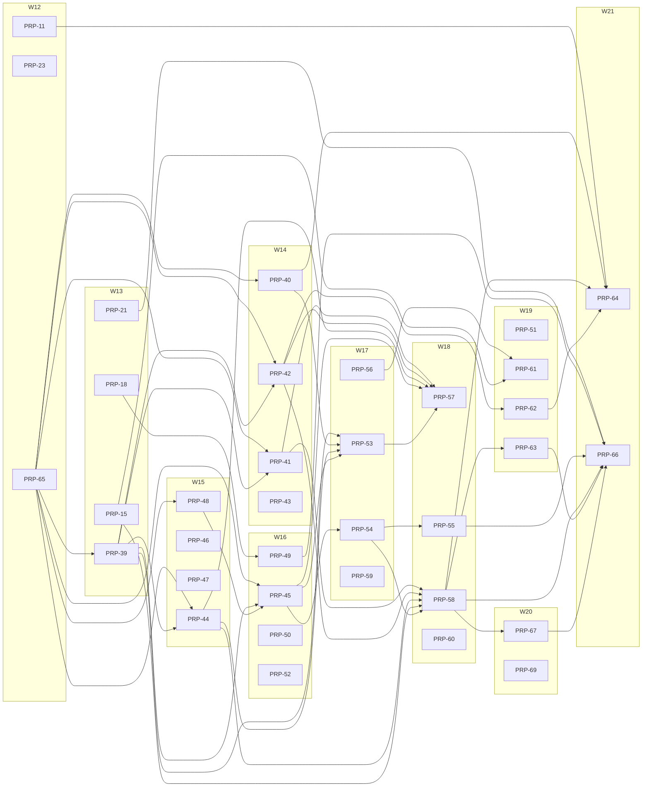

# Execution plan: parallel build, waves W11 to W21

This plan covers every PRP that is not shipped. It was produced by the
2026-11-14 audit (`/prp:prp-audit`). Shared rules, file-ownership tiers,
commands and traps are in `PRPs/reference/parallel-build-reference.md`; read
that first.

The tables, graph and prompts between the markers below are generated by
`python scripts/prp_execution_plan.py --write` from the PRP files. Edit the PRPs
or the script, not the generated block.

## How to run a wave

1. Start one fresh Claude Code session per PRP in the wave (WIP limit 4), each
   in its own worktree, with the kickoff prompt from the last section.
2. Only one session per wave may run `docker compose` or `make stack-up`: the
   "Holds stack" column names it. The others test against in-memory fakes.
3. Merge in the order of the wave table, top to bottom. `main` requires an
   up-to-date branch and has no merge queue, so each later PRP rebases,
   regenerates its Tier-3 files (`openapi.json`, `docs/reference`, the PRP
   index and status table), waits for CI and then merges. Items marked
   `[serial-after: PRP-NN]` are done after that PRP merged.
4. Run the integration check below on `main` after the last merge of the wave.
5. Do not start the next wave until the check passes and the wave gate holds.

## Integration check after every wave

```bash
git switch main && git pull
uv sync && pnpm install
uv run ruff check . && uv run ruff format --check . && uv run pyright
uv run pytest -q
python packages/contracts/scripts/generate.py --check
pnpm --filter @neurosphere/frontend lint
pnpm --filter @neurosphere/frontend typecheck
pnpm --filter @neurosphere/frontend test
pnpm --filter @neurosphere/frontend build
pnpm --filter @neurosphere/frontend test:e2e
python scripts/validate_planning.py && python scripts/prp_status.py --check
python scripts/prp_execution_plan.py --check
powershell -NoProfile -ExecutionPolicy Bypass -File ~/.claude/hooks/verify-gates.ps1 -Mode full
# From W12 on (after PRP-38): the real stack, one session at a time. PRP-38's
# completion note carries the exact command if it changed this one.
make stack-up && uv run pytest -q -m integration tests/integration/real_stack && make stack-down
```

A failure is fixed on `main` (or by reverting the offending merge) before the
next wave starts. Report failures with the output; do not start the next wave
on a red `main`.

<!-- execution-plan:begin -->

## Waves and merge order

### W12

| Merge | PRP | Model | Review | Blocked by | Serial-after items | Holds stack | Branch |
|---|---|---|---|---|---|---|---|
| 1 | [PRP-11: Analytics adapters (round 2)](backlog/PRP-11-analytics-adapters.md) | sonnet | required | none | - | - | `prp-11-round2-analytics-runtime` |
| 2 | [PRP-23: ATO evidence and data lifecycle (round 2)](backlog/PRP-23-ato-evidence-and-data-lifecycle.md) | sonnet | required | none | - | - | `prp-23-round2-lifecycle-runtime` |
| 3 | [PRP-65: Admin permissions, policy write repository and audited config store](backlog/PRP-65-admin-permissions-policy-repository-and-config-store.md) | opus | required | none | - | - | `prp-65-admin-store` |

Gate before the next wave: Permissions and the admin store reviewed (Opus). `make stack-up` completes on a fresh machine and the real-stack job is green in CI.

### W13

| Merge | PRP | Model | Review | Blocked by | Serial-after items | Holds stack | Branch |
|---|---|---|---|---|---|---|---|
| 1 | [PRP-39: Identity admin API and principal revocation](backlog/PRP-39-identity-admin-api-and-revocation.md) | opus | required | PRP-65 | - | - | `prp-39-identity-admin` |
| 2 | [PRP-15: Recommendations engine (round 2)](backlog/PRP-15-recommendations-engine.md) | sonnet | required | none | - | - | `prp-15-round2-production-series` |
| 3 | [PRP-21: Scale, federation, FinOps and DR (round 2)](backlog/PRP-21-scale-federation-finops-and-dr.md) | sonnet | required | none | - | yes | `prp-21-round2-admission-federation` |
| 4 | [PRP-18: Live map and session replay (round 2)](backlog/PRP-18-live-map-and-session-replay.md) | sonnet | required | none | - | - | `prp-18-round2-map-edge-batching` |

Gate before the next wave: Identity admin routes pass the authz suites; admission is on in compose; pilot re-run filed.

### W14

| Merge | PRP | Model | Review | Blocked by | Serial-after items | Holds stack | Branch |
|---|---|---|---|---|---|---|---|
| 1 | [PRP-40: Audit search, export, readable denials and an Event Hubs SIEM sink](backlog/PRP-40-audit-search-export-and-siem-sink.md) | opus | required | PRP-65 | PRP-21 | - | `prp-40-audit-siem` |
| 2 | [PRP-41: Ingest producer registry (store-backed, secret shown once)](backlog/PRP-41-producer-registry.md) | sonnet | required | PRP-65, PRP-39 | - | - | `prp-41-producer-registry` |
| 3 | [PRP-42: Connector configuration with credential references](backlog/PRP-42-connector-configuration-and-credential-references.md) | sonnet | required | PRP-65, PRP-39 | - | - | `prp-42-connector-config` |
| 4 | [PRP-43: Catalog hardening and the relationship review queue](backlog/PRP-43-catalog-hardening-and-review-queue.md) | sonnet | required | none | PRP-37, PRP-42 | - | `prp-43-catalog-hardening` |

Gate before the next wave: Producers and connector configs are stored, not file-only; audit export works on the emulator stack.

### W15

| Merge | PRP | Model | Review | Blocked by | Serial-after items | Holds stack | Branch |
|---|---|---|---|---|---|---|---|
| 1 | [PRP-46: Cost-center attribution and ingest follow-ups](backlog/PRP-46-cost-center-attribution-and-ingest-follow-ups.md) | sonnet | required | none | - | - | `prp-46-cost-center` |
| 2 | [PRP-47: Frontend shell fixes and test infrastructure](backlog/PRP-47-frontend-shell-and-test-infrastructure.md) | sonnet | none | none | PRP-18 | - | `prp-47-shell-test-infra` |
| 3 | [PRP-48: Authorization and audit-chain hardening](backlog/PRP-48-authorization-and-audit-chain-hardening.md) | opus | required | PRP-65 | - | - | `prp-48-authz-audit-hardening` |
| 4 | [PRP-44: Platform configuration (domains, budgets, price sheets, review policy)](backlog/PRP-44-platform-configuration.md) | sonnet | required | PRP-65, PRP-39 | PRP-39, PRP-48 | - | `prp-44-platform-config` |

Gate before the next wave: Authz and audit-chain suites green; cost-center attribution visible in the ledger.

### W16

| Merge | PRP | Model | Review | Blocked by | Serial-after items | Holds stack | Branch |
|---|---|---|---|---|---|---|---|
| 1 | [PRP-45: System status, first-run checklist and stored feature settings](backlog/PRP-45-system-status-first-run-and-feature-settings.md) | opus | required | PRP-65, PRP-39, PRP-48 | - | - | `prp-45-system-status-settings` |
| 2 | [PRP-49: Per-agent aggregates and map metrics](backlog/PRP-49-per-agent-aggregates-and-map-metrics.md) | sonnet | required | PRP-18 | - | - | `prp-49-per-agent-aggregates` |
| 3 | [PRP-50: Connector SDK and data-path follow-ups](backlog/PRP-50-connector-sdk-and-data-path-follow-ups.md) | sonnet | required | none | PRP-46 | - | `prp-50-connector-followups` |
| 4 | [PRP-52: CI and infrastructure hardening](backlog/PRP-52-ci-and-infrastructure-hardening.md) | sonnet | required | none | PRP-11 | - | `prp-52-ci-infra-hardening` |

Gate before the next wave: System status reports every unconfigured feature; per-node map metrics populated on the emulator stack.

### W17

| Merge | PRP | Model | Review | Blocked by | Serial-after items | Holds stack | Branch |
|---|---|---|---|---|---|---|---|
| 1 | [PRP-53: Admin console, part 1: identity, domains, system status and audit search](backlog/PRP-53-admin-console-identity-status-and-audit.md) | sonnet | required | PRP-39, PRP-40, PRP-44, PRP-45 | - | - | `prp-53-admin-console-core` |
| 2 | [PRP-54: Write targets from stored configuration, more than one per connector kind](backlog/PRP-54-write-targets-from-configuration.md) | sonnet | required | PRP-45 | PRP-50 | yes | `prp-54-write-targets` |
| 3 | [PRP-56: Compliance control library and evidence bundles](backlog/PRP-56-compliance-control-library-and-evidence-bundles.md) | sonnet | required | none | - | - | `prp-56-compliance-evidence` |
| 4 | [PRP-59: Deploy and Government follow-ups](backlog/PRP-59-deploy-and-government-follow-ups.md) | sonnet | none | none | - | - | `prp-59-deploy-gov-followups` |

Gate before the next wave: An operator can assign a role and read the first-run checklist in the UI; a write target is enabled from configuration.

### W18

| Merge | PRP | Model | Review | Blocked by | Serial-after items | Holds stack | Branch |
|---|---|---|---|---|---|---|---|
| 1 | [PRP-57: Admin console, part 2: data sources, pricing and feature settings](backlog/PRP-57-admin-console-sources-pricing-and-features.md) | sonnet | required | PRP-41, PRP-42, PRP-44, PRP-45, PRP-53 | - | - | `prp-57-admin-console-sources` |
| 2 | [PRP-58: Hosted data path](backlog/PRP-58-hosted-data-path-and-environment-hardening.md) | sonnet | required | PRP-41, PRP-42, PRP-44, PRP-15, PRP-54 | - | - | `prp-58-hosted-data-path` |
| 3 | [PRP-55: Real deploy apply](backlog/PRP-55-real-deploy-apply.md) | opus | required | PRP-54 | PRP-58 | - | `prp-55-real-deploy-apply` |
| 4 | [PRP-60: Search indexing hardening](backlog/PRP-60-search-indexing-hardening.md) | sonnet | required | none | PRP-44, PRP-55 | - | `prp-60-search-indexing-hardening` |

Gate before the next wave: An operator can register a producer and a connector in the UI; hosted IaC builds offline with the connector roles.

### W19

| Merge | PRP | Model | Review | Blocked by | Serial-after items | Holds stack | Branch |
|---|---|---|---|---|---|---|---|
| 1 | [PRP-51: Composition and API hygiene](backlog/PRP-51-composition-and-api-hygiene.md) | sonnet | required | none | - | - | `prp-51-composition-hygiene` |
| 2 | [PRP-61: Configuration detections and shadow-AI discovery](backlog/PRP-61-configuration-detections-and-shadow-ai-discovery.md) | sonnet | required | PRP-56, PRP-15 | PRP-56 | - | `prp-61-detections` |
| 3 | [PRP-62: AWS Bedrock reference connector (metadata only)](backlog/PRP-62-aws-bedrock-reference-connector.md) | sonnet | required | PRP-42 | - | - | `prp-62-aws-bedrock-connector` |
| 4 | [PRP-63: Delivery pipeline to the hosted environment](backlog/PRP-63-delivery-pipeline-to-hosted.md) | sonnet | required | PRP-58 | - | - | `prp-63-delivery-pipeline` |

Gate before the next wave: Delivery workflow passes its dry run; no open critical or high security finding.

### W20

| Merge | PRP | Model | Review | Blocked by | Serial-after items | Holds stack | Branch |
|---|---|---|---|---|---|---|---|
| 1 | [PRP-67: Hosted environment hardening](backlog/PRP-67-hosted-environment-hardening.md) | sonnet | required | PRP-58 | - | - | `prp-67-hosted-hardening` |
| 2 | [PRP-69: Private-network MCP servers (per-server SSRF override)](backlog/PRP-69-mcp-private-network-servers.md) | opus | required | none | PRP-67 | - | `prp-69-mcp-private-network` |

Gate before the next wave: Hosted profiles carry probe settings and build offline; the MCP private-network ADR is accepted or its items are descoped.

### W21

| Merge | PRP | Model | Review | Blocked by | Serial-after items | Holds stack | Branch |
|---|---|---|---|---|---|---|---|
| 1 | [PRP-64: Live gates campaign, Azure service gates (operator-attended)](backlog/PRP-64-live-gates-campaign.md) | sonnet | required | PRP-11, PRP-40, PRP-58, PRP-62 | - | - | `prp-64-live-gates` |
| 2 | [PRP-66: Operations and sign-off gates (operator-attended)](backlog/PRP-66-operations-and-sign-off-gates.md) | sonnet | required | PRP-21, PRP-49, PRP-55, PRP-58, PRP-63, PRP-67 | PRP-64 | - | `prp-66-operations-gates` |

Gate before the next wave: Every gate has evidence or is recorded OPEN with its reason.

## Dependency graph



Arrows are logical dependencies (`depends_on`). Waves also order PRPs that only share files; those have no arrow.

## Tier-1 file owners per wave

A Tier-1 file has one owner per wave. Any other PRP touches it only in a `[serial-after]` item.

| Wave | PRP | Tier-1 files it owns |
|---|---|---|
| W12 | PRP-11 | `services/api/neurosphere_api/runtime/compose.py`<br>`services/api/neurosphere_api/runtime/status.py` |
| W12 | PRP-23 | `services/workers/neurosphere_workers/runtime/factories.py` |
| W12 | PRP-65 | `packages/core/neurosphere_core/stores/containers.py`<br>`infra/compose/cosmos-containers.json`<br>`infra/demo/modules/cosmos-data.bicep`<br>`infra/bicep/modules/cosmos.bicep`<br>`packages/core/neurosphere_core/auth/scope/permissions.py` |
| W13 | PRP-15 | `services/workers/neurosphere_workers/runtime/factories.py` |
| W13 | PRP-21 | `services/api/neurosphere_api/authz/dependencies.py`<br>`services/api/neurosphere_api/app.py`<br>`services/api/neurosphere_api/runtime/builders/data.py`<br>`docker-compose.yml`<br>`infra/helm/**`<br>`docs/adr/0002-stack-pins.md`<br>`pyproject.toml` |
| W13 | PRP-18 | `frontend/tests/mock-api/server.ts` |
| W14 | PRP-40 | `services/api/neurosphere_api/runtime/builders/data.py` |
| W14 | PRP-41 | `services/api/neurosphere_api/runtime/builders/edge.py`<br>`services/api/neurosphere_api/main.py` |
| W14 | PRP-42 | `services/workers/neurosphere_workers/runtime/factories.py` |
| W14 | PRP-43 | `packages/core/neurosphere_core/stores/containers.py`<br>`infra/compose/cosmos-containers.json`<br>`infra/demo/modules/cosmos-data.bicep`<br>`infra/bicep/modules/cosmos.bicep` |
| W15 | PRP-44 | `services/api/neurosphere_api/runtime/builders/data.py`<br>`services/api/neurosphere_api/runtime/builders/planes.py`<br>`services/workers/neurosphere_workers/runtime/factories.py` |
| W15 | PRP-47 | `frontend/src/app/Shell.tsx`<br>`frontend/src/app/Providers.tsx`<br>`frontend/src/app/App.tsx`<br>`frontend/src/app/domain.tsx`<br>`frontend/tests/mock-api/server.ts` |
| W15 | PRP-48 | `services/api/neurosphere_api/authz/dependencies.py` |
| W16 | PRP-45 | `services/api/neurosphere_api/runtime/compose.py`<br>`services/api/neurosphere_api/runtime/builders/copilot.py`<br>`services/api/neurosphere_api/runtime/builders/mcp.py`<br>`services/api/neurosphere_api/runtime/builders/search.py`<br>`services/api/neurosphere_api/runtime/builders/write_targets.py`<br>`services/api/neurosphere_api/runtime/status.py`<br>`services/workers/neurosphere_workers/runtime/factories.py` |
| W16 | PRP-52 | `.github/workflows/ci.yml`<br>`.github/workflows/security.yml`<br>`.github/workflows/contracts.yml`<br>`infra/bicep/modules/**`<br>`infra/helm/**`<br>`services/api/Dockerfile`<br>`services/workers/Dockerfile`<br>`services/docs-assistant/Dockerfile`<br>`.grype.yaml` |
| W17 | PRP-54 | `docker-compose.yml`<br>`infra/helm/**`<br>`infra/demo/main.bicep`<br>`services/workers/neurosphere_workers/runtime/factories.py`<br>`services/api/neurosphere_api/runtime/planes.py` |
| W17 | PRP-56 | `packages/contracts/**` |
| W18 | PRP-55 | `packages/core/neurosphere_core/stores/containers.py`<br>`infra/compose/cosmos-containers.json`<br>`services/workers/neurosphere_workers/runtime/factories.py` |
| W18 | PRP-58 | `infra/demo/main.bicep`<br>`infra/appservice/main.bicep`<br>`infra/helm/**`<br>`docker-compose.yml` |
| W18 | PRP-60 | `services/api/neurosphere_api/runtime/builders/search.py` |
| W19 | PRP-51 | `services/api/neurosphere_api/runtime/builders/__init__.py`<br>`services/api/neurosphere_api/routers.py` |
| W19 | PRP-61 | `packages/contracts/**` |
| W19 | PRP-62 | `pyproject.toml`<br>`uv.lock`<br>`docs/licenses.md`<br>`docs/adr/0002-stack-pins.md`<br>`services/api/Dockerfile`<br>`services/api/Dockerfile.dev`<br>`services/workers/Dockerfile`<br>`services/workers/Dockerfile.dev`<br>`scripts/sandbox/Dockerfile.seed` |
| W19 | PRP-63 | `.github/workflows/deploy-hosted.yml`<br>`.github/workflows/release.yml` |
| W20 | PRP-67 | `infra/demo/**`<br>`infra/appservice/main.bicep`<br>`infra/helm/**` |

## Kickoff prompts

Paste one into a fresh Claude Code session started at the repo root.

### PRP-11 (W12)

```text
/prp:prp-execute PRPs/backlog/PRP-11-analytics-adapters.md

Context for this run: wave W12 of PRPs/EXECUTION-PLAN.md, branch prp-11-round2-analytics-runtime cut from origin/main, implementer model sonnet, review required. Read PRPs/reference/parallel-build-reference.md first, then the PRP. No PRP in this wave is assigned the compose stack: do not run docker compose or make stack-up unless I confirm no other session is using it. Edit only the files in the PRP's Ownership block; add lines only to Tier-2 registries; leave Tier-3 generated files for the final close-out commit after rebasing on main. Do any [serial-after] item only after the named PRP has merged. No live or paid call without NS_LIVE_APPROVED=1 and my approval in this session; record what did not run as OPEN. Finish with the PRP's Validation gates, show their output, open the PR and report what works, what is partial and what is open.
```

### PRP-23 (W12)

```text
/prp:prp-execute PRPs/backlog/PRP-23-ato-evidence-and-data-lifecycle.md

Context for this run: wave W12 of PRPs/EXECUTION-PLAN.md, branch prp-23-round2-lifecycle-runtime cut from origin/main, implementer model sonnet, review required. Read PRPs/reference/parallel-build-reference.md first, then the PRP. No PRP in this wave is assigned the compose stack: do not run docker compose or make stack-up unless I confirm no other session is using it. Edit only the files in the PRP's Ownership block; add lines only to Tier-2 registries; leave Tier-3 generated files for the final close-out commit after rebasing on main. Do any [serial-after] item only after the named PRP has merged. No live or paid call without NS_LIVE_APPROVED=1 and my approval in this session; record what did not run as OPEN. Finish with the PRP's Validation gates, show their output, open the PR and report what works, what is partial and what is open.
```

### PRP-65 (W12)

```text
/prp:prp-execute PRPs/backlog/PRP-65-admin-permissions-policy-repository-and-config-store.md

Context for this run: wave W12 of PRPs/EXECUTION-PLAN.md, branch prp-65-admin-store cut from origin/main, implementer model opus, review required. Read PRPs/reference/parallel-build-reference.md first, then the PRP. No PRP in this wave is assigned the compose stack: do not run docker compose or make stack-up unless I confirm no other session is using it. Edit only the files in the PRP's Ownership block; add lines only to Tier-2 registries; leave Tier-3 generated files for the final close-out commit after rebasing on main. Do any [serial-after] item only after the named PRP has merged. No live or paid call without NS_LIVE_APPROVED=1 and my approval in this session; record what did not run as OPEN. Finish with the PRP's Validation gates, show their output, open the PR and report what works, what is partial and what is open.
```

### PRP-39 (W13)

```text
/prp:prp-execute PRPs/backlog/PRP-39-identity-admin-api-and-revocation.md

Context for this run: wave W13 of PRPs/EXECUTION-PLAN.md, branch prp-39-identity-admin cut from origin/main, implementer model opus, review required. Read PRPs/reference/parallel-build-reference.md first, then the PRP. Before anything else confirm that PRP-65 are in PRPs/shipped/ on origin/main; if not, stop and say so. PRP-21 holds the compose stack in this wave: do not run docker compose or make stack-up. Edit only the files in the PRP's Ownership block; add lines only to Tier-2 registries; leave Tier-3 generated files for the final close-out commit after rebasing on main. Do any [serial-after] item only after the named PRP has merged. No live or paid call without NS_LIVE_APPROVED=1 and my approval in this session; record what did not run as OPEN. Finish with the PRP's Validation gates, show their output, open the PR and report what works, what is partial and what is open.
```

### PRP-15 (W13)

```text
/prp:prp-execute PRPs/backlog/PRP-15-recommendations-engine.md

Context for this run: wave W13 of PRPs/EXECUTION-PLAN.md, branch prp-15-round2-production-series cut from origin/main, implementer model sonnet, review required. Read PRPs/reference/parallel-build-reference.md first, then the PRP. PRP-21 holds the compose stack in this wave: do not run docker compose or make stack-up. Edit only the files in the PRP's Ownership block; add lines only to Tier-2 registries; leave Tier-3 generated files for the final close-out commit after rebasing on main. Do any [serial-after] item only after the named PRP has merged. No live or paid call without NS_LIVE_APPROVED=1 and my approval in this session; record what did not run as OPEN. Finish with the PRP's Validation gates, show their output, open the PR and report what works, what is partial and what is open.
```

### PRP-21 (W13)

```text
/prp:prp-execute PRPs/backlog/PRP-21-scale-federation-finops-and-dr.md

Context for this run: wave W13 of PRPs/EXECUTION-PLAN.md, branch prp-21-round2-admission-federation cut from origin/main, implementer model sonnet, review required. Read PRPs/reference/parallel-build-reference.md first, then the PRP. You hold the compose stack for this wave. Edit only the files in the PRP's Ownership block; add lines only to Tier-2 registries; leave Tier-3 generated files for the final close-out commit after rebasing on main. Do any [serial-after] item only after the named PRP has merged. No live or paid call without NS_LIVE_APPROVED=1 and my approval in this session; record what did not run as OPEN. Finish with the PRP's Validation gates, show their output, open the PR and report what works, what is partial and what is open.
```

### PRP-18 (W13)

```text
/prp:prp-execute PRPs/backlog/PRP-18-live-map-and-session-replay.md

Context for this run: wave W13 of PRPs/EXECUTION-PLAN.md, branch prp-18-round2-map-edge-batching cut from origin/main, implementer model sonnet, review required. Read PRPs/reference/parallel-build-reference.md first, then the PRP. PRP-21 holds the compose stack in this wave: do not run docker compose or make stack-up. Edit only the files in the PRP's Ownership block; add lines only to Tier-2 registries; leave Tier-3 generated files for the final close-out commit after rebasing on main. Do any [serial-after] item only after the named PRP has merged. No live or paid call without NS_LIVE_APPROVED=1 and my approval in this session; record what did not run as OPEN. Finish with the PRP's Validation gates, show their output, open the PR and report what works, what is partial and what is open.
```

### PRP-40 (W14)

```text
/prp:prp-execute PRPs/backlog/PRP-40-audit-search-export-and-siem-sink.md

Context for this run: wave W14 of PRPs/EXECUTION-PLAN.md, branch prp-40-audit-siem cut from origin/main, implementer model opus, review required. Read PRPs/reference/parallel-build-reference.md first, then the PRP. Before anything else confirm that PRP-65 are in PRPs/shipped/ on origin/main; if not, stop and say so. No PRP in this wave is assigned the compose stack: do not run docker compose or make stack-up unless I confirm no other session is using it. Edit only the files in the PRP's Ownership block; add lines only to Tier-2 registries; leave Tier-3 generated files for the final close-out commit after rebasing on main. Do any [serial-after] item only after the named PRP has merged. No live or paid call without NS_LIVE_APPROVED=1 and my approval in this session; record what did not run as OPEN. Finish with the PRP's Validation gates, show their output, open the PR and report what works, what is partial and what is open.
```

### PRP-41 (W14)

```text
/prp:prp-execute PRPs/backlog/PRP-41-producer-registry.md

Context for this run: wave W14 of PRPs/EXECUTION-PLAN.md, branch prp-41-producer-registry cut from origin/main, implementer model sonnet, review required. Read PRPs/reference/parallel-build-reference.md first, then the PRP. Before anything else confirm that PRP-65, PRP-39 are in PRPs/shipped/ on origin/main; if not, stop and say so. No PRP in this wave is assigned the compose stack: do not run docker compose or make stack-up unless I confirm no other session is using it. Edit only the files in the PRP's Ownership block; add lines only to Tier-2 registries; leave Tier-3 generated files for the final close-out commit after rebasing on main. Do any [serial-after] item only after the named PRP has merged. No live or paid call without NS_LIVE_APPROVED=1 and my approval in this session; record what did not run as OPEN. Finish with the PRP's Validation gates, show their output, open the PR and report what works, what is partial and what is open.
```

### PRP-42 (W14)

```text
/prp:prp-execute PRPs/backlog/PRP-42-connector-configuration-and-credential-references.md

Context for this run: wave W14 of PRPs/EXECUTION-PLAN.md, branch prp-42-connector-config cut from origin/main, implementer model sonnet, review required. Read PRPs/reference/parallel-build-reference.md first, then the PRP. Before anything else confirm that PRP-65, PRP-39 are in PRPs/shipped/ on origin/main; if not, stop and say so. No PRP in this wave is assigned the compose stack: do not run docker compose or make stack-up unless I confirm no other session is using it. Edit only the files in the PRP's Ownership block; add lines only to Tier-2 registries; leave Tier-3 generated files for the final close-out commit after rebasing on main. Do any [serial-after] item only after the named PRP has merged. No live or paid call without NS_LIVE_APPROVED=1 and my approval in this session; record what did not run as OPEN. Finish with the PRP's Validation gates, show their output, open the PR and report what works, what is partial and what is open.
```

### PRP-43 (W14)

```text
/prp:prp-execute PRPs/backlog/PRP-43-catalog-hardening-and-review-queue.md

Context for this run: wave W14 of PRPs/EXECUTION-PLAN.md, branch prp-43-catalog-hardening cut from origin/main, implementer model sonnet, review required. Read PRPs/reference/parallel-build-reference.md first, then the PRP. No PRP in this wave is assigned the compose stack: do not run docker compose or make stack-up unless I confirm no other session is using it. Edit only the files in the PRP's Ownership block; add lines only to Tier-2 registries; leave Tier-3 generated files for the final close-out commit after rebasing on main. Do any [serial-after] item only after the named PRP has merged. No live or paid call without NS_LIVE_APPROVED=1 and my approval in this session; record what did not run as OPEN. Finish with the PRP's Validation gates, show their output, open the PR and report what works, what is partial and what is open.
```

### PRP-44 (W15)

```text
/prp:prp-execute PRPs/backlog/PRP-44-platform-configuration.md

Context for this run: wave W15 of PRPs/EXECUTION-PLAN.md, branch prp-44-platform-config cut from origin/main, implementer model sonnet, review required. Read PRPs/reference/parallel-build-reference.md first, then the PRP. Before anything else confirm that PRP-65, PRP-39 are in PRPs/shipped/ on origin/main; if not, stop and say so. No PRP in this wave is assigned the compose stack: do not run docker compose or make stack-up unless I confirm no other session is using it. Edit only the files in the PRP's Ownership block; add lines only to Tier-2 registries; leave Tier-3 generated files for the final close-out commit after rebasing on main. Do any [serial-after] item only after the named PRP has merged. No live or paid call without NS_LIVE_APPROVED=1 and my approval in this session; record what did not run as OPEN. Finish with the PRP's Validation gates, show their output, open the PR and report what works, what is partial and what is open.
```

### PRP-46 (W15)

```text
/prp:prp-execute PRPs/backlog/PRP-46-cost-center-attribution-and-ingest-follow-ups.md

Context for this run: wave W15 of PRPs/EXECUTION-PLAN.md, branch prp-46-cost-center cut from origin/main, implementer model sonnet, review required. Read PRPs/reference/parallel-build-reference.md first, then the PRP. No PRP in this wave is assigned the compose stack: do not run docker compose or make stack-up unless I confirm no other session is using it. Edit only the files in the PRP's Ownership block; add lines only to Tier-2 registries; leave Tier-3 generated files for the final close-out commit after rebasing on main. Do any [serial-after] item only after the named PRP has merged. No live or paid call without NS_LIVE_APPROVED=1 and my approval in this session; record what did not run as OPEN. Finish with the PRP's Validation gates, show their output, open the PR and report what works, what is partial and what is open.
```

### PRP-47 (W15)

```text
/prp:prp-execute PRPs/backlog/PRP-47-frontend-shell-and-test-infrastructure.md

Context for this run: wave W15 of PRPs/EXECUTION-PLAN.md, branch prp-47-shell-test-infra cut from origin/main, implementer model sonnet, review none. Read PRPs/reference/parallel-build-reference.md first, then the PRP. No PRP in this wave is assigned the compose stack: do not run docker compose or make stack-up unless I confirm no other session is using it. Edit only the files in the PRP's Ownership block; add lines only to Tier-2 registries; leave Tier-3 generated files for the final close-out commit after rebasing on main. Do any [serial-after] item only after the named PRP has merged. No live or paid call without NS_LIVE_APPROVED=1 and my approval in this session; record what did not run as OPEN. Finish with the PRP's Validation gates, show their output, open the PR and report what works, what is partial and what is open.
```

### PRP-48 (W15)

```text
/prp:prp-execute PRPs/backlog/PRP-48-authorization-and-audit-chain-hardening.md

Context for this run: wave W15 of PRPs/EXECUTION-PLAN.md, branch prp-48-authz-audit-hardening cut from origin/main, implementer model opus, review required. Read PRPs/reference/parallel-build-reference.md first, then the PRP. Before anything else confirm that PRP-65 are in PRPs/shipped/ on origin/main; if not, stop and say so. No PRP in this wave is assigned the compose stack: do not run docker compose or make stack-up unless I confirm no other session is using it. Edit only the files in the PRP's Ownership block; add lines only to Tier-2 registries; leave Tier-3 generated files for the final close-out commit after rebasing on main. Do any [serial-after] item only after the named PRP has merged. No live or paid call without NS_LIVE_APPROVED=1 and my approval in this session; record what did not run as OPEN. Finish with the PRP's Validation gates, show their output, open the PR and report what works, what is partial and what is open.
```

### PRP-45 (W16)

```text
/prp:prp-execute PRPs/backlog/PRP-45-system-status-first-run-and-feature-settings.md

Context for this run: wave W16 of PRPs/EXECUTION-PLAN.md, branch prp-45-system-status-settings cut from origin/main, implementer model opus, review required. Read PRPs/reference/parallel-build-reference.md first, then the PRP. Before anything else confirm that PRP-65, PRP-39, PRP-48 are in PRPs/shipped/ on origin/main; if not, stop and say so. No PRP in this wave is assigned the compose stack: do not run docker compose or make stack-up unless I confirm no other session is using it. Edit only the files in the PRP's Ownership block; add lines only to Tier-2 registries; leave Tier-3 generated files for the final close-out commit after rebasing on main. Do any [serial-after] item only after the named PRP has merged. No live or paid call without NS_LIVE_APPROVED=1 and my approval in this session; record what did not run as OPEN. Finish with the PRP's Validation gates, show their output, open the PR and report what works, what is partial and what is open.
```

### PRP-49 (W16)

```text
/prp:prp-execute PRPs/backlog/PRP-49-per-agent-aggregates-and-map-metrics.md

Context for this run: wave W16 of PRPs/EXECUTION-PLAN.md, branch prp-49-per-agent-aggregates cut from origin/main, implementer model sonnet, review required. Read PRPs/reference/parallel-build-reference.md first, then the PRP. Before anything else confirm that PRP-18 are in PRPs/shipped/ on origin/main; if not, stop and say so. No PRP in this wave is assigned the compose stack: do not run docker compose or make stack-up unless I confirm no other session is using it. Edit only the files in the PRP's Ownership block; add lines only to Tier-2 registries; leave Tier-3 generated files for the final close-out commit after rebasing on main. Do any [serial-after] item only after the named PRP has merged. No live or paid call without NS_LIVE_APPROVED=1 and my approval in this session; record what did not run as OPEN. Finish with the PRP's Validation gates, show their output, open the PR and report what works, what is partial and what is open.
```

### PRP-50 (W16)

```text
/prp:prp-execute PRPs/backlog/PRP-50-connector-sdk-and-data-path-follow-ups.md

Context for this run: wave W16 of PRPs/EXECUTION-PLAN.md, branch prp-50-connector-followups cut from origin/main, implementer model sonnet, review required. Read PRPs/reference/parallel-build-reference.md first, then the PRP. No PRP in this wave is assigned the compose stack: do not run docker compose or make stack-up unless I confirm no other session is using it. Edit only the files in the PRP's Ownership block; add lines only to Tier-2 registries; leave Tier-3 generated files for the final close-out commit after rebasing on main. Do any [serial-after] item only after the named PRP has merged. No live or paid call without NS_LIVE_APPROVED=1 and my approval in this session; record what did not run as OPEN. Finish with the PRP's Validation gates, show their output, open the PR and report what works, what is partial and what is open.
```

### PRP-52 (W16)

```text
/prp:prp-execute PRPs/backlog/PRP-52-ci-and-infrastructure-hardening.md

Context for this run: wave W16 of PRPs/EXECUTION-PLAN.md, branch prp-52-ci-infra-hardening cut from origin/main, implementer model sonnet, review required. Read PRPs/reference/parallel-build-reference.md first, then the PRP. No PRP in this wave is assigned the compose stack: do not run docker compose or make stack-up unless I confirm no other session is using it. Edit only the files in the PRP's Ownership block; add lines only to Tier-2 registries; leave Tier-3 generated files for the final close-out commit after rebasing on main. Do any [serial-after] item only after the named PRP has merged. No live or paid call without NS_LIVE_APPROVED=1 and my approval in this session; record what did not run as OPEN. Finish with the PRP's Validation gates, show their output, open the PR and report what works, what is partial and what is open.
```

### PRP-53 (W17)

```text
/prp:prp-execute PRPs/backlog/PRP-53-admin-console-identity-status-and-audit.md

Context for this run: wave W17 of PRPs/EXECUTION-PLAN.md, branch prp-53-admin-console-core cut from origin/main, implementer model sonnet, review required. Read PRPs/reference/parallel-build-reference.md first, then the PRP. Before anything else confirm that PRP-39, PRP-40, PRP-44, PRP-45 are in PRPs/shipped/ on origin/main; if not, stop and say so. PRP-54 holds the compose stack in this wave: do not run docker compose or make stack-up. Edit only the files in the PRP's Ownership block; add lines only to Tier-2 registries; leave Tier-3 generated files for the final close-out commit after rebasing on main. Do any [serial-after] item only after the named PRP has merged. No live or paid call without NS_LIVE_APPROVED=1 and my approval in this session; record what did not run as OPEN. Finish with the PRP's Validation gates, show their output, open the PR and report what works, what is partial and what is open.
```

### PRP-54 (W17)

```text
/prp:prp-execute PRPs/backlog/PRP-54-write-targets-from-configuration.md

Context for this run: wave W17 of PRPs/EXECUTION-PLAN.md, branch prp-54-write-targets cut from origin/main, implementer model sonnet, review required. Read PRPs/reference/parallel-build-reference.md first, then the PRP. Before anything else confirm that PRP-45 are in PRPs/shipped/ on origin/main; if not, stop and say so. You hold the compose stack for this wave. Edit only the files in the PRP's Ownership block; add lines only to Tier-2 registries; leave Tier-3 generated files for the final close-out commit after rebasing on main. Do any [serial-after] item only after the named PRP has merged. No live or paid call without NS_LIVE_APPROVED=1 and my approval in this session; record what did not run as OPEN. Finish with the PRP's Validation gates, show their output, open the PR and report what works, what is partial and what is open.
```

### PRP-56 (W17)

```text
/prp:prp-execute PRPs/backlog/PRP-56-compliance-control-library-and-evidence-bundles.md

Context for this run: wave W17 of PRPs/EXECUTION-PLAN.md, branch prp-56-compliance-evidence cut from origin/main, implementer model sonnet, review required. Read PRPs/reference/parallel-build-reference.md first, then the PRP. PRP-54 holds the compose stack in this wave: do not run docker compose or make stack-up. Edit only the files in the PRP's Ownership block; add lines only to Tier-2 registries; leave Tier-3 generated files for the final close-out commit after rebasing on main. Do any [serial-after] item only after the named PRP has merged. No live or paid call without NS_LIVE_APPROVED=1 and my approval in this session; record what did not run as OPEN. Finish with the PRP's Validation gates, show their output, open the PR and report what works, what is partial and what is open.
```

### PRP-59 (W17)

```text
/prp:prp-execute PRPs/backlog/PRP-59-deploy-and-government-follow-ups.md

Context for this run: wave W17 of PRPs/EXECUTION-PLAN.md, branch prp-59-deploy-gov-followups cut from origin/main, implementer model sonnet, review none. Read PRPs/reference/parallel-build-reference.md first, then the PRP. PRP-54 holds the compose stack in this wave: do not run docker compose or make stack-up. Edit only the files in the PRP's Ownership block; add lines only to Tier-2 registries; leave Tier-3 generated files for the final close-out commit after rebasing on main. Do any [serial-after] item only after the named PRP has merged. No live or paid call without NS_LIVE_APPROVED=1 and my approval in this session; record what did not run as OPEN. Finish with the PRP's Validation gates, show their output, open the PR and report what works, what is partial and what is open.
```

### PRP-57 (W18)

```text
/prp:prp-execute PRPs/backlog/PRP-57-admin-console-sources-pricing-and-features.md

Context for this run: wave W18 of PRPs/EXECUTION-PLAN.md, branch prp-57-admin-console-sources cut from origin/main, implementer model sonnet, review required. Read PRPs/reference/parallel-build-reference.md first, then the PRP. Before anything else confirm that PRP-41, PRP-42, PRP-44, PRP-45, PRP-53 are in PRPs/shipped/ on origin/main; if not, stop and say so. No PRP in this wave is assigned the compose stack: do not run docker compose or make stack-up unless I confirm no other session is using it. Edit only the files in the PRP's Ownership block; add lines only to Tier-2 registries; leave Tier-3 generated files for the final close-out commit after rebasing on main. Do any [serial-after] item only after the named PRP has merged. No live or paid call without NS_LIVE_APPROVED=1 and my approval in this session; record what did not run as OPEN. Finish with the PRP's Validation gates, show their output, open the PR and report what works, what is partial and what is open.
```

### PRP-55 (W18)

```text
/prp:prp-execute PRPs/backlog/PRP-55-real-deploy-apply.md

Context for this run: wave W18 of PRPs/EXECUTION-PLAN.md, branch prp-55-real-deploy-apply cut from origin/main, implementer model opus, review required. Read PRPs/reference/parallel-build-reference.md first, then the PRP. Before anything else confirm that PRP-54 are in PRPs/shipped/ on origin/main; if not, stop and say so. No PRP in this wave is assigned the compose stack: do not run docker compose or make stack-up unless I confirm no other session is using it. Edit only the files in the PRP's Ownership block; add lines only to Tier-2 registries; leave Tier-3 generated files for the final close-out commit after rebasing on main. Do any [serial-after] item only after the named PRP has merged. No live or paid call without NS_LIVE_APPROVED=1 and my approval in this session; record what did not run as OPEN. Finish with the PRP's Validation gates, show their output, open the PR and report what works, what is partial and what is open.
```

### PRP-58 (W18)

```text
/prp:prp-execute PRPs/backlog/PRP-58-hosted-data-path-and-environment-hardening.md

Context for this run: wave W18 of PRPs/EXECUTION-PLAN.md, branch prp-58-hosted-data-path cut from origin/main, implementer model sonnet, review required. Read PRPs/reference/parallel-build-reference.md first, then the PRP. Before anything else confirm that PRP-41, PRP-42, PRP-44, PRP-15, PRP-54 are in PRPs/shipped/ on origin/main; if not, stop and say so. No PRP in this wave is assigned the compose stack: do not run docker compose or make stack-up unless I confirm no other session is using it. Edit only the files in the PRP's Ownership block; add lines only to Tier-2 registries; leave Tier-3 generated files for the final close-out commit after rebasing on main. Do any [serial-after] item only after the named PRP has merged. No live or paid call without NS_LIVE_APPROVED=1 and my approval in this session; record what did not run as OPEN. Finish with the PRP's Validation gates, show their output, open the PR and report what works, what is partial and what is open.
```

### PRP-60 (W18)

```text
/prp:prp-execute PRPs/backlog/PRP-60-search-indexing-hardening.md

Context for this run: wave W18 of PRPs/EXECUTION-PLAN.md, branch prp-60-search-indexing-hardening cut from origin/main, implementer model sonnet, review required. Read PRPs/reference/parallel-build-reference.md first, then the PRP. No PRP in this wave is assigned the compose stack: do not run docker compose or make stack-up unless I confirm no other session is using it. Edit only the files in the PRP's Ownership block; add lines only to Tier-2 registries; leave Tier-3 generated files for the final close-out commit after rebasing on main. Do any [serial-after] item only after the named PRP has merged. No live or paid call without NS_LIVE_APPROVED=1 and my approval in this session; record what did not run as OPEN. Finish with the PRP's Validation gates, show their output, open the PR and report what works, what is partial and what is open.
```

### PRP-51 (W19)

```text
/prp:prp-execute PRPs/backlog/PRP-51-composition-and-api-hygiene.md

Context for this run: wave W19 of PRPs/EXECUTION-PLAN.md, branch prp-51-composition-hygiene cut from origin/main, implementer model sonnet, review required. Read PRPs/reference/parallel-build-reference.md first, then the PRP. No PRP in this wave is assigned the compose stack: do not run docker compose or make stack-up unless I confirm no other session is using it. Edit only the files in the PRP's Ownership block; add lines only to Tier-2 registries; leave Tier-3 generated files for the final close-out commit after rebasing on main. Do any [serial-after] item only after the named PRP has merged. No live or paid call without NS_LIVE_APPROVED=1 and my approval in this session; record what did not run as OPEN. Finish with the PRP's Validation gates, show their output, open the PR and report what works, what is partial and what is open.
```

### PRP-61 (W19)

```text
/prp:prp-execute PRPs/backlog/PRP-61-configuration-detections-and-shadow-ai-discovery.md

Context for this run: wave W19 of PRPs/EXECUTION-PLAN.md, branch prp-61-detections cut from origin/main, implementer model sonnet, review required. Read PRPs/reference/parallel-build-reference.md first, then the PRP. Before anything else confirm that PRP-56, PRP-15 are in PRPs/shipped/ on origin/main; if not, stop and say so. No PRP in this wave is assigned the compose stack: do not run docker compose or make stack-up unless I confirm no other session is using it. Edit only the files in the PRP's Ownership block; add lines only to Tier-2 registries; leave Tier-3 generated files for the final close-out commit after rebasing on main. Do any [serial-after] item only after the named PRP has merged. No live or paid call without NS_LIVE_APPROVED=1 and my approval in this session; record what did not run as OPEN. Finish with the PRP's Validation gates, show their output, open the PR and report what works, what is partial and what is open.
```

### PRP-62 (W19)

```text
/prp:prp-execute PRPs/backlog/PRP-62-aws-bedrock-reference-connector.md

Context for this run: wave W19 of PRPs/EXECUTION-PLAN.md, branch prp-62-aws-bedrock-connector cut from origin/main, implementer model sonnet, review required. Read PRPs/reference/parallel-build-reference.md first, then the PRP. Before anything else confirm that PRP-42 are in PRPs/shipped/ on origin/main; if not, stop and say so. No PRP in this wave is assigned the compose stack: do not run docker compose or make stack-up unless I confirm no other session is using it. Edit only the files in the PRP's Ownership block; add lines only to Tier-2 registries; leave Tier-3 generated files for the final close-out commit after rebasing on main. Do any [serial-after] item only after the named PRP has merged. No live or paid call without NS_LIVE_APPROVED=1 and my approval in this session; record what did not run as OPEN. Finish with the PRP's Validation gates, show their output, open the PR and report what works, what is partial and what is open.
```

### PRP-63 (W19)

```text
/prp:prp-execute PRPs/backlog/PRP-63-delivery-pipeline-to-hosted.md

Context for this run: wave W19 of PRPs/EXECUTION-PLAN.md, branch prp-63-delivery-pipeline cut from origin/main, implementer model sonnet, review required. Read PRPs/reference/parallel-build-reference.md first, then the PRP. Before anything else confirm that PRP-58 are in PRPs/shipped/ on origin/main; if not, stop and say so. No PRP in this wave is assigned the compose stack: do not run docker compose or make stack-up unless I confirm no other session is using it. Edit only the files in the PRP's Ownership block; add lines only to Tier-2 registries; leave Tier-3 generated files for the final close-out commit after rebasing on main. Do any [serial-after] item only after the named PRP has merged. No live or paid call without NS_LIVE_APPROVED=1 and my approval in this session; record what did not run as OPEN. Finish with the PRP's Validation gates, show their output, open the PR and report what works, what is partial and what is open.
```

### PRP-67 (W20)

```text
/prp:prp-execute PRPs/backlog/PRP-67-hosted-environment-hardening.md

Context for this run: wave W20 of PRPs/EXECUTION-PLAN.md, branch prp-67-hosted-hardening cut from origin/main, implementer model sonnet, review required. Read PRPs/reference/parallel-build-reference.md first, then the PRP. Before anything else confirm that PRP-58 are in PRPs/shipped/ on origin/main; if not, stop and say so. No PRP in this wave is assigned the compose stack: do not run docker compose or make stack-up unless I confirm no other session is using it. Edit only the files in the PRP's Ownership block; add lines only to Tier-2 registries; leave Tier-3 generated files for the final close-out commit after rebasing on main. Do any [serial-after] item only after the named PRP has merged. No live or paid call without NS_LIVE_APPROVED=1 and my approval in this session; record what did not run as OPEN. Finish with the PRP's Validation gates, show their output, open the PR and report what works, what is partial and what is open.
```

### PRP-69 (W20)

```text
/prp:prp-execute PRPs/backlog/PRP-69-mcp-private-network-servers.md

Context for this run: wave W20 of PRPs/EXECUTION-PLAN.md, branch prp-69-mcp-private-network cut from origin/main, implementer model opus, review required. Read PRPs/reference/parallel-build-reference.md first, then the PRP. No PRP in this wave is assigned the compose stack: do not run docker compose or make stack-up unless I confirm no other session is using it. Edit only the files in the PRP's Ownership block; add lines only to Tier-2 registries; leave Tier-3 generated files for the final close-out commit after rebasing on main. Do any [serial-after] item only after the named PRP has merged. No live or paid call without NS_LIVE_APPROVED=1 and my approval in this session; record what did not run as OPEN. Finish with the PRP's Validation gates, show their output, open the PR and report what works, what is partial and what is open.
```

### PRP-64 (W21)

```text
/prp:prp-execute PRPs/backlog/PRP-64-live-gates-campaign.md

Context for this run: wave W21 of PRPs/EXECUTION-PLAN.md, branch prp-64-live-gates cut from origin/main, implementer model sonnet, review required. Read PRPs/reference/parallel-build-reference.md first, then the PRP. Before anything else confirm that PRP-11, PRP-40, PRP-58, PRP-62 are in PRPs/shipped/ on origin/main; if not, stop and say so. No PRP in this wave is assigned the compose stack: do not run docker compose or make stack-up unless I confirm no other session is using it. Edit only the files in the PRP's Ownership block; add lines only to Tier-2 registries; leave Tier-3 generated files for the final close-out commit after rebasing on main. Do any [serial-after] item only after the named PRP has merged. No live or paid call without NS_LIVE_APPROVED=1 and my approval in this session; record what did not run as OPEN. Finish with the PRP's Validation gates, show their output, open the PR and report what works, what is partial and what is open.
```

### PRP-66 (W21)

```text
/prp:prp-execute PRPs/backlog/PRP-66-operations-and-sign-off-gates.md

Context for this run: wave W21 of PRPs/EXECUTION-PLAN.md, branch prp-66-operations-gates cut from origin/main, implementer model sonnet, review required. Read PRPs/reference/parallel-build-reference.md first, then the PRP. Before anything else confirm that PRP-21, PRP-49, PRP-55, PRP-58, PRP-63, PRP-67 are in PRPs/shipped/ on origin/main; if not, stop and say so. No PRP in this wave is assigned the compose stack: do not run docker compose or make stack-up unless I confirm no other session is using it. Edit only the files in the PRP's Ownership block; add lines only to Tier-2 registries; leave Tier-3 generated files for the final close-out commit after rebasing on main. Do any [serial-after] item only after the named PRP has merged. No live or paid call without NS_LIVE_APPROVED=1 and my approval in this session; record what did not run as OPEN. Finish with the PRP's Validation gates, show their output, open the PR and report what works, what is partial and what is open.
```

<!-- execution-plan:end -->
