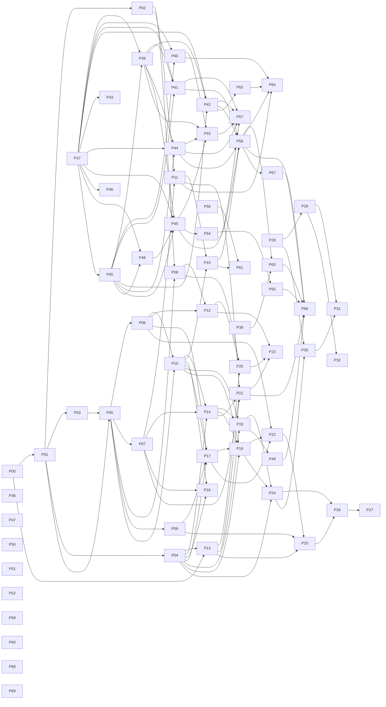

# PRP-MASTER: NeuroSphere build orchestration

> **This is the file you kick off from.** It sequences PRP-00 to PRP-64 (PRP-65 to PRP-69 were added by the 2026-11-14 audit), carries the
> decisions that bind all of them, and defines what "the whole thing is done" means.
> Individual PRPs live in `PRPs/backlog/`; run one per session with
> `/prp:prp-execute PRPs/backlog/<file>.md`. The binding preamble is `PRP.md` §1–§3.

## Current status (read this first)

A fresh session starts here. The repository hygiene baseline (hooks, CI, kit
onboarding, emulator compose, ADRs) was done on 2026-10-08 outside the PRP flow.

The table below is **generated from the `PRPs/` directories**: `backlog/`,
`active/` and `shipped/` are the status. `/prp:prp-execute` moves the file; the
pre-commit hook regenerates this table whenever a `PRPs/` file is staged, and
`scripts/validate_planning.py` (CI) fails if it is stale. To refresh by hand:
`python scripts/prp_status.py --write`.

<!-- prp-status:begin -->
_Generated by `python scripts/prp_status.py --write` on 2026-11-25; do not edit by hand. The directory each file sits in is the status._

Shipped 81 · Active 1 · Backlog 60 of 142. **Next ready: PRP-105 policy-engine-core** (wave W21).

| PRP | Status | Wave | Depends on | Ready | Model | Review | Note |
|---|---|---|---|---|---|---|---|
| [PRP-00](shipped/PRP-00-toolchain-workspaces-and-gates.md) toolchain-workspaces-and-gates | shipped | W0 | none | done | sonnet | required |  |
| [PRP-01](shipped/PRP-01-contracts-and-schemas.md) contracts-and-schemas | shipped | W1 | PRP-00 | done | opus | required |  |
| [PRP-02](shipped/PRP-02-capability-matrix-and-feasibility-benchmark.md) capability-matrix-and-feasibility-benchmark | shipped | W2 | PRP-01 | done | sonnet | required |  |
| [PRP-03](shipped/PRP-03-local-dev-environment-and-sandbox-generator.md) local-dev-environment-and-sandbox-generator | shipped | W2 | PRP-01 | done | sonnet | none |  |
| [PRP-04](shipped/PRP-04-frontend-shell-design-system-auth.md) frontend-shell-design-system-auth | shipped | W2 | PRP-01 | done | sonnet | none |  |
| [PRP-05](shipped/PRP-05-api-worker-runtime-and-self-observability.md) api-worker-runtime-and-self-observability | shipped | W3 | PRP-01, PRP-03 | done | sonnet | none |  |
| [PRP-06](shipped/PRP-06-identity-authz-and-audit.md) identity-authz-and-audit | shipped | W4 | PRP-05 | done | opus | required |  |
| [PRP-07](shipped/PRP-07-telemetry-ingestion-and-cost-ledger.md) telemetry-ingestion-and-cost-ledger | shipped | W4 | PRP-01, PRP-05 | done | sonnet | required |  |
| [PRP-08](shipped/PRP-08-deployment-intelligence-and-iac.md) deployment-intelligence-and-iac | shipped | W4 | PRP-02, PRP-05 | done | sonnet | required |  |
| [PRP-09](shipped/PRP-09-connector-sdk-and-reference-connectors.md) connector-sdk-and-reference-connectors | shipped | W4 | PRP-01, PRP-05 | done | sonnet | required |  |
| [PRP-10](shipped/PRP-10-catalog-and-relationship-governance.md) catalog-and-relationship-governance | shipped | W5 | PRP-05, PRP-06 | done | sonnet | required |  |
| [PRP-11](shipped/PRP-11-analytics-adapters.md) analytics-adapters | shipped | W12 | none | done | sonnet | required |  |
| [PRP-12](shipped/PRP-12-threat-model-and-security-baseline.md) threat-model-and-security-baseline | shipped | W5 | PRP-05, PRP-06, PRP-08 | done | opus | required |  |
| [PRP-13](shipped/PRP-13-release-versioning-and-container-publishing.md) release-versioning-and-container-publishing | shipped | W5 | PRP-00, PRP-04, PRP-05 | done | sonnet | none |  |
| [PRP-14](shipped/PRP-14-dashboards-cost-latency-coverage.md) dashboards-cost-latency-coverage | shipped | W6 | PRP-04, PRP-07, PRP-10 | done | sonnet | none |  |
| [PRP-15](shipped/PRP-15-recommendations-engine.md) recommendations-engine | shipped | W13 | none | done | sonnet | required |  |
| [PRP-16](shipped/PRP-16-agent-evaluation-and-quality.md) agent-evaluation-and-quality | shipped | W6 | PRP-04, PRP-07, PRP-10 | done | sonnet | required |  |
| [PRP-17](shipped/PRP-17-action-executor-and-hitl.md) action-executor-and-hitl | shipped | W6 | PRP-04, PRP-06, PRP-09, PRP-10 | done | opus | required |  |
| [PRP-18](shipped/PRP-18-live-map-and-session-replay.md) live-map-and-session-replay | shipped | W13 | none | done | sonnet | required |  |
| [PRP-19](shipped/PRP-19-copilot-and-report-creation.md) copilot-and-report-creation | shipped | W7 | PRP-04, PRP-10, PRP-14, PRP-17 | done | sonnet | required |  |
| [PRP-20](shipped/PRP-20-government-verification-and-sovereign-deployment.md) government-verification-and-sovereign-deployment | shipped | W7 | PRP-08, PRP-12, PRP-13 | done | sonnet | required |  |
| [PRP-21](shipped/PRP-21-scale-federation-finops-and-dr.md) scale-federation-finops-and-dr | shipped | W13 | none | done | sonnet | required |  |
| [PRP-22](shipped/PRP-22-mcp-server-and-client.md) mcp-server-and-client | shipped | W8 | PRP-06, PRP-17, PRP-19 | done | opus | required |  |
| [PRP-23](shipped/PRP-23-ato-evidence-and-data-lifecycle.md) ato-evidence-and-data-lifecycle | shipped | W12 | none | done | sonnet | required |  |
| [PRP-24](shipped/PRP-24-themes-sandbox-mode-and-accessibility.md) themes-sandbox-mode-and-accessibility | shipped | W8 | PRP-03, PRP-04, PRP-18, PRP-19, PRP-28 | done | sonnet | none |  |
| [PRP-25](shipped/PRP-25-docs-site-and-public-assistant.md) docs-site-and-public-assistant | shipped | W9 | PRP-09, PRP-13, PRP-22 | done | sonnet | none |  |
| [PRP-26](shipped/PRP-26-sales-and-marketing-deliverables.md) sales-and-marketing-deliverables | shipped | W9 | PRP-24, PRP-25 | done | sonnet | required |  |
| [PRP-27](shipped/PRP-27-explainer-video-render.md) explainer-video-render | shipped | W10 | PRP-26 | done | sonnet | none |  |
| [PRP-28](shipped/PRP-28-ui-shell-and-usability.md) ui-shell-and-usability | shipped | W8 | PRP-04, PRP-06, PRP-14, PRP-17, PRP-18, PRP-19 | done | sonnet | required |  |
| [PRP-29](shipped/PRP-29-platform-runtime-wiring.md) platform-runtime-wiring | shipped | W9 | PRP-28 | done | opus | required |  |
| [PRP-30](shipped/PRP-30-visual-redesign-and-switchable-ui-styles.md) visual-redesign-and-switchable-ui-styles | shipped | W9 | PRP-24, PRP-28 | done | sonnet | required |  |
| [PRP-31](shipped/PRP-31-missing-ui-surfaces.md) missing-ui-surfaces | shipped | W9 | PRP-29, PRP-30 | done | sonnet | required |  |
| [PRP-32](shipped/PRP-32-hosted-azure-environment.md) hosted-azure-environment | shipped | W9 | PRP-29 | done | sonnet | required |  |
| [PRP-33](shipped/PRP-33-apim-gateway-observe.md) apim-gateway-observe | shipped | W10 | PRP-02, PRP-07, PRP-09, PRP-10, PRP-22, PRP-29, PRP-31 | done | sonnet | required |  |
| [PRP-34](shipped/PRP-34-apim-gateway-manage.md) apim-gateway-manage | shipped | W10 | PRP-08, PRP-17, PRP-22, PRP-33 | done | opus | required |  |
| [PRP-35](shipped/PRP-35-runtime-composition.md) runtime-composition | shipped |  | none | done | opus | required |  |
| [PRP-36](shipped/PRP-36-tracker-and-docs-truth-up.md) tracker-and-docs-truth-up | shipped | W11 | none | done | sonnet | none |  |
| [PRP-37](shipped/PRP-37-contracts-revision-admin-cost-and-permissions.md) contracts-revision-admin-cost-and-permissions | shipped | W11 | none | done | opus | required |  |
| [PRP-38](shipped/PRP-38-real-stack-ci-and-dev-stack.md) real-stack-ci-and-dev-stack | shipped | W12 | none | done | sonnet | required |  |
| [PRP-39](shipped/PRP-39-identity-admin-api-and-revocation.md) identity-admin-api-and-revocation | shipped | W13 | PRP-37, PRP-65 | done | opus | required |  |
| [PRP-40](shipped/PRP-40-audit-search-export-and-siem-sink.md) audit-search-export-and-siem-sink | shipped | W14 | PRP-37, PRP-65 | done | opus | required |  |
| [PRP-41](shipped/PRP-41-producer-registry.md) producer-registry | shipped | W14 | PRP-37, PRP-65, PRP-39 | done | sonnet | required |  |
| [PRP-42](shipped/PRP-42-connector-configuration-and-credential-references.md) connector-configuration-and-credential-references | shipped | W14 | PRP-37, PRP-65, PRP-39 | done | sonnet | required |  |
| [PRP-43](shipped/PRP-43-catalog-hardening-and-review-queue.md) catalog-hardening-and-review-queue | shipped | W14 | PRP-37 | done | sonnet | required |  |
| [PRP-44](shipped/PRP-44-platform-configuration.md) platform-configuration | shipped | W15 | PRP-37, PRP-65, PRP-39 | done | sonnet | required |  |
| [PRP-45](shipped/PRP-45-system-status-first-run-and-feature-settings.md) system-status-first-run-and-feature-settings | shipped | W16 | PRP-37, PRP-65, PRP-39, PRP-48 | done | opus | required |  |
| [PRP-46](shipped/PRP-46-cost-center-attribution-and-ingest-follow-ups.md) cost-center-attribution-and-ingest-follow-ups | shipped | W15 | PRP-37 | done | sonnet | required |  |
| [PRP-47](shipped/PRP-47-frontend-shell-and-test-infrastructure.md) frontend-shell-and-test-infrastructure | shipped | W15 | none | done | sonnet | none |  |
| [PRP-48](shipped/PRP-48-authorization-and-audit-chain-hardening.md) authorization-and-audit-chain-hardening | shipped | W15 | PRP-37, PRP-65 | done | opus | required |  |
| [PRP-49](shipped/PRP-49-per-agent-aggregates-and-map-metrics.md) per-agent-aggregates-and-map-metrics | shipped | W16 | PRP-18 | done | sonnet | required |  |
| [PRP-50](shipped/PRP-50-connector-sdk-and-data-path-follow-ups.md) connector-sdk-and-data-path-follow-ups | shipped | W16 | none | done | sonnet | required |  |
| [PRP-51](shipped/PRP-51-composition-and-api-hygiene.md) composition-and-api-hygiene | shipped | W19 | none | done | sonnet | required |  |
| [PRP-52](shipped/PRP-52-ci-and-infrastructure-hardening.md) ci-and-infrastructure-hardening | shipped | W16 | none | done | sonnet | required |  |
| [PRP-53](shipped/PRP-53-admin-console-identity-status-and-audit.md) admin-console-identity-status-and-audit | shipped | W17 | PRP-39, PRP-40, PRP-44, PRP-45 | done | sonnet | required |  |
| [PRP-54](shipped/PRP-54-write-targets-from-configuration.md) write-targets-from-configuration | shipped | W17 | PRP-45 | done | sonnet | required |  |
| [PRP-55](shipped/PRP-55-real-deploy-apply.md) real-deploy-apply | shipped | W18 | PRP-54 | done | opus | required |  |
| [PRP-56](shipped/PRP-56-compliance-control-library-and-evidence-bundles.md) compliance-control-library-and-evidence-bundles | shipped | W17 | none | done | sonnet | required |  |
| [PRP-57](shipped/PRP-57-admin-console-sources-pricing-and-features.md) admin-console-sources-pricing-and-features | shipped | W18 | PRP-41, PRP-42, PRP-44, PRP-45, PRP-53 | done | sonnet | required |  |
| [PRP-58](shipped/PRP-58-hosted-data-path-and-environment-hardening.md) hosted-data-path-and-environment-hardening | shipped | W18 | PRP-41, PRP-42, PRP-44, PRP-15, PRP-54 | done | sonnet | required |  |
| [PRP-59](shipped/PRP-59-deploy-and-government-follow-ups.md) deploy-and-government-follow-ups | shipped | W17 | none | done | sonnet | none |  |
| [PRP-60](shipped/PRP-60-search-indexing-hardening.md) search-indexing-hardening | shipped | W18 | none | done | sonnet | required |  |
| [PRP-61](shipped/PRP-61-configuration-detections-and-shadow-ai-discovery.md) configuration-detections-and-shadow-ai-discovery | shipped | W19 | PRP-56, PRP-15 | done | sonnet | required |  |
| [PRP-62](shipped/PRP-62-aws-bedrock-reference-connector.md) aws-bedrock-reference-connector | shipped | W23 | PRP-42 | done | sonnet | required |  |
| [PRP-63](shipped/PRP-63-delivery-pipeline-to-hosted.md) delivery-pipeline-to-hosted | shipped | W19 | PRP-38, PRP-58 | done | sonnet | required |  |
| [PRP-64](backlog/PRP-64-live-gates-campaign.md) live-gates-campaign | backlog | W33 | PRP-11, PRP-40, PRP-58, PRP-62, PRP-78, PRP-80 | blocked by PRP-80 | sonnet | required |  |
| [PRP-65](shipped/PRP-65-admin-permissions-policy-repository-and-config-store.md) admin-permissions-policy-repository-and-config-store | shipped | W12 | PRP-37 | done | opus | required |  |
| [PRP-66](backlog/PRP-66-operations-and-sign-off-gates.md) operations-and-sign-off-gates | backlog | W34 | PRP-21, PRP-49, PRP-55, PRP-58, PRP-63, PRP-67, PRP-84, PRP-82, PRP-77, PRP-109 | blocked by PRP-67, PRP-84, PRP-82, PRP-109 | sonnet | required |  |
| [PRP-67](backlog/PRP-67-hosted-environment-hardening.md) hosted-environment-hardening | backlog | W19 | PRP-58 | **yes** | sonnet | required |  |
| [PRP-68](shipped/PRP-68-changelog-fragments-and-index-freshness.md) changelog-fragments-and-index-freshness | shipped | W11 | none | done | sonnet | none |  |
| [PRP-69](backlog/PRP-69-mcp-private-network-servers.md) mcp-private-network-servers | backlog | W33 | none | **yes** | opus | required |  |
| [PRP-70](shipped/PRP-70-contracts-revision-restored-scope.md) contracts-revision-restored-scope | shipped | W19 | none | done | opus | required |  |
| [PRP-71](shipped/PRP-71-realistic-seeded-world-and-demo-profile.md) realistic-seeded-world-and-demo-profile | shipped | W20 | PRP-70 | done | sonnet | required |  |
| [PRP-72](shipped/PRP-72-agent-and-tool-recommender-backend.md) agent-and-tool-recommender-backend | shipped | W20 | PRP-70 | done | sonnet | required |  |
| [PRP-73](shipped/PRP-73-graph-access-and-sensitivity-questions.md) graph-access-and-sensitivity-questions | shipped | W20 | PRP-70 | done | sonnet | required |  |
| [PRP-74](shipped/PRP-74-live-map-topology-backend.md) live-map-topology-backend | shipped | W22 | PRP-70, PRP-71, PRP-73, PRP-100, PRP-137 | done | sonnet | required |  |
| [PRP-75](shipped/PRP-75-find-an-agent-ui-and-recommendation-metrics.md) find-an-agent-ui-and-recommendation-metrics | shipped | W24 | PRP-72 | done | sonnet | required |  |
| [PRP-76](backlog/PRP-76-catalog-registration-completeness.md) catalog-registration-completeness | backlog | W24 | PRP-70, PRP-73, PRP-108, PRP-105 | blocked by PRP-108, PRP-105 | sonnet | required |  |
| [PRP-77](shipped/PRP-77-live-map-filters-search-and-incident-view.md) live-map-filters-search-and-incident-view | shipped | W24 | PRP-74 | done | sonnet | required |  |
| [PRP-78](shipped/PRP-78-copilot-graph-timeline-and-recommender-tools.md) copilot-graph-timeline-and-recommender-tools | shipped | W23 | PRP-70, PRP-73, PRP-72, PRP-71 | done | opus | required |  |
| [PRP-79](backlog/PRP-79-agent-sdk-and-telemetry-onboarding.md) agent-sdk-and-telemetry-onboarding | backlog | W25 | PRP-58 | **yes** | sonnet | required |  |
| [PRP-80](backlog/PRP-80-copilot-docs-retrieval-and-groundedness.md) copilot-docs-retrieval-and-groundedness | backlog | W31 | PRP-78, PRP-60 | **yes** | opus | required |  |
| [PRP-81](backlog/PRP-81-compliance-mappings-soc2-iso27001-gdpr.md) compliance-mappings-soc2-iso27001-gdpr | backlog | W25 | PRP-70 | **yes** | sonnet | required |  |
| [PRP-82](backlog/PRP-82-hosted-profile-everything-on.md) hosted-profile-everything-on | backlog | W21 | PRP-58, PRP-63, PRP-67, PRP-60, PRP-139 | blocked by PRP-67 | sonnet | required |  |
| [PRP-83](backlog/PRP-83-data-subject-requests-and-residency.md) data-subject-requests-and-residency | backlog | W32 | PRP-81, PRP-102 | blocked by PRP-81, PRP-102 | sonnet | required |  |
| [PRP-84](backlog/PRP-84-ingest-throughput-and-autoscaling.md) ingest-throughput-and-autoscaling | backlog | W32 | PRP-58, PRP-67, PRP-79, PRP-103 | blocked by PRP-67, PRP-79, PRP-103 | sonnet | required |  |
| [PRP-85](backlog/PRP-85-deployment-target-ports-and-adapter-boundary.md) deployment-target-ports-and-adapter-boundary | backlog | W34 | none | **yes** | opus | required |  |
| [PRP-86](backlog/PRP-86-contracts-platform-dimension-and-credential-kinds.md) contracts-platform-dimension-and-credential-kinds | backlog | W35 | PRP-85, PRP-70, PRP-107, PRP-117 | blocked by PRP-85, PRP-107, PRP-117 | opus | required |  |
| [PRP-87](backlog/PRP-87-api-composition-seam-and-adapter-packages.md) api-composition-seam-and-adapter-packages | backlog | W35 | PRP-85, PRP-51, PRP-67 | blocked by PRP-85, PRP-67 | opus | required |  |
| [PRP-88](backlog/PRP-88-worker-composition-seam-event-and-object-ports.md) worker-composition-seam-event-and-object-ports | backlog | W35 | PRP-85 | blocked by PRP-85 | sonnet | required |  |
| [PRP-89](backlog/PRP-89-postgres-foundation-catalog-and-security-stores.md) postgres-foundation-catalog-and-security-stores | backlog | W36 | PRP-85, PRP-87, PRP-102 | blocked by PRP-85, PRP-87, PRP-102 | opus | required |  |
| [PRP-90](backlog/PRP-90-postgres-data-plane-stores.md) postgres-data-plane-stores | backlog | W37 | PRP-88, PRP-89, PRP-102, PRP-107, PRP-117 | blocked by PRP-88, PRP-89, PRP-102, PRP-107, PRP-117 | sonnet | required |  |
| [PRP-91](backlog/PRP-91-postgres-control-plane-stores-and-search.md) postgres-control-plane-stores-and-search | backlog | W37 | PRP-87, PRP-88, PRP-89, PRP-60, PRP-105, PRP-127, PRP-131 | blocked by PRP-87, PRP-88, PRP-89, PRP-105, PRP-127, PRP-131 | sonnet | required |  |
| [PRP-92](backlog/PRP-92-kafka-and-object-store-adapters.md) kafka-and-object-store-adapters | backlog | W36 | PRP-87, PRP-88, PRP-102 | blocked by PRP-87, PRP-88, PRP-102 | sonnet | required |  |
| [PRP-93](backlog/PRP-93-generic-oidc-identity.md) generic-oidc-identity | backlog | W36 | PRP-85, PRP-87 | blocked by PRP-85, PRP-87 | opus | required |  |
| [PRP-94](backlog/PRP-94-secret-readers-and-workload-identity.md) secret-readers-and-workload-identity | backlog | W37 | PRP-86, PRP-89, PRP-92, PRP-95, PRP-102 | blocked by PRP-86, PRP-89, PRP-92, PRP-95, PRP-102 | opus | required |  |
| [PRP-95](backlog/PRP-95-model-telemetry-and-analytics-adapters.md) model-telemetry-and-analytics-adapters | backlog | W36 | PRP-86, PRP-87 | blocked by PRP-86, PRP-87 | sonnet | required |  |
| [PRP-96](backlog/PRP-96-helm-for-four-platforms-and-on-prem-reference.md) helm-for-four-platforms-and-on-prem-reference | backlog | W38 | PRP-89, PRP-90, PRP-91, PRP-92, PRP-93, PRP-94, PRP-95, PRP-58, PRP-63, PRP-67, PRP-105, PRP-107, PRP-117, PRP-130, PRP-132 | blocked by PRP-89, PRP-90, PRP-91, PRP-92, PRP-93, PRP-94, PRP-95, PRP-67, PRP-105, PRP-107, PRP-117, PRP-130, PRP-132 | sonnet | required |  |
| [PRP-97](backlog/PRP-97-terraform-reference-for-aws-and-gcp.md) terraform-reference-for-aws-and-gcp | backlog | W38 | PRP-85, PRP-94 | blocked by PRP-85, PRP-94 | sonnet | required |  |
| [PRP-98](backlog/PRP-98-conformance-matrix-dr-and-multicloud-live-gates.md) conformance-matrix-dr-and-multicloud-live-gates | backlog | W39 | PRP-85, PRP-86, PRP-87, PRP-88, PRP-89, PRP-90, PRP-91, PRP-92, PRP-93, PRP-94, PRP-95, PRP-96, PRP-97, PRP-64, PRP-66 | blocked by PRP-85, PRP-86, PRP-87, PRP-88, PRP-89, PRP-90, PRP-91, PRP-92, PRP-93, PRP-94, PRP-95, PRP-96, PRP-97, PRP-64, PRP-66 | sonnet | required |  |
| [PRP-99](shipped/PRP-99-governance-contracts-a.md) governance-contracts-a | shipped | W20 | PRP-70 | done | opus | required |  |
| [PRP-100](shipped/PRP-100-telemetry-tool-service-identity-and-aggregates.md) telemetry-tool-service-identity-and-aggregates | shipped | W22 | PRP-70, PRP-71 | done | sonnet | required |  |
| [PRP-101](shipped/PRP-101-sensitive-information-detectors-and-redaction.md) sensitive-information-detectors-and-redaction | shipped | W21 | PRP-70, PRP-99 | done | opus | required |  |
| [PRP-102](active/PRP-102-encrypted-interaction-store-and-retention.md) encrypted-interaction-store-and-retention | active | W21 | PRP-99 | in progress | opus | required |  |
| [PRP-103](backlog/PRP-103-interaction-capture-policy-and-edge.md) interaction-capture-policy-and-edge | backlog | W22 | PRP-99, PRP-101, PRP-102 | blocked by PRP-102 | opus | required |  |
| [PRP-104](backlog/PRP-104-interaction-explorer-and-export.md) interaction-explorer-and-export | backlog | W23 | PRP-99, PRP-102, PRP-103, PRP-105 | blocked by PRP-102, PRP-103, PRP-105 | opus | required |  |
| [PRP-105](backlog/PRP-105-policy-engine-core.md) policy-engine-core | backlog | W21 | PRP-99, PRP-73 | **yes** | opus | required | START HERE |
| [PRP-106](backlog/PRP-106-policy-violations-and-exceptions-ui.md) policy-violations-and-exceptions-ui | backlog | W23 | PRP-105 | blocked by PRP-105 | sonnet | required |  |
| [PRP-107](backlog/PRP-107-notification-channels-and-subscriptions.md) notification-channels-and-subscriptions | backlog | W22 | PRP-99, PRP-102, PRP-105 | blocked by PRP-102, PRP-105 | sonnet | required |  |
| [PRP-108](backlog/PRP-108-agent-approval-gate-and-platform-control-actions.md) agent-approval-gate-and-platform-control-actions | backlog | W23 | PRP-99, PRP-105, PRP-103 | blocked by PRP-105, PRP-103 | opus | required |  |
| [PRP-109](backlog/PRP-109-north-star-scenario-acceptance.md) north-star-scenario-acceptance | backlog | W24 | PRP-100, PRP-101, PRP-102, PRP-103, PRP-104, PRP-105, PRP-106, PRP-107, PRP-108, PRP-82, PRP-63, PRP-71 | blocked by PRP-102, PRP-103, PRP-104, PRP-105, PRP-106, PRP-107, PRP-108, PRP-82 | opus | required |  |
| [PRP-110](backlog/PRP-110-governance-contracts-b.md) governance-contracts-b | backlog | W25 | PRP-99 | **yes** | opus | required |  |
| [PRP-111](backlog/PRP-111-interaction-capture-sources-sdk-and-gateway.md) interaction-capture-sources-sdk-and-gateway | backlog | W26 | PRP-103, PRP-79, PRP-100 | blocked by PRP-103, PRP-79 | opus | required |  |
| [PRP-112](backlog/PRP-112-gateway-policy-enforcement-apim.md) gateway-policy-enforcement-apim | backlog | W25 | PRP-99, PRP-105, PRP-108 | blocked by PRP-105, PRP-108 | opus | required |  |
| [PRP-113](backlog/PRP-113-tool-call-guard-mcp-and-copilot.md) tool-call-guard-mcp-and-copilot | backlog | W26 | PRP-105, PRP-78, PRP-108 | blocked by PRP-105, PRP-108 | opus | required |  |
| [PRP-114](backlog/PRP-114-policy-decision-api-and-sdk-guard.md) policy-decision-api-and-sdk-guard | backlog | W27 | PRP-105, PRP-79, PRP-111, PRP-107, PRP-110 | blocked by PRP-105, PRP-79, PRP-111, PRP-107, PRP-110 | opus | required |  |
| [PRP-115](backlog/PRP-115-budget-evaluation-alerts-and-enforcement.md) budget-evaluation-alerts-and-enforcement | backlog | W26 | PRP-105, PRP-107, PRP-110 | blocked by PRP-105, PRP-107, PRP-110 | sonnet | required |  |
| [PRP-116](backlog/PRP-116-copilot-and-mcp-governance-tools.md) copilot-and-mcp-governance-tools | backlog | W27 | PRP-78, PRP-104, PRP-105, PRP-113, PRP-108, PRP-109 | blocked by PRP-104, PRP-105, PRP-113, PRP-108, PRP-109 | opus | required |  |
| [PRP-117](backlog/PRP-117-connector-runner-and-estate-foundation.md) connector-runner-and-estate-foundation | backlog | W26 | PRP-99, PRP-42 | **yes** | sonnet | required |  |
| [PRP-118](backlog/PRP-118-agent-identity-and-entra-entitlements.md) agent-identity-and-entra-entitlements | backlog | W27 | PRP-110, PRP-117, PRP-76 | blocked by PRP-110, PRP-117, PRP-76 | opus | required |  |
| [PRP-119](backlog/PRP-119-over-privilege-findings-and-could-access.md) over-privilege-findings-and-could-access | backlog | W29 | PRP-118, PRP-73, PRP-105, PRP-61, PRP-120 | blocked by PRP-118, PRP-105, PRP-120 | sonnet | required |  |
| [PRP-120](backlog/PRP-120-purview-labels-classifications-and-lineage.md) purview-labels-classifications-and-lineage | backlog | W27 | PRP-110, PRP-117, PRP-73 | blocked by PRP-110, PRP-117 | sonnet | required |  |
| [PRP-121](backlog/PRP-121-unity-catalog-connector-and-lineage-push-back.md) unity-catalog-connector-and-lineage-push-back | backlog | W28 | PRP-110, PRP-117, PRP-120 | blocked by PRP-110, PRP-117, PRP-120 | opus | required |  |
| [PRP-122](backlog/PRP-122-m365-copilot-and-copilot-studio-connector.md) m365-copilot-and-copilot-studio-connector | backlog | W28 | PRP-110, PRP-117 | blocked by PRP-110, PRP-117 | sonnet | required |  |
| [PRP-123](backlog/PRP-123-github-copilot-and-cursor-connectors.md) github-copilot-and-cursor-connectors | backlog | W28 | PRP-110, PRP-117 | blocked by PRP-110, PRP-117 | sonnet | required |  |
| [PRP-124](backlog/PRP-124-openai-chatgpt-enterprise-connector.md) openai-chatgpt-enterprise-connector | backlog | W29 | PRP-110, PRP-117 | blocked by PRP-110, PRP-117 | sonnet | required |  |
| [PRP-125](backlog/PRP-125-anthropic-claude-connector.md) anthropic-claude-connector | backlog | W29 | PRP-110, PRP-117 | blocked by PRP-110, PRP-117 | sonnet | required |  |
| [PRP-126](backlog/PRP-126-shadow-ai-discovery-identity-and-cloud-apps.md) shadow-ai-discovery-identity-and-cloud-apps | backlog | W29 | PRP-61, PRP-110, PRP-117, PRP-118 | blocked by PRP-110, PRP-117, PRP-118 | sonnet | required |  |
| [PRP-127](backlog/PRP-127-ai-system-register-tiering-and-impact-assessments.md) ai-system-register-tiering-and-impact-assessments | backlog | W30 | PRP-110, PRP-108 | blocked by PRP-110, PRP-108 | sonnet | required |  |
| [PRP-128](backlog/PRP-128-ai-risk-framework-mappings.md) ai-risk-framework-mappings | backlog | W30 | PRP-81, PRP-70 | blocked by PRP-81 | sonnet | required |  |
| [PRP-129](backlog/PRP-129-cicd-registration-and-policy-gate.md) cicd-registration-and-policy-gate | backlog | W31 | PRP-108, PRP-105, PRP-127 | blocked by PRP-108, PRP-105, PRP-127 | opus | required |  |
| [PRP-130](backlog/PRP-130-owner-reattestation-campaigns.md) owner-reattestation-campaigns | backlog | W31 | PRP-105, PRP-107, PRP-110, PRP-76 | blocked by PRP-105, PRP-107, PRP-110, PRP-76 | sonnet | required |  |
| [PRP-131](backlog/PRP-131-model-and-agent-cards-and-safety-evaluation-records.md) model-and-agent-cards-and-safety-evaluation-records | backlog | W32 | PRP-110, PRP-127, PRP-105, PRP-108 | blocked by PRP-110, PRP-127, PRP-105, PRP-108 | sonnet | required |  |
| [PRP-132](backlog/PRP-132-alert-rules-and-incidents.md) alert-rules-and-incidents | backlog | W30 | PRP-107, PRP-105, PRP-115, PRP-110 | blocked by PRP-107, PRP-105, PRP-115, PRP-110 | sonnet | required |  |
| [PRP-133](backlog/PRP-133-ticketing-integration.md) ticketing-integration | backlog | W31 | PRP-132, PRP-117, PRP-101 | blocked by PRP-132, PRP-117 | opus | required |  |
| [PRP-134](backlog/PRP-134-chargeback-showback-and-success-metrics.md) chargeback-showback-and-success-metrics | backlog | W32 | PRP-75, PRP-76, PRP-78, PRP-115, PRP-100, PRP-137 | blocked by PRP-76, PRP-115 | sonnet | required |  |
| [PRP-135](backlog/PRP-135-semantic-matching-and-embedding-port.md) semantic-matching-and-embedding-port | backlog | W33 | PRP-72, PRP-80, PRP-60 | blocked by PRP-80 | sonnet | required |  |
| [PRP-136](backlog/PRP-136-governance-live-gates-campaign.md) governance-live-gates-campaign | backlog | W33 | PRP-102, PRP-107, PRP-109, PRP-111, PRP-112, PRP-118, PRP-120, PRP-121, PRP-122, PRP-123, PRP-124, PRP-125, PRP-126, PRP-129, PRP-133 | blocked by PRP-102, PRP-107, PRP-109, PRP-111, PRP-112, PRP-118, PRP-120, PRP-121, PRP-122, PRP-123, PRP-124, PRP-125, PRP-126, PRP-129, PRP-133 | sonnet | required |  |
| [PRP-137](shipped/PRP-137-telemetry-agent-identity-resolution.md) telemetry-agent-identity-resolution | shipped | W19 | none | done | sonnet | required |  |
| [PRP-138](shipped/PRP-138-entra-admin-role-mapping-and-first-admin.md) entra-admin-role-mapping-and-first-admin | shipped | W18b | none | done | opus | required |  |
| [PRP-139](shipped/PRP-139-hosted-environment-real-tenant-data.md) hosted-environment-real-tenant-data | shipped | W18b | none | done | sonnet | required |  |
| [PRP-140](backlog/PRP-140-navigation-grouping.md) navigation-grouping | backlog | W18b | none | **yes** | sonnet | none |  |
| [PRP-141](shipped/PRP-141-azure-monitor-ai-call-telemetry-reader.md) azure-monitor-ai-call-telemetry-reader | shipped | W20 | PRP-139, PRP-137 | done | sonnet | required |  |
<!-- prp-status:end -->

### Preflight (run before spawning anything)

```bash
# 1. Gates green on a clean tree. Empty required gate = FAIL by design.
powershell -NoProfile -ExecutionPolicy Bypass -File ~/.claude/hooks/verify-gates.ps1 -Mode full

# 2. Planning alignment (also enforces PRP index coverage and no '|| true' in CI).
python scripts/validate_planning.py

# 3. Emulators healthy; no outbound calls. Needed from PRP-03 onward.
docker compose up -d --wait

# 4. Repo visibility: public by operator decision D1 (a push is publication; see SECURITY.md).
gh repo view --json isPrivate

# 5. Only when a live gate is about to run, and only after operator approval:
#    az account show   &&   export NS_LIVE_APPROVED=1
```

Expected: gates PASS (build reported SKIP until PRP-00 item 2 makes it required),
validator PASS, three healthy containers, `"isPrivate": false` (public, D1).

## Execution order and waves

> **Remaining work: waves W19 to W39 (re-planned 2026-11-16, decisions D13 to D18).** Every PRP still in
> `PRPs/backlog/` belongs to one of those waves. Their order, merge sequence,
> shared-file owners and kickoff prompts are in `PRPs/EXECUTION-PLAN.md`; the
> rules they share are in `PRPs/reference/parallel-build-reference.md`. The
> table below is the history of W0 to W10.

WIP limit is 4 parallel sessions. A PRP starts only when every PRP it depends on is
in `PRPs/shipped/`. Phase gates sit between waves and need operator sign-off.

| Wave | PRPs (parallel) | Gate before the next wave |
|---|---|---|
| W0 | 00 | gates green on the real workspace; diagram render script and CI check keep G10 closed |
| W1 | 01 | contracts reviewed (Opus, `review: required`) |
| W2 | 02, 03, 04 | none |
| W3 | 05 | **Phase 0 exit**: contracts reviewed, emulator benchmark evidence filed under `docs/evidence/G03/` (decision D9), capability matrix fixture tests pass, operator approval before any paid or cloud work |
| W4 | 06, 07, 08, 09 | none |
| W5 | 10, 11, 12, 13 | PRP-10 cannot merge until the **G03 live benchmark** ran with operator approval |
| W6 | 14, 15, 16, 17 | **Phase 1 exit**: synthetic vertical slice (PRP-14 e2e) passes; one authorized live connector pilot (PRP-09) has measured freshness, or is recorded OPEN |
| W7 | 18, 19, 20, 21 | none |
| W8 | 22, 23, 24 | **Phase 3 exit**: failure/revocation/action-injection suites pass (PRP-17, PRP-19, PRP-22) |
| W9 | 29 and 30 (P0, parallel), then 31 and 32 | **Platform exit** (added 2026-10-24): the real stack runs end to end locally (PRP-29), the redesigned UI clears its mockup approval checkpoint (PRP-30), and the hosted environment is live in Limitlessdata with operator approval per live step (PRP-32) |
| W9 (cont.) | 25, 26 | none |
| W10 | 33, then 34 (added 2026-10-29) | **Gateway exit**: G17 observe and manage live runs on a throwaway Standard v2 APIM with operator approval, or recorded OPEN (manage script `scripts/gates/g17_apim_manage_live.py` ships; live run OPEN until an operator-approved run writes `docs/evidence/G17/manage-*.md`); reviewer confirms no write path to a reused gateway outside an audited manage-mode switch |
| W10 | 27 | explicit budget approval recorded in `marketing/video/APPROVAL.md` |
| W11 | 36, 37, 68 | see `PRPs/EXECUTION-PLAN.md` (docs truth-up, contracts revision, changelog fragments) |
| W12 | 11, 23, 38, 65 | see `PRPs/EXECUTION-PLAN.md` |
| W13 | 15, 18, 21, 39 | see `PRPs/EXECUTION-PLAN.md` |
| W14 | 40, 41, 42, 43 | see `PRPs/EXECUTION-PLAN.md` |
| W15 | 44, 46, 47, 48 | see `PRPs/EXECUTION-PLAN.md` |
| W16 | 45, 49, 50, 52 | see `PRPs/EXECUTION-PLAN.md` |
| W17 | 53, 54, 56, 59 | see `PRPs/EXECUTION-PLAN.md` |
| W18 | 55, 57, 58, 60 | see `PRPs/EXECUTION-PLAN.md` |
| W19 | 51, 61, 62, 63 | see `PRPs/EXECUTION-PLAN.md` |
| W20 | 67, 69 | see `PRPs/EXECUTION-PLAN.md` |
| W21 | 64, 66 | see `PRPs/EXECUTION-PLAN.md` (live-gates campaign and sign-off gates; live items stay OPEN until an operator-approved run) |



## PRP register

Model: `sonnet` by default; `opus` where the work defines contracts or security
boundaries that everything else inherits. Every PRP gets a Haiku verify pass for
gate output. `review: required` means one independent reviewer pass, approve
unless a blocking defect exists.

| ID | File | Phase | NS | Absorbs (v1.1) | Model | Review | Depends on | Wave |
|---|---|---|---|---|---|---|---|---|
| PRP-00 | `backlog/PRP-00-toolchain-workspaces-and-gates.md` | 0 | 07, 08, 10 | P0.3 remainder, G08, G10 | sonnet | required | none | W0 |
| PRP-01 | `backlog/PRP-01-contracts-and-schemas.md` | 0 | all | P0.2 contracts | **opus** | required | 00 | W1 |
| PRP-02 | `backlog/PRP-02-capability-matrix-and-feasibility-benchmark.md` | 0 | 07, 08 | P0.1, P0.2 benchmark, G01, G03 | sonnet | required | 01 | W2 |
| PRP-03 | `backlog/PRP-03-local-dev-environment-and-sandbox-generator.md` | 0 | 10 | new | sonnet | none | 01 | W2 |
| PRP-04 | `backlog/PRP-04-frontend-shell-design-system-auth.md` | 0/1 | 08, 10 | new | sonnet | none | 01 | W2 |
| PRP-05 | `backlog/PRP-05-api-worker-runtime-and-self-observability.md` | 0/1 | 08 | new | sonnet | none | 01, 03 | W3 |
| PRP-06 | `backlog/PRP-06-identity-authz-and-audit.md` | 1 | 08 | P1.3 | **opus** | required | 05 | W4 |
| PRP-07 | `backlog/PRP-07-telemetry-ingestion-and-cost-ledger.md` | 1 | 01 | P1.1 | sonnet | required | 01, 05 | W4 |
| PRP-08 | `backlog/PRP-08-deployment-intelligence-and-iac.md` | 1 | 07 | P1.4 reuse/IaC | sonnet | required | 02, 05 | W4 |
| PRP-09 | `backlog/PRP-09-connector-sdk-and-reference-connectors.md` | 2 | 01, 09 | P2.2 | sonnet | required | 01, 05 | W4 |
| PRP-10 | `backlog/PRP-10-catalog-and-relationship-governance.md` | 1 | 02 | P1.2 | sonnet | required | 05, 06, G03 live | W5 |
| PRP-11 | `backlog/PRP-11-analytics-adapters.md` | 2 | 01, 07 | P2.1 | sonnet | required | 02, 07 | W5 |
| PRP-12 | `backlog/PRP-12-threat-model-and-security-baseline.md` | 1 | 08 | new | **opus** | required | 05, 06, 08 | W5 |
| PRP-13 | `backlog/PRP-13-release-versioning-and-container-publishing.md` | 1 | 10 | new | sonnet | none | 00, 04, 05 | W5 |
| PRP-14 | `backlog/PRP-14-dashboards-cost-latency-coverage.md` | 1 | 01, 07 | P1.4 dashboards | sonnet | none | 04, 07, 10 | W6 |
| PRP-15 | `backlog/PRP-15-recommendations-engine.md` | 2 | 03 | P2.3 | sonnet | none | 10, 11 | W6 |
| PRP-16 | `backlog/PRP-16-agent-evaluation-and-quality.md` | 2 | 03 | P2.4 | sonnet | required | 04, 07, 10 | W6 |
| PRP-17 | `backlog/PRP-17-action-executor-and-hitl.md` | 3 | 04, 06 | P3.2 + P3.4, G05 | **opus** | required | 04, 06, 09, 10 | W6 |
| PRP-18 | `backlog/PRP-18-live-map-and-session-replay.md` | 3 | 05 | P3.1 | sonnet | required | 04, 10, 14 | W7 |
| PRP-19 | `backlog/PRP-19-copilot-and-report-creation.md` | 3 | 06 | P3.3 | sonnet | required | 04, 10, 14, 17 | W7 |
| PRP-20 | `backlog/PRP-20-government-verification-and-sovereign-deployment.md` | 4 | 07, 08 | P4.1 + P4.2, G02 | sonnet | required | 08, 12, 13 | W7 |
| PRP-21 | `backlog/PRP-21-scale-federation-finops-and-dr.md` | 4 | 07, 08 | P4.3 + P4.4, G07 | sonnet | none | 07, 11, 13, 14 | W7 |
| PRP-22 | `backlog/PRP-22-mcp-server-and-client.md` | 3 | 09 | P3.5 | **opus** | required | 06, 17, 19 | W8 |
| PRP-23 | `backlog/PRP-23-ato-evidence-and-data-lifecycle.md` | 4 | 08 | P4.5, G06 | sonnet | required | 12, 20, 21 | W8 |
| PRP-24 | `backlog/PRP-24-themes-sandbox-mode-and-accessibility.md` | 5 | 10 | P5.2, G09 | sonnet | none | 03, 04, 18, 19, 28 | W8 |
| PRP-25 | `backlog/PRP-25-docs-site-and-public-assistant.md` | 5 | 10 | P5.1 | sonnet | none | 09, 13, 22 | W9 |
| PRP-26 | `backlog/PRP-26-sales-and-marketing-deliverables.md` | 5 | 10 | P5.3 deck + scripts | sonnet | required | 24, 25 | W9 |
| PRP-27 | `backlog/PRP-27-explainer-video-render.md` | 5 | 10 | P5.3 video | sonnet | none | 26, budget approval | W10 |
| PRP-28 | `backlog/PRP-28-ui-shell-and-usability.md` | 5 | 08, 10 | new (UI shell, domain switcher, overview, demo mode; priority P1, runs before PRP-20) | sonnet | required | 04, 06, 14, 17, 18, 19 | W8 |
| PRP-29 | `backlog/PRP-29-platform-runtime-wiring.md` | 5 | 01, 02, 03, 05, 08 | new (production composition root, durable stores, worker roles, same-origin, real Entra sign-in, real-stack seed and compose; priority P0, added 2026-10-24) | **opus** | required | 28 | W9 |
| PRP-30 | `backlog/PRP-30-visual-redesign-and-switchable-ui-styles.md` | 5 | 08, 10 | new (mockup checkpoint, switchable Ops console and Enterprise Fluent styles, charts, brand; priority P0) | sonnet | required | 24, 28 | W9 |
| PRP-31 | `backlog/PRP-31-missing-ui-surfaces.md` | 5 | 01, 02, 03, 06, 07, 08, 10 | new (catalog, curation, audit, finops and federation, deploy, evaluation pages; priority P1) | sonnet | required | 29, 30 | W9 |
| PRP-32 | `backlog/PRP-32-hosted-azure-environment.md` | 5 | 07, 08, 10 | new (persistent right-sized demo environment in Limitlessdata DMLZ centralus; live steps operator-approved; priority P0) | sonnet | required | 29, live approval | W9 |
| PRP-33 | `backlog/PRP-33-apim-gateway-observe.md` | 6 | 01, 02, 07, 08, 09 | new (APIM AI gateway observe side: tier matrix rows, gateway and LLM log ingestion, observe-mode registry and inventory, Grant and McpServer contracts; patterns from microsoft/mosaic-apim; priority P1, added 2026-10-29) | sonnet (opus contracts) | required | 02, 07, 09, 10, 22, 29, 31 | W10 |
| PRP-34 | `backlog/PRP-34-apim-gateway-manage.md` | 6 | 04, 06, 07, 08, 09 | new (APIM write connector: plan, apply, rollback with recorded ownership; manage mode; real model swap and budget cap; grant and MCP publication; optional own-MCP fronting; priority P1, added 2026-10-29) | **opus** | required | 08, 17, 22, 33, live approval | W10 |

Traceability (NS requirement to PRPs): NS-01 → 07, 09, 11, 14, 33; NS-02 → 10, 33;
NS-03 → 15, 16; NS-04 → 17, 34; NS-05 → 18; NS-06 → 17, 19, 34; NS-07 → 02, 08, 11, 20, 21, 33, 34;
NS-08 → 04, 05, 06, 12, 20, 21, 23, 28, 33, 34; NS-09 → 09, 22, 33, 34; NS-10 → 00, 03, 04, 13, 24, 25, 26, 27, 28.
PRP-01 underpins all ten.

## Binding decisions

All PRPs inherit `PRP.md` §1–§3 and these operator decisions (full log in
`docs/DECISIONS-LOG.md`, technical choices in `docs/adr/`):

| # | Decision |
|---|---|
| D1 | Repository is public by operator decision (was private until 2026-11-14; see `docs/DECISIONS-LOG.md`). A push is publication; secrets are rotated, never just removed; see `SECURITY.md` |
| D2 | This kit is the only harness. No `tasks.json`, no `PROGRESS.md`; status lives in PRP frontmatter and git |
| D3 | Legacy demo scaffold is deleted; git history is the archive |
| D4 | One PRP per epic, 27 PRPs plus the video follow-up |
| D5 | Stack pins per ADR-0002: Python 3.12, uv, FastAPI, Pydantic v2; Node 24, pnpm, React 19, Vite, TypeScript 6.0.x, Fluent UI v9, MSAL; sigma.js/graphology; Vega-Lite with vega-interpreter; Bicep, Helm 4; MkDocs Material 9.7 with a Zensical evaluation in PRP-25 |
| D6 | Models: Sonnet default; Opus for PRP-01, 06, 12, 17, 22; Haiku verify passes |
| D7 | Commercial Azure subscription exists; live gates run only with per-PRP operator approval and `NS_LIVE_APPROVED=1`; Government has no subscription and stays an open gate |
| D8 | Local development uses the Docker Compose emulators (Cosmos vNext, Event Hubs, Azurite); no paid calls in tests or CI |
| D9 | Emulator benchmark evidence exits Phase 0; the live G03 benchmark is required before PRP-10 merges |
| D10 | PRP-26 ships deck and scripts; the video render is PRP-27, budget-gated |
| D11 | `packages/core` is the shared Python library imported by `services/api` and `services/workers` |

## Model policy and cost notes

- **Sonnet** implements every PRP not listed below. Items are small and
  ownership-disjoint so a fresh Sonnet implementer per item is the cheapest shape.
- **Opus** for PRP-01 (schemas everything imports), PRP-06 (identity, scope, audit),
  PRP-12 (threat model), PRP-17 (action executor and HITL), PRP-22 (MCP auth and
  SSRF/confused-deputy defences). A defect in these is expensive to find later.
- **Haiku** confirms gate output and the one allowed rework round on reviewed items.
- One PRP per session. End the session after the PRP ships; do not chain PRPs.
- Paid model calls never run in CI. Copilot and evaluation PRPs test against
  recorded fixtures; the live adapter check is an operator-approved item.

## Phase gates in detail

| Gate | Evidence that opens the next wave | Who signs |
|---|---|---|
| Phase 0 exit (after W3) | `tests/contracts/` green offline; `docs/evidence/G03/emulator-*.md` filed; `validate_profile()` fixture tests for Commercial and Government pass; ADR-0005..0007 merged | Operator |
| G03 live (before PRP-10 merge) | `docs/evidence/G03/live-<date>.md` with measured p95 for three workloads on a real Cosmos account | Operator approves the run; PRP-10 reviewer checks the file |
| Phase 1 exit (after W6) | `tests/e2e/dashboards/` passes with compose; one reference connector (PRP-09) reported freshness against a consented live source, or G04 marked OPEN with reason | Operator |
| Phase 3 exit (after W8) | `tests/security/authz`, `tests/security/injection`, `tests/security/mcp` green; revocation closes WebSocket sessions (PRP-18) | Operator |
| Phase 4 | PRP-20 Government items stay OPEN until a Government subscription exists; PRP-21 publishes measured RTO/RPO or marks G07 OPEN | Customer security owner for G02 |
| Phase 5 | PRP-26 manifest reports real files only; PRP-27 needs `marketing/video/APPROVAL.md` | Operator |

## Open gates

`docs/RESEARCH-AND-GATES.md` is the register. A gate closes only through a
`gate-evidence` issue and a row update in the same PR that files the evidence
under `docs/evidence/<gate>/`. A PRP whose live item did not run writes OPEN in
its completion note. "Availability", "feature GA" and "authorization" are three
separate facts; no PRP may collapse them.

## Definition of programme done

Every in-scope PRP is in `PRPs/shipped/` with a completion note; every NS
requirement has executable acceptance evidence; no open critical or high security
defect; profile availability and compliance reviewed with G01/G02 status stated;
migrations and rollback tested; known limitations documented; production
credentials and approvals present only through approved channels; docs, deck and
media artefacts verified as real files. No FedRAMP authorization, ATO or parity
claim anywhere. Estimates and schedules require team and workload sizing; this
index fixes order, not dates.
