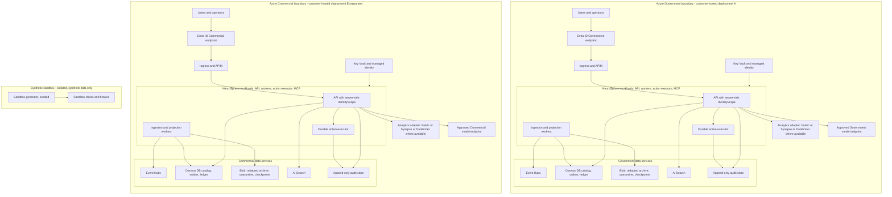
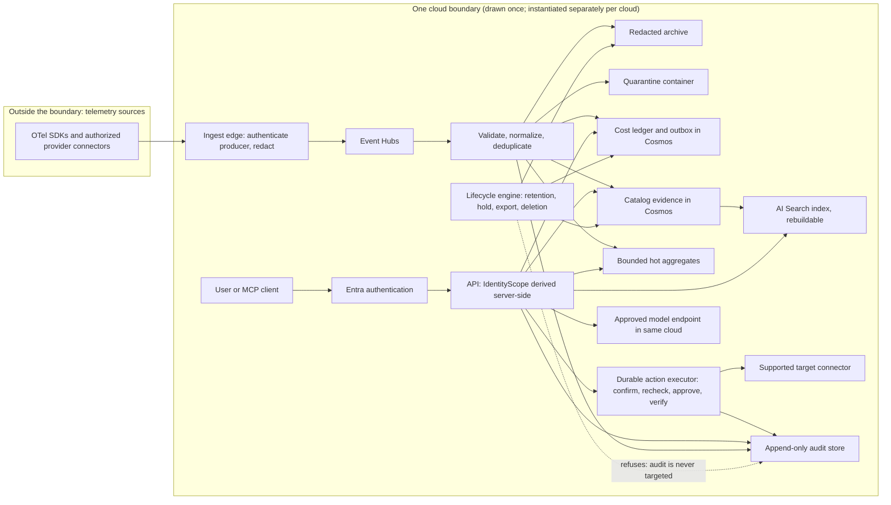

# Boundary and data-flow diagrams

> **Scope:** Authorization-boundary candidate and data flows of a customer-hosted NeuroSphere deployment, Azure Government and Azure Commercial drawn separately.
> **Status vocabulary:** `designed`, `implemented_tested`, `inherited`, `customer`, `planned`, `not_applicable`.
> **Statement:** NeuroSphere is not FedRAMP authorized; the authorizing official decides. This document supports the customer security team and the authorizing official. It is not an assessment, makes no authorization, ATO, parity or certification claim, and carries no authorization date or compliance score.
> **Provenance:** PRP-23 item 4. Customer-owned inputs are recorded as `customer` and OPEN; they are never guessed here.

Each diagram has its Mermaid source in `diagrams/`, the same source in a fenced block below, and a rendered SVG committed beside the source. Rendered with `@mermaid-js/mermaid-cli@12.0.0` (see "Rendering" at the end).

Companion documents: [incident response](incident-response-plan.md), [contingency](contingency-plan.md), [change management](change-management-plan.md), [continuous monitoring](continuous-monitoring-plan.md). Responsibility split: [responsibility matrix](../responsibility-matrix.md). Platform trust-boundary baseline: [ARCHITECTURE.md](../../ARCHITECTURE.md) section 1 and the [threat model](../../security/threat-model.md).

## 1. Boundary diagram

Source: [diagrams/boundary.mmd](diagrams/boundary.mmd). Rendered: [diagrams/boundary.svg](diagrams/boundary.svg).

Reading the diagram:

- **Two separate boundaries.** An Azure Government deployment and an Azure Commercial deployment are different deployments with their own identity endpoint, model endpoint, search, storage, event and analytics resources. The diagram has no edge between them, and the product has none: no automatic cross-cloud data flow exists, and Government data is never bridged to Commercial to fill a feature gap. A feature unavailable in the target environment is disabled with a reason, not substituted. Source: ARCHITECTURE.md section 4 and the responsibility matrix ground rules.
- **Customer-hosted.** Each boundary is deployed into the customer's subscription and tenant. The customer chooses cloud and region, owns network design, key custody and identity configuration (see the matrix).
- **Synthetic sandbox.** The sandbox generator and its stores are isolated and hold synthetic data only. No edge joins the sandbox to either boundary's ingestion or stores. Real ingestion requires authorized connectors, credentials and a privacy policy (`customer` input, OPEN).
- **Trust boundaries inside a deployment.** User to ingress (Entra authentication), ingress to API (authorization with `IdentityScope` derived server-side), API to data services (scoped queries), producers to Event Hubs (producer identity enforced at the ingest edge), workloads to Key Vault (managed identity; no secrets in files, prompts or logs), and the action executor to target connectors. The numbered boundaries and abuse cases are in the [threat model](../../security/threat-model.md).
- **Audit store.** Append-only, written by the API and the action executor. The lifecycle engine refuses to target it.
- **Analytics adapter.** Fabric, Synapse or Azure Databricks is a deployment choice behind an adapter, enabled only where the cloud, region and feature are verified. Availability per service is in the G02 register, `docs/evidence/G02/register.yaml`, and says nothing about authorization.
- **Model endpoint.** One approved model endpoint per cloud, inside the same cloud. The endpoint does not fail over with the platform (see the contingency plan).

| Element | Status | Note |
|---|---|---|
| Separation of Government and Commercial deployments | `designed` | Separate endpoint sets per cloud profile; in-cluster proof of no Commercial egress from a Government cluster has not run, OPEN (G02) |
| Server-side `IdentityScope` on every path | `implemented_tested` for the paths built to date | Evidence is indexed by the SSP control narratives (PRP-23 item 2); this document does not restate it |
| Azure platform services in the boundary | `inherited` (as input only) | A listing in an audit scope is not an authorization of this application; see the matrix |
| Boundary approval, system categorization, interconnections | `customer` | OPEN: authorizing official and agency baseline are customer inputs |

## 2. Data-flow diagram

Source: [diagrams/dataflow.mmd](diagrams/dataflow.mmd). Rendered: [diagrams/dataflow.svg](diagrams/dataflow.svg).

This diagram is drawn once for a single cloud boundary and is instantiated separately in each cloud; it contains no cross-cloud flow. Notes:

- Telemetry enters only through the ingest edge, which authenticates the producer and redacts before archive and before any external transmission. Prompt and response bodies are off by default.
- Checkpoints advance only after durable accept or quarantine. Event Hubs has no dead-letter queue; quarantine is an explicit container with a replay CLI.
- Indexes (AI Search) and projections are rebuildable from the catalog; the redacted archive and the audit store are not rebuildable and are the recovery priorities.
- The user, REST, MCP and copilot paths all reach the same scoped API and the same durable action executor, which rechecks permission and target version at execution, audits, and verifies the actual change.
- The lifecycle engine (retention, legal hold, export, deletion) acts on archive, catalog and ledger through target adapters. It refuses any action against the audit store. Retention periods, hold process and classification are `customer` inputs, OPEN (G06); with no policy configured it deletes nothing.
- No LLM-generated SQL, Cypher or JavaScript executes anywhere in the flow; the copilot uses bounded structured tools.

## Rendering

Both diagrams were rendered with the pinned CLI (`pnpm dlx @mermaid-js/mermaid-cli@12.0.0 -i <name>.mmd -o <name>.svg`) and the SVG coordinates were trimmed to two decimals, matching `scripts/render_mermaid.py`, so the repository PII scan does not misread long digit runs. On the authoring machine puppeteer's own headless shell was not installed, so the installed Google Chrome was supplied through the puppeteer `executablePath` option; the Mermaid CLI and version are the pinned ones. Re-render after any change to a `.mmd` file and keep the fenced block above identical to its source.
