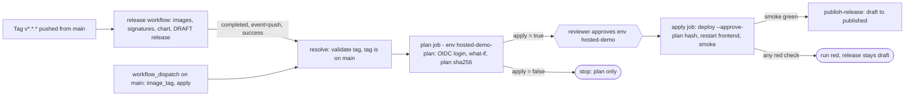

# Delivery pipeline to the hosted environment (PRP-63)

When a release is cut from `main`, GitHub Actions can deploy that release to the persistent hosted
demo for you: it logs in to Azure with OpenID Connect (no stored secret), shows the plan, waits for
your approval, deploys the pinned image tag with the same `hosted_demo.py` the runbook uses, runs a
smoke, and only then turns the draft GitHub Release into a published one.

Status: the workflow is merged but has **never run live**. The first OIDC login, the first approved
plan and apply and the first smoke against the real environment belong to PRP-64 and need
`NS_LIVE_APPROVED=1` plus your approval in the protected environment. Until you create the federated
credential, the two environments and the secrets below, the workflow does nothing useful (the plan
job fails at login), so merging it deploys nothing.

## 1. Trigger and flow

The diagram source was rendered locally with the mermaid-cli package (version 12.0.0) (see
`docs/dev/diagram-rendering.md`) before this page claimed it renders.

| Job | Environment | Permissions | What it does |
|---|---|---|---|
| `resolve` | none | `contents: read` | Checks the trigger (a `push` run of `release` that succeeded, or a manual run on `main`), validates the tag as SemVer, requires the tag commit to be an ancestor of `main`, requires the GitHub Release to exist, and fixes the date-derived parameters (delete-after date, budget start) once so plan and apply agree. |
| `plan` | `hosted-demo-plan` | `id-token: write`, `contents: read` | Logs in, runs `hosted_demo.py plan`, writes the plan sha256 and the change counts to the job summary, uploads the scrubbed evidence for 7 days. |
| `apply` | `hosted-demo` (required reviewers) | `id-token: write`, `contents: read` | Waits for approval, runs `hosted_demo.py deploy --approve-plan <hash from plan>` with the `hub-subnet,hub-pe,hub-dns,budget` tokens, restarts the frontend site, runs `scripts/gates/hosted_smoke.py`, fails on any red check. |
| `publish-release` | none | `contents: write` | Publishes the draft release of the tag (the prerelease flag is kept). No Azure login. Runs only when `apply` succeeded. |

A pull request run or a dry run of `release` never deploys: the trigger requires
`workflow_run.event == 'push'` and a tag-shaped branch, and manual runs are accepted only on `main`.
A manual run takes `image_tag` (for example `v0.1.0-rc.2`) and `apply` (default `false`, which stops
after the plan). One deploy runs at a time (`concurrency: hosted-demo-deploy`, queued runs wait,
nothing is cancelled mid-deployment). Re-running with the same tag is idempotent: the plan reports no
change.

The deploy tooling (`hosted_demo.py`, the Bicep) comes from the `main` commit the workflow runs on;
only the image tag is pinned to the release.

### The plan hash

`plan` and `apply` build their `hosted_demo.py` arguments with identical steps (a static test
compares them) so the plan sha256 binds the same parameters. `deploy` re-runs the what-if and refuses
before changing anything if the change list no longer matches the approved hash. Read the plan in the
job summary before you approve; the summary lists change types and resource types only.

## 2. One-time setup (operator)

Run `temp/setup-delivery-oidc.ps1` (kept untracked in the operator's checkout; the PRP completion
note says how). It performs, idempotently and with a dry-run switch:

1. Creates or updates one Entra app registration for delivery.
2. Adds two federated credentials on it, subjects exactly
   `repo:fgarofalo56/neurosphere:environment:hosted-demo-plan` and
   `repo:fgarofalo56/neurosphere:environment:hosted-demo`, issuer
   `https://token.actions.githubusercontent.com`, audience `api://AzureADTokenExchange`.
3. Assigns the roles in section 3.
4. Creates the GitHub environments `hosted-demo-plan` (no reviewers) and `hosted-demo` (required
   reviewer: you; restrict deployment branches to `main` and tags `v*`).
5. Sets the environment secrets by prompting you. Values are typed as secure strings, never echoed and
   never put on a command line.

Nothing about the operator script is committed; it holds no secret, but it names your tenant steps.

### Secrets (environment secrets on both environments, names only)

Set every one of these on `hosted-demo-plan` **and** `hosted-demo`. They are environment secrets, not
repository variables, because subscription ids appear inside subnet and zone ids and the repository
is public.

| Secret | Holds |
|---|---|
| `NS_AZURE_CLIENT_ID`, `NS_AZURE_TENANT_ID`, `NS_AZURE_SUBSCRIPTION_ID` | The delivery app registration and the target subscription |
| `NS_INTEGRATION_SUBNET_ID`, `NS_PE_SUBNET_ID` | Hub `snet-functions` and private-endpoint subnet ARM ids |
| `NS_COSMOS_ZONE_ID`, `NS_EVENTHUBS_ZONE_ID`, `NS_BLOB_ZONE_ID`, `NS_WEBAPPS_ZONE_ID`, `NS_KEYVAULT_ZONE_ID` | Private DNS zone ARM ids (Key Vault zone optional) |
| `NS_ENTRA_TENANT_ID`, `NS_ENTRA_CLIENT_ID` | The hosted app's Entra tenant and API app (client) id |
| `NS_COPILOT_ENDPOINT` | Foundry endpoint URL |
| `NS_BUDGET_EMAILS`, `NS_TAG_OWNER` | Budget alert emails and the `owner` tag value |
| `NS_FOUNDRY_ACCOUNT_IDS`, `NS_BILLING_EXPORT_STORAGE_ID` | Optional hosted data path inputs (PRP-58) |

Optional environment **variables** (non-identifying; unset means the `hosted_demo.py` default):
`NS_HOSTED_RESOURCE_GROUP`, `NS_HOSTED_LOCATION`, `NS_HOSTED_PREFIX`, `NS_HOSTED_SKU`,
`NS_HOSTED_COPILOT_MODE`, `NS_HOSTED_COPILOT_DEPLOYMENT`, `NS_HOSTED_CONNECTOR_ROLES`,
`NS_HOSTED_RECOMMENDATIONS` (`true` to enable), `NS_HOSTED_EVAL_DOMAIN_ID`,
`NS_HOSTED_EVAL_SUBJECT_ID`, `NS_HOSTED_EVAL_DATASET_IDS`.

Set the variables and secrets to what the environment was last deployed with by hand. If a value is
missing, the plan will show the difference as a change and you will see it before approving.

## 3. Roles the identity needs, and why

Never Owner. Scope everything as narrowly as the resource allows.

| Role | Scope | Why |
|---|---|---|
| Contributor | the hosted resource group | Deploys the Bicep, restarts sites, creates the budget, reads metrics for the smoke. |
| Role Based Access Control Administrator, constrained to the roles `infra/demo` assigns (Event Hubs Data Sender/Receiver, Storage Blob Data Contributor/Reader, Key Vault Secrets User, Foundry user, Cosmos is data-plane) | the hosted resource group | The Bicep creates role assignments for the sites' managed identities; Contributor cannot. Prefer the constrained form over User Access Administrator. |
| Network Contributor | the integration subnet and the private-endpoint subnet | Joining the VNet integration subnet and creating private endpoints. |
| Private DNS Zone Contributor | the five hub private DNS zones | Private endpoint DNS zone groups write into the zones. |
| Cosmos DB built-in data contributor (data plane, `az cosmosdb sql role assignment`) | the hosted Cosmos account | The ownership register has a Cosmos copy; see section 5. |

Which exact roles the first run needs is not verified yet. PRP-64 records the real list from the first
approved run; trim anything unused.

## 4. Smoke

`scripts/gates/hosted_smoke.py` wraps the existing `run_smoke`: frontend root, `/config.json` keys,
401 for an unauthenticated API call through the frontend, `/readyz` not proxied, the API's own host
refused, all sites running, `HealthCheckStatus` healthy. It restarts the frontend first (update path
step 4), retries the whole smoke up to 6 times with growing backoff while the sites warm up, writes
a machine-readable result and a summary table, and exits 1 on any failed check. It prints statuses
only, never a response body, token or header value other than `Cache-Control`. The signed-in browser
smoke (`frontend/playwright.hosted.config.ts`) needs a human sign-in and stays manual.

## 5. Register state on an ephemeral runner

A runner's local disk is gone after the job, so the local register export is not there on the next
run. The register also has a Cosmos copy written and read through the deployment outputs
(`cosmosEndpoint`), which is what an update deploy relies on. That needs the Cosmos data-plane role
above. Uploading the local export as an artifact was rejected: it holds full resource ids, and
artifacts of a public repository are readable by anyone signed in to GitHub.

UNVERIFIED: that an update deploy without a local register leaves the register correct. PRP-64
must confirm it on the first run (compare register rows before and after). If the Cosmos role is
missing, do not approve the apply.

## 6. Evidence and artifacts

Plan and deploy evidence come from `hosted_demo.py`, which scrubs subscription ids before writing.
They are uploaded as workflow artifacts with 7-day retention and are never committed. In a public
repository workflow artifacts are visible to anyone signed in to GitHub, which is why only scrubbed
output is uploaded and the raw state directory is not.

## 7. Rollback

- Re-run the workflow (`workflow_dispatch`, `apply` true) with the previous tag. This is the update
  path: it changes site settings and images only. The release for that tag is already published, so
  the publish step reports "already published" and does nothing.
- Or the operator runs `teardown` by hand (runbook section 7). The pipeline never runs `teardown`.
- To stop the pipeline altogether: delete the two environments and the two federated credentials, or
  revert the PR.

## 8. What the pipeline does not do

- It does not deploy every merge to `main`; images exist only for tagged releases, because the GHCR
  packages of this public repository come out public.
- It does not perform a first-ever deploy, `grant-model-access`, `entra-redirect`, `seed-access` or
  `teardown`; those stay with the operator (runbook S3 to S7, S10).
- It does not run the signed-in browser smoke, scheduled smokes, alerting or rollback automation.
- It does not deploy to Azure Government.
- The two existing draft releases `v0.1.0-rc.1` and `v0.1.0-rc.2` predate the pipeline; publish them
  by hand or let the first run handle `rc.2` (your decision).

See also `docs/deploy/hosted-demo.md`, `docs/release/release-process.md` and `docs/release/verify.md`.
