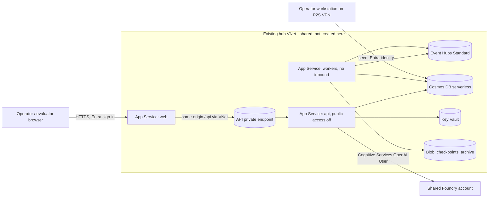

# Hosted demo runbook (PRP-32)

Status: the offline pieces (Bicep, deploy script, seeder, smoke) are built and unit-tested. No live
step has run. Every step S1-S10 below is **OPEN** until the operator runs it and the evidence lands
in `docs/evidence/PRP-32/`. Nothing here is an availability, compliance or authorization claim.

This runbook stands up one persistent, right-sized demo in the Limitlessdata tenant, subscription
`Limitlessdata - DMLZ`, region `centralus`, resource group `rg-neurosphere-demo`. Azure Commercial
only. The repo is public, so every id below is a placeholder. You pass real values as arguments
and never commit them.

## 1. Architecture

The frontend is the only public site. It serves the SPA over HTTPS (Entra sign-in in the browser)
and proxies same-origin `/api/` calls to the API site. The API site has no public path: its own
hostname is reached only through a private endpoint in the hub. The workers site has no inbound
path. All three sites join the hub subnet `snet-functions` through regional VNet integration with
route-all on. Cosmos DB (serverless), Event Hubs (Standard), Storage and Key Vault are private
only, each with a private endpoint in the hub `snet-private-endpoints` and an A record in the
existing hub private DNS zone. Nothing creates a VNet, subnet, peering or DNS zone.

The workers run six roles (ingestion, projections, aggregates, actions, hitl_timers, lifecycle).
Recommendations and evaluations are not run hosted; the seeder writes them. There is no AI
Search and no APIM. The copilot uses a deployment on the shared Foundry account through the API's
managed identity, with no keys.



The diagram is Mermaid source only. `scripts/render_mermaid.py` renders just the five blocks of
`docs/ARCHITECTURE.md`, so no SVG was produced for this runbook.

## 2. Prerequisites

Operator access:

- Roles on `Limitlessdata - DMLZ`: Owner, or Contributor plus User Access Administrator on
  `rg-neurosphere-demo` (role assignments are created). Network Contributor-level join rights on the
  hub subnet and private endpoint and DNS-zone-group rights on the hub zones. Cognitive Services
  Contributor-level rights to assign a role on the shared Foundry account.
- Entra: rights to edit the app registration used for sign-in and to assign users to its app roles
  (Application Administrator or owner of the app).
- Tools: `az` (signed in), `uv`, Git Bash. Run scripts with `uv run python`, never plain `python`.

Account selection. The script checks `az cloud show` is `AzureCloud` and that the active account
equals `--subscription`. It never runs `az account set`. You do:

```
az account set --subscription "Limitlessdata - DMLZ"
```

and when you finish, restore your default subscription (for example `Limitlessdata - Main`):

```
az account set --subscription "<your-default-subscription-name>"
```

P2S VPN. Cosmos is private (a management-group Modify policy forces `publicNetworkAccess` off), so
the seed step and the one-time secret creation need the point-to-site VPN. The generated VPN profile
must carry the resolver `10.0.9.4` as its DNS server plus these name suffixes:

- `.documents.azure.com`
- `.servicebus.windows.net`
- `.blob.core.windows.net`
- `.vault.azure.net`

Verify resolution with `Resolve-DnsName` from a `.ps1` file, not `nslookup` (nslookup ignores the
name resolution policy table the VPN client writes). Put this in `temp/check-dns.ps1`:

```powershell
param([string[]]$Names)
foreach ($n in $Names) { Resolve-DnsName -Name $n -Type A | Select-Object Name, IPAddress }
```

then run it with `powershell -NoProfile -ExecutionPolicy Bypass -File temp/check-dns.ps1 -Names <cosmos-account>.documents.azure.com`.
A private address in the hub range means the VPN path works. A public address, or no answer, means
the profile is missing the DNS server or the suffix.

Common rules for every command below:

- `NS_LIVE_APPROVED=1` must be set for the command, otherwise the script exits 2 and runs no `az`.
- Prefix `MSYS_NO_PATHCONV=1` on any command with a `/subscriptions/...` argument, or Git Bash
  rewrites it into a Windows path.
- Redirect long runs to a log and read the exit code with `echo $?`. A pipe into `tail` hides it.
- Exit codes: 0 ok, 1 failed (evidence written), 2 refused (nothing changed).
- Pass `--operator <your-handle>` on every mutating command. It is a name or handle, not an email.
- Agents cannot run `az deployment`. Deploys run only through this script, started by you.

The infra flags are the same for `preflight`, `plan`, `deploy` and `status`. Set them once as shell
variables in your session (do not write them to a tracked file):

```
SUB=<subscription-id>
HUB_ARGS="--integration-subnet-id <hub-snet-functions-id> --private-endpoint-subnet-id <hub-snet-private-endpoints-id> --cosmos-zone-id <cosmos-zone-id> --eventhubs-zone-id <eventhubs-zone-id> --blob-zone-id <blob-zone-id> --webapps-zone-id <webapps-zone-id> --keyvault-zone-id <keyvault-zone-id>"
```

The commands below spell the flags out for clarity. In practice substitute `$HUB_ARGS`.

## 3. Steps S1-S10

Each live step needs `NS_LIVE_APPROVED=1` and your explicit approval for that step, recorded in
the evidence (operator, UTC time, step, token). A step that did not run stays **OPEN**.

### S1 Preflight (read-only)

Checks cloud, account, providers, that `snet-functions` is empty, delegated and has internet
egress (no route table, no outbound Internet deny), that the hub zones exist, and that the Foundry
deployment is present.

```
MSYS_NO_PATHCONV=1 NS_LIVE_APPROVED=1 uv run python scripts/gates/hosted_demo.py preflight \
  --subscription <subscription-id> \
  --operator <handle> \
  --integration-subnet-id <hub-snet-functions-id> \
  --private-endpoint-subnet-id <hub-snet-private-endpoints-id> \
  --cosmos-zone-id <cosmos-zone-id> \
  --eventhubs-zone-id <eventhubs-zone-id> \
  --blob-zone-id <blob-zone-id> \
  --webapps-zone-id <webapps-zone-id> \
  --keyvault-zone-id <keyvault-zone-id> \
  --foundry-account-id <foundry-account-id> \
  --copilot-endpoint <foundry-endpoint-url> \
  --entra-tenant-id <tenant-id> \
  --entra-client-id <api-app-client-id> \
  --image-tag 0.1.0-rc.2 \
  --budget-contact-emails <alert-email> \
  --tag-owner <owner-handle>
```

Evidence: `<date>-preflight`.

### S2 Plan

Creates `rg-neurosphere-demo` (tagged) if it is absent, runs what-if and prints the sha256 of the
normalized change list. Approval: the resource group creation (you are choosing to run it).

```
MSYS_NO_PATHCONV=1 NS_LIVE_APPROVED=1 uv run python scripts/gates/hosted_demo.py plan \
  --subscription <subscription-id> \
  --operator <handle> \
  --integration-subnet-id <hub-snet-functions-id> \
  --private-endpoint-subnet-id <hub-snet-private-endpoints-id> \
  --cosmos-zone-id <cosmos-zone-id> \
  --eventhubs-zone-id <eventhubs-zone-id> \
  --blob-zone-id <blob-zone-id> \
  --webapps-zone-id <webapps-zone-id> \
  --keyvault-zone-id <keyvault-zone-id> \
  --foundry-account-id <foundry-account-id> \
  --copilot-endpoint <foundry-endpoint-url> \
  --entra-tenant-id <tenant-id> \
  --entra-client-id <api-app-client-id> \
  --image-tag 0.1.0-rc.2 \
  --budget-contact-emails <alert-email> \
  --tag-owner <owner-handle>
```

Read the change list. Copy the printed hash for S3. The hash binds the shared resource ids, so a
different id at deploy time changes it. Evidence: `<date>-plan`.

### S3 Deploy

Creates billable resources and touches shared hub resources. Approval needs the plan hash plus a
token for each shared touch:

- `hub-subnet`: the sites join `snet-functions`.
- `hub-pe`: five private-endpoint NICs in `snet-private-endpoints` (Cosmos, Event Hubs, blob, the
  API site, Key Vault).
- `hub-dns`: A records in the hub `privatelink.*` zones.
- `budget`: the resource-group budget.

```
MSYS_NO_PATHCONV=1 NS_LIVE_APPROVED=1 uv run python scripts/gates/hosted_demo.py deploy \
  --subscription <subscription-id> \
  --operator <handle> \
  --integration-subnet-id <hub-snet-functions-id> \
  --private-endpoint-subnet-id <hub-snet-private-endpoints-id> \
  --cosmos-zone-id <cosmos-zone-id> \
  --eventhubs-zone-id <eventhubs-zone-id> \
  --blob-zone-id <blob-zone-id> \
  --webapps-zone-id <webapps-zone-id> \
  --keyvault-zone-id <keyvault-zone-id> \
  --foundry-account-id <foundry-account-id> \
  --copilot-endpoint <foundry-endpoint-url> \
  --entra-tenant-id <tenant-id> \
  --entra-client-id <api-app-client-id> \
  --image-tag 0.1.0-rc.2 \
  --budget-contact-emails <alert-email> \
  --tag-owner <owner-handle> \
  --approve-plan <plan-sha256> \
  --approve-shared hub-subnet,hub-pe,hub-dns,budget \
  --keep
```

When this run creates the pseudonym secret, the sites already started and App Service has cached
`SecretNotFound` for the Key Vault references (it refetches only every 24 hours, and a plain
restart does not clear it). `deploy` therefore POSTs
`<site id>/config/configreferences/appsettings/refresh` for the API and workers sites, restarts
them, and re-reads the references. A reference that is not `Resolved` fails the step and names the
setting and its status, never a value. If the secret already existed, no refresh is sent.

`--keep` is the default and is accepted for clarity. The script re-runs what-if and refuses before
any create if the hash changed. After it deploys it writes the ownership register to the hosted
Cosmos `deploy_register` container and to `temp/hosted-demo/register-<id>.json`, writes
`temp/hosted-demo/registration.json` (gitignored; the seeder reads it), and re-reads each site's
`publicNetworkAccess` and image. A mismatch fails the run loudly (see Troubleshooting).
Evidence: `<date>-deploy`.

#### Recovering from a failed deploy

If the top-level deployment fails after the nested modules created everything (the 2026-10-27
`ResourceNotFound` on the Cosmos account and Event Hubs namespace outputs), the script stopped
before it wrote the ownership register. A plain re-run would then record every resource as
pre-existing and not ours, and teardown would refuse. Recover with the failed run's evidence:

1. Keep the failed `<date>-deploy.json` and the `<date>-plan.json` it was approved against in
   `docs/evidence/PRP-32/` (or pass `--evidence-dir`). Fix the cause first.
2. Run `plan` again. The resources now exist, so what-if reports mostly NoChange and prints a new
   hash.
3. Run the S3 `deploy` command above with the new `--approve-plan` hash and the same
   `--approve-shared` tokens, plus `--resume-failed docs/evidence/PRP-32/<date>-deploy.json`.

The script refuses (exit 2, before any create) unless the group is ours; the file is a FAIL
`deploy` for this deployment id, resource group and subscription with a `plan-hash` approval; a
plan evidence file with the same `plan_sha256` and a change list is in the evidence directory; and
the local register has no NeuroSphere-created rows. It then registers as ours only the live
resources and budget whose scrubbed id was a Create in that plan, plus private-endpoint NICs named
after a Create'd private endpoint. Anything else stays not ours. The new deploy evidence records
`resumed_from` and `resume_registered_count`. Without the flag nothing changes.

#### One-time pseudonym secret (D4)

Under `NS_ENV=prod` the API refuses to start without a pseudonym key. `deploy` creates the Key
Vault secret once, only when it is absent. It generates the value locally, writes it to a temp file,
passes the file to `az keyvault secret set --file`, and deletes the file. The value is never on a
command line, in output or in evidence. Key Vault is private, so you must be on the P2S VPN for
this step. The script never regenerates the secret: a new key would orphan every policy grant
already made under the old pseudonyms. If the secret exists, the run reports "already present;
left untouched". Never delete and recreate it unless you also intend to re-issue every grant.

### S4 Grant model access

Assigns Cognitive Services OpenAI User on the shared Foundry account to the API's managed identity
(no keys; the account is Entra-only). This changes a shared resource. Approval: `foundry-role`.

```
MSYS_NO_PATHCONV=1 NS_LIVE_APPROVED=1 uv run python scripts/gates/hosted_demo.py grant-model-access \
  --subscription <subscription-id> \
  --operator <handle> \
  --foundry-account-id <foundry-account-id> \
  --approve-shared foundry-role
```

Evidence: `<date>-grant-model-access`. Without S4 the copilot stays disabled with a reason. That is
acceptable and is reported, not hidden. Even with S4 it remains disabled until a dated Commercial
`centralus` capability row exists for the chosen model (decision 5). On the shipped matrix every
Commercial Foundry row is `unverified`.

### S5 Entra redirect and user assignment

Adds the hosted SPA redirect URI to the existing API app registration. The script does a Graph GET,
merges, then PATCHes from a body file, because a PATCH of `spa.redirectUris` replaces the whole
array. It records the prior list and, at teardown, removes only the URI it added. This is a tenant
change. Approval: `entra-app`.

```
MSYS_NO_PATHCONV=1 NS_LIVE_APPROVED=1 uv run python scripts/gates/hosted_demo.py entra-redirect \
  --subscription <subscription-id> \
  --operator <handle> \
  --entra-client-id <api-app-client-id> \
  --approve-shared entra-app
```

Evidence: `<date>-entra-redirect`.

Users and app roles are assigned by you in Entra, not by the script. The app roles already exist on
the registration (PRP-29): `viewer`, `analyst`, `domain_steward`, `admin`, `security_auditor`. In the
Entra admin center open Enterprise applications, find the API app, then Users and groups, Add
user/group, pick the user and one role. A user with no role can sign in but sees nothing. To test
the hidden-route check, also keep one user on `viewer` only. Policy grants to domains come from the
seeder (S7) for the operator's object id; other users need their own grants through the product.

### S6 Seed access (grant)

Gives the operator identity time-boxed data-plane roles on NeuroSphere-owned resources only:
Cosmos Data Contributor (database scope), Event Hubs Data Sender (hub scope), Storage Blob Data
Contributor (archive container) and Key Vault Secrets User (the pseudonym secret). Be on the P2S
VPN. The script refuses if the register does not show those resources as created by NeuroSphere.

```
MSYS_NO_PATHCONV=1 NS_LIVE_APPROVED=1 uv run python scripts/gates/hosted_demo.py seed-access \
  --subscription <subscription-id> \
  --operator <handle> \
  --grant \
  --principal <operator-object-id> \
  --expires-hours 8
```

`--expires-hours` is a hint written to the evidence. Nothing expires the grant for you, so revoke it
in S7. Evidence: `<date>-seed-access`.

### S7 Seed, then revoke

Synthetic data only. The seeder verifies the registration, runs every endpoint through the hosted
guard (it allows exactly the registered hosts, only with `NS_LIVE_APPROVED=1` and a matching
deployment id, and refuses any key or connection string), generates the deterministic synthetic
world, then writes it with Entra auth. It creates no database or container; Bicep owns those.

```
NS_LIVE_APPROVED=1 NS_ENV=prod NS_SANDBOX_HOSTED_DEPLOYMENT_ID=<deployment-id> NS_AUTH_TENANT_ID=<tenant-id> \
  uv run python scripts/gates/hosted_demo_seed.py \
  --operator-object-id <operator-object-id> \
  --registration temp/hosted-demo/registration.json \
  --profile small
```

`--profile demo` seeds a larger world. Evidence holds counts only: `hosted_demo_seed.json`
(renamed to `<date>-seed` when you commit it). Then revoke the roles:

```
MSYS_NO_PATHCONV=1 NS_LIVE_APPROVED=1 uv run python scripts/gates/hosted_demo.py seed-access \
  --subscription <subscription-id> \
  --operator <handle> \
  --revoke \
  --principal <operator-object-id>
```

Revoke is register-bound: it deletes only assignments that exist live and that the register
records as created by `seed-access` (the S6 grant), drops those register rows, and logs the count
actually removed (`removed 0 (none registered)` when there is nothing to remove). A matching
assignment that someone else created is left in place. S6 and S7 pass the full role-definition id
(`/subscriptions/<id>/providers/Microsoft.Authorization/roleDefinitions/<guid>`) to `--role`,
because a bare GUID failed to resolve at the blob-container scope.

### S8 Release tag

The images pulled by the sites come from the public GHCR packages
`ghcr.io/fgarofalo56/neurosphere/{api,workers,frontend}`. Tag `v0.1.0-rc.2` is cut with
`docs/release/release-process.md` and verified with `docs/release/verify.md` (cosign signatures and
SBOM attestations). Pushing the tag publishes public images, so it needs your explicit approval.
Record each image digest in `docs/evidence/PRP-32/release-v0.1.0-rc.2.md`. This step must happen
before S3 for a first deploy, since S3 pins that tag.

### S9 Smoke

Automated, unauthenticated checks. They write evidence.

```
MSYS_NO_PATHCONV=1 NS_LIVE_APPROVED=1 uv run python scripts/gates/hosted_demo.py smoke \
  --subscription <subscription-id> \
  --operator <handle>
```

What it checks: the frontend `/` is 200; `/config.json` is 200 with `no-store`, the expected keys,
non-zero ids and `apiBaseUrl` equal to `/`; an unauthenticated `GET /api/v1/me/domains` through the
frontend is 401 (the proxy reaches the API and auth is enforced); the API's own public hostname is
refused; all three sites are `Running`; the `HealthCheckStatus` metric is healthy. Evidence:
`<date>-smoke`.

Then the manual browser run, which needs your sign-in:

1. Open `https://<prefix>-web.azurewebsites.net` in a Playwright-controlled browser, sign in, and
   save the storage state to `temp/hosted-demo/auth.json`.
2. MSAL keeps its cache in `sessionStorage`, which storage state does not carry. Dump it to
   `temp/hosted-demo/session-storage.json` (a flat JSON object of keys to values). The spec replays
   it into each page when the file exists.
3. Run the spec. It has its own config, no web server, and is excluded from CI.

```
NS_HOSTED_URL=https://<prefix>-web.azurewebsites.net pnpm --filter @neurosphere/frontend exec playwright test -c playwright.hosted.config.ts
```

It checks the shell, the domain switcher with synthetic domains, overview tiles with data, the map
and the copilot (an answer, or the disabled reason). Everything under `temp/` holds tokens and is
never committed. List the spec offline with `--list` to confirm it is wired.

### S10 Teardown

Only when you decide. The environment is persistent by default and `teardown` is the only removal
path. See section 7.

## 4. Update path (new image tag)

1. Cut and verify the new tag (S8) and record digests.
2. Re-run `plan` with the new `--image-tag`. Read the change list: it should only touch the site
   settings and images. Copy the new hash.
3. Re-run `deploy` with `--approve-plan <new-hash>` and the same `--approve-shared` tokens. The
   register is updated; the secret is left untouched.
4. Restart the web app so nginx re-resolves the API upstream (see Troubleshooting), then run `smoke`.
5. `status` shows drift between the template and the live resources, plus the `delete-after` date.

```
MSYS_NO_PATHCONV=1 NS_LIVE_APPROVED=1 uv run python scripts/gates/hosted_demo.py status \
  --subscription <subscription-id> \
  --operator <handle> \
  --integration-subnet-id <hub-snet-functions-id> \
  --private-endpoint-subnet-id <hub-snet-private-endpoints-id> \
  --cosmos-zone-id <cosmos-zone-id> \
  --eventhubs-zone-id <eventhubs-zone-id> \
  --blob-zone-id <blob-zone-id> \
  --webapps-zone-id <webapps-zone-id> \
  --entra-tenant-id <tenant-id> \
  --entra-client-id <api-app-client-id> \
  --copilot-endpoint <foundry-endpoint-url> \
  --image-tag 0.1.0-rc.2 \
  --budget-contact-emails <alert-email> \
  --tag-owner <owner-handle>
```

## 5. Cost (estimate; verify with the Azure pricing calculator)

Single small environment, not a sizing claim. These are planning estimates, not measurements. Key
Vault is on because the API needs the pseudonym key (D4), which adds a fifth private endpoint.

| Resource | SKU / setting | Est. USD/month |
|---|---|---|
| App Service plan (Linux) | B2 x1 (web, api, workers) | ~26 (P0v3 option ~62) |
| Cosmos DB | Serverless, single region, <1 GB, low RU | ~1-10 |
| Event Hubs | Standard, 1 TU, 1 hub, 1 extra consumer group | ~22 |
| Storage | StorageV2 LRS (checkpoints, quarantine) | ~1-2 |
| Private endpoints | 5 (Cosmos, Event Hubs, blob, API site, Key Vault) | ~36.50 + data |
| Log Analytics | PerGB2018, 30 d retention, 1 GB/day cap | <=7 at demo volume |
| Key Vault | Standard, one secret | ~0 |
| AI Search / APIM | not deployed | 0 |
| Cost Management budget | RG budget | 0 |
| **Subtotal in RG** | | **~90-105** |
| Foundry tokens (`mini`) | usage-based, shared account | ~<5 at demo usage, **outside the RG budget** |

The Log Analytics daily cap is 1 GB, the smallest positive integer the module accepts, not the
0.1 GB planned. Real demo volume is far lower, but a worst case would cost more than the table.

Foundry token spend lands on the shared Foundry account and is invisible to the RG budget. Watch it
on that account. The $200/month RG budget (alerts at 50/80/100% actual and 100% forecast) is a
notification, not a spending limit.

Monthly `delete-after` review: the `delete-after` tag starts at deploy date plus 30 days. Once a
month, run `status`, decide whether the demo is still wanted, and if so extend the tag (re-run
`plan` and `deploy` with a new `--tag-delete-after`). If it is not wanted, tear it down.

## 6. Troubleshooting

- `/readyz` is 404 at the frontend. By design (D3): the hosted frontend does not proxy `/readyz` or
  `/healthz`. The smoke asserts it is not 200.
- API calls through the frontend fail right after deploy. nginx resolves the API upstream once at
  start. Restart the web app after the API private endpoint exists:
  `az webapp restart --resource-group rg-neurosphere-demo --name <prefix>-web`.
- Entra, GHCR or Foundry unreachable from the sites. Route-all is on (D5) for all three sites, as
  Linux apps need it to reach private endpoints. Egress must stay open on `snet-functions` (no route
  table, no outbound Internet deny); preflight checks this. Image pulls use the public route.
- Deploy fails or a site is not private. A management-group Modify policy can flip
  `publicNetworkAccess` (it shows only as `policies/modify/action` in the activity log). The
  post-deploy check re-reads each site and fails on a mismatch. Read failures with
  `az monitor activity-log list --resource-group rg-neurosphere-demo --offset 2h --status Failed`.
- Cosmos 403 with substatus 5300 on create. Entra data-plane tokens cannot create databases or
  containers, so every database and container is in Bicep. Do not create them by script.
- Cosmos is serverless through the `EnableServerless` capability (API `2024-11-15` has no
  `capacityMode`). No container sets throughput. Catalog is a flat `/domain` key while the
  hierarchical-key matrix row is `unverified`; partition keys are immutable, so a mismatch means
  delete and recreate.
- Workers never report healthy. They need `NS_WORKER_HEALTH_HOST=0.0.0.0`; the template sets it.
- Workers run six roles only. The recommendations and evaluation roles read compose-mounted data the
  hosted image lacks, so those records are written by the seeder instead.
- Copilot shows disabled. Expected until a dated Commercial `centralus` capability row exists for the
  chosen model (decision 5) and S4 ran. `NS_COPILOT_MODEL_FEATURE` and `NS_COPILOT_SKU` are set from
  the chosen model but are unverified until a live answer proves them.
- Log Analytics ingestion and query are public (no private link scope). This is deliberate so
  diagnostic settings work; the workspace holds site logs only.
- A short workers restart during deploy is expected. The app-service module is deployed twice (the
  second pass adds the workers' own object id, which exists only after the first).
- `HealthCheckStatus` may have no datapoints right after deploy. Wait a few minutes and re-run
  `smoke`.
- `/subscriptions/...` argument turns into a Windows path. Prefix `MSYS_NO_PATHCONV=1`.
- The script says `neurosphere_core` is not importable. Run it with `uv run python`. A plain run once
  crashed mid-teardown and stranded billable resources.
- `az cosmosdb` is slow and heavy. Run it one command at a time with a bounded wait.
- Key Vault purge protection blocks purging at teardown (expected). The name stays reserved for 90
  days, so a redeploy with the same prefix may need a different `--prefix`.
- Seeding cannot reach a data service. Check the VPN profile (DNS server and suffixes) with
  `Resolve-DnsName`, and that the grant from S6 has propagated.

## 7. Teardown and orphan checks

`teardown` is register-guarded: it removes only resources the ownership register records as created
by NeuroSphere. It never deletes the hub subnet, DNS zones, the Foundry account or the Entra app
object. Order: restore the Entra redirect list (removes only our URI), remove the Foundry role, remove
the seeder roles, disconnect VNet integration, delete the private endpoints, delete the sites and
plan, delete the data services, delete the budget, and delete the resource group only when the
register shows no foreign resource. Disconnecting before deleting matters: a lingering service
association link can block the shared subnet. It refuses with a wrong or missing `--confirm`, and
refuses when the register is unreadable or the group holds an unregistered resource.

```
MSYS_NO_PATHCONV=1 NS_LIVE_APPROVED=1 uv run python scripts/gates/hosted_demo.py teardown \
  --subscription <subscription-id> \
  --operator <handle> \
  --confirm <deployment-id>
```

Evidence: `<date>-teardown`. Afterwards restore your default `az` subscription and check for leftovers:

- Resource groups: `az group list --query "[?starts_with(name, 'rg-ns-')].name" -o tsv` should list
  nothing from this work (a leftover `rg-ns-*` is a stranded smoke or demo group).
- Hub private endpoints by tag: `az network private-endpoint list --query "[?tags.project=='neurosphere'].name" -o tsv`
  should list nothing.
- Entra: open the API app registration and confirm the hosted SPA redirect URI is gone and the prior
  list is intact.
- Key Vault: a purge-protected vault may remain soft-deleted; that is expected.

Record the result in the teardown evidence.
