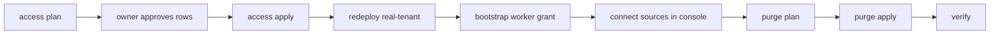

# Hosted real-tenant runbook (PRP-139)

Status: the scripts, templates and console pieces are built and unit-tested. **Nothing in this
runbook was run by PRP-139.** Every live step and every gate row in `docs/evidence/PRP-139/README.md`
is **OPEN** until an operator runs it and the evidence lands there. Nothing here is an availability,
compliance or authorization claim.

This runbook turns a hosted deployment (see `docs/deploy/hosted-demo.md`) from the synthetic demo
into one that shows the Azure tenant it is deployed to, and nothing else. Azure Commercial only:
Government is refused, never bridged. The repo is public, so every id below is a placeholder; you
pass real values as arguments and never commit them.

The sequence is fixed. The app is never a mix of synthetic and real data, and the synthetic data is
never deleted before the switch.



## 1. Prerequisites

- Point-to-site VPN with name resolution through `.documents.azure.com`, `.servicebus.windows.net`,
  `.blob.core.windows.net` and `.vault.azure.net` (`docs/deploy/hosted-demo.md`, VPN section).
  Cosmos, Blob and Key Vault writes from your machine (worker grant, purge, producer secret) need it.
- Who can sign in as an administrator. Preferred: the PRP-138 Entra role mapping is deployed, so the
  owner is an administrator at first sign-in. If it is not, the D20 stopgap applies:
  `scripts/sandbox/sbx_grant_operator.py --hosted <registration file>` grants one person by hand.
  Treat the stopgap as a last resort and ask the owner first.
- The owner's list of resources to govern, written down before you start: the Foundry account(s)
  and project(s), the API Management service and the Log Analytics workspace its diagnostics go to,
  and the storage account holding the Cost Management export. The Foundry account
  `aifndry-loom-centralus` belongs to another workload and is never a default target; the owner names
  every account.
- An existing Cost Management export (this runbook does not create one) with at least one closed
  month, written as CSV to one blob container on that storage account.
- API Management gateway diagnostics `GatewayLogs` and `GatewayLlmLogs` sent to the workspace.
- A producer secret for `gateway_poll` and for `billing_export`, placed in the deployment's Key
  Vault **by you**, outside this runbook. The workers identity needs Key Vault Secrets User on that
  vault (`docs/runbooks/connector-config.md`, section 2). Never put the secret value in a command,
  a file or a chat.
- A signed-in `az` session in the Commercial cloud, and `NS_LIVE_APPROVED=1` for every mutating
  command. On Git Bash, prefix `MSYS_NO_PATHCONV=1` on any command with an argument that starts with
  `/subscriptions/`.
- Exit codes: 0 ok, 1 failed (evidence written), 2 refused (nothing changed).

Call telemetry paths. Azure Monitor and Application Insights AI call telemetry is not available in
this release (a follow-up PRP builds it). The two shipped paths for model and agent calls are API
Management gateway logs and OpenTelemetry pushed by the workload to the ingest edge with a producer
credential.

## 2. Role assignments NeuroSphere needs

Every assignment is at the scope of a single resource. Nothing is assigned at resource-group or
subscription scope. Role definition ids were verified against Microsoft Learn on 2026-11-21. This
page carries no GUID (the docs tests forbid one in `docs/deploy`), so the ids are listed in
`docs/evidence/PRP-139/README.md` and printed by `access-plan`.

| Identity | Role | Scope |
|---|---|---|
| Workers | Foundry User | each named Foundry account |
| Workers | Storage Blob Data Reader | the export storage account |
| Workers | Log Analytics Data Reader | the gateway's workspace |
| API | API Management Service Reader Role | the API Management service |

Gateway registration also reads the service's diagnostic settings. Whether Service Reader alone
covers that is **not settled**. The access plan prints a Monitoring Reader row marked UNVERIFIED that
cannot be applied. Try registration with Service Reader. If it is denied on diagnostic settings, stop
and record the row as OPEN. Do not hand-assign a broader role without the owner's approval:
Monitoring Reader is `*/read` on the service.

A role assignment can take up to 10 minutes to take effect. `verify` retries up to
`--propagation-seconds` (default 600) before it reports a failure.

## 3. Cut-over

### Step 1. Access plan and approval

Writes the table of assignments and changes nothing. It prints a plan hash and one approval token per
row, and writes a plan file under `temp/`.

```
MSYS_NO_PATHCONV=1 uv run python scripts/gates/hosted_real_tenant.py access-plan \
  --registration temp/hosted-demo/registration.json \
  --foundry-account-ids <foundry-account-id> \
  --log-analytics-workspace-ids <workspace-id> \
  --apim-service-ids <apim-service-id> \
  --billing-export-storage-account-id <storage-account-id>
```

Give the printed table to the owner. They approve row by row. Apply only the approved rows: one
`--approve-assignment` per row, each token copied from the table. A row that is not in the plan, or a
scope wider than one resource, is refused, and the script never creates, edits or deletes the
governed resource itself.

```
MSYS_NO_PATHCONV=1 NS_LIVE_APPROVED=1 uv run python scripts/gates/hosted_real_tenant.py access-apply \
  --registration temp/hosted-demo/registration.json \
  --approve-plan <plan-sha256> \
  --approve-assignment <row-token> \
  --approve-assignment <row-token>
```

Evidence: `docs/evidence/PRP-139/<date>-access.json` (counts, states and a short hash of each
subscription; no ids).

### Step 2. Redeploy in real-tenant mode

The customer id is the partition key of most containers and part of every principal id, so a new id
makes the synthetic estate invisible at the restart. Pick a lowercase slug of the organisation, never
`synthco`. `--budget-start-date 2026-10-01` is needed on every redeploy until the budget module is
fixed (PRP-67). Use the same infrastructure arguments as the last demo deploy; the lines below show
the ones that matter.

```
MSYS_NO_PATHCONV=1 NS_LIVE_APPROVED=1 uv run python scripts/gates/hosted_demo.py plan \
  --subscription <sub-id> \
  --operator <handle> \
  --data-mode real-tenant \
  --customer-id <customer-slug> \
  --foundry-account-ids <foundry-account-id> \
  --log-analytics-workspace-ids <workspace-id> \
  --apim-service-ids <apim-service-id> \
  --billing-export-storage-account-id <storage-account-id> \
  --budget-start-date 2026-10-01
```

Read the change list and copy the printed hash. Then deploy with the same arguments plus the
approvals, as in `docs/deploy/hosted-demo.md` S3:

```
MSYS_NO_PATHCONV=1 NS_LIVE_APPROVED=1 uv run python scripts/gates/hosted_demo.py deploy \
  --subscription <sub-id> \
  --operator <handle> \
  --data-mode real-tenant \
  --customer-id <customer-slug> \
  --foundry-account-ids <foundry-account-id> \
  --log-analytics-workspace-ids <workspace-id> \
  --apim-service-ids <apim-service-id> \
  --billing-export-storage-account-id <storage-account-id> \
  --budget-start-date 2026-10-01 \
  --approve-plan <plan-sha256> \
  --approve-shared hub-subnet,hub-pe,hub-dns,budget
```

Real-tenant mode turns the three connector roles (`foundry_discovery`, `gateway_poll`,
`billing_export`) on and sets `NS_HOSTED_DATA_MODE=real-tenant` on the API and workers. The template
sets that setting; you do not. After the restart the pages show empty states that say what is
missing and link to `/admin/sources/connectors`.

The `deploy-hosted.yml` pipeline reads these repository variables: `NS_HOSTED_DATA_MODE` (required;
the plan and apply jobs fail when it is unset), `NS_HOSTED_CUSTOMER_ID`,
`NS_HOSTED_LOG_ANALYTICS_WORKSPACE_IDS` and `NS_HOSTED_APIM_SERVICE_IDS`.

### Step 3. Create a domain, then bootstrap the worker grant

The workers' own principal is not a person, and in a fresh customer it has no authority. Sign in as
an administrator and create at least one domain at `/admin/domains`. Then grant the workers principal
`viewer` on the domains discovery should write into:

```
NS_LIVE_APPROVED=1 NS_ENV=prod NS_SANDBOX_HOSTED_DEPLOYMENT_ID=<deployment-id> NS_AUTH_TENANT_ID=<tenant-id> \
  uv run python scripts/gates/hosted_real_tenant.py bootstrap-worker \
  --registration temp/hosted-demo/registration.json \
  --domain-ids <domain-id> \
  --customer-id <customer-slug>
```

### Step 4. Connect sources in the console

Open `/admin/sources/connectors` as an administrator. The "First sources" panel lists the four
sources with state, last success time and a Connect action. Configure each one. Credentials are
managed identity or a Key Vault secret reference; no key or connection string is accepted.

- Azure AI Foundry: kind `foundry_discovery`, `projects` set to the owner-named
  `resource/project` pairs, exactly one domain. Hosted uses the workers' system-assigned identity.
- API Management AI gateways: register the gateway under the domain (Admin Gateways), then add a
  `gateway_poll` configuration with `api_base_url` and the producer reference.
- Cost and billing: kind `billing_export` with `storage_account_url`, `container`, `manifest_blob`,
  `api_base_url` and the producer reference, exactly one domain.

A stored configuration is read when a role starts; there is no hot reload. **Restart the workers
site after each console change:**

```
az webapp restart --subscription <sub-id> --resource-group <resource-group> --name <workers-site-name>
```

### Step 5. Purge the synthetic data

Only after real sources are connected. The purge refuses unless the active mode is already
`real-tenant`. `plan` counts what it would delete and deletes nothing. It selects only documents of
the synthetic customer whose source is `sandbox`, plus the seed's own fixed records; real records and
other customers are counted as kept. Audit chains are kept unless you pass `--include-audit` (a
global flag, placed before the subcommand). Event Hubs is not purged; retention ages it out.

```
NS_LIVE_APPROVED=1 NS_ENV=prod NS_SANDBOX_HOSTED_DEPLOYMENT_ID=<deployment-id> \
  uv run python scripts/gates/hosted_purge_synthetic.py \
  --registration temp/hosted-demo/registration.json \
  plan
```

Read the counts. Apply needs `NS_LIVE_APPROVED=1`, `--confirm <deployment-id>` and a plan file less
than 24 hours old whose counts still match:

```
NS_LIVE_APPROVED=1 NS_ENV=prod NS_SANDBOX_HOSTED_DEPLOYMENT_ID=<deployment-id> \
  uv run python scripts/gates/hosted_purge_synthetic.py \
  --registration temp/hosted-demo/registration.json \
  apply \
  --confirm <deployment-id>
```

Evidence: `docs/evidence/PRP-139/<date>-purge-plan.json` and `<date>-purge.json` (counts only). Wait
for the event hub to drain or its retention to pass before `verify`; synthetic events still in flight
are not stored under the new customer.

### Step 6. Verify

Reads per-source counts through the API with your token, and the count of synthetic records, which
must be zero. A source that was not connected is `OPEN`, never `PASS`. The registration file does not
hold the API host or audience, so name both.

```
NS_LIVE_APPROVED=1 NS_SANDBOX_HOSTED_DEPLOYMENT_ID=<deployment-id> \
  uv run python scripts/gates/hosted_real_tenant.py verify \
  --registration temp/hosted-demo/registration.json \
  --api-host <api-host> \
  --api-audience <api-audience> \
  --domain-ids <domain-id> \
  --propagation-seconds 600
```

Evidence: `docs/evidence/PRP-139/<date>-verify.json`.

## 4. What each source reads, and what it does not

Metadata only. Content capture stays off. No code path here reads or stores a prompt, response,
header or body.

| Source | Reads | Does not read |
|---|---|---|
| Azure AI Foundry | Agents and model deployments of the named projects, written as draft catalog entities marked as discovered from Foundry | Prompts, responses, files, threads |
| API Management gateways | Gateway and LLM log rows from the one workspace, a fixed column allowlist: token counts, model, status, latency; tier and diagnostic settings of the service at registration | Any body or header column |
| Cost and billing | CSV files of the owner's Cost Management export in one blob container; invoiced cost for closed months | Anything else in the storage account |
| Azure Monitor and Application Insights | Nothing in this release beyond the gateway tables | Not available in this release |

## 5. What is disabled when access is missing

A missing role never stops the other sources.

- Foundry: discovery of that project fails with state `failed` and reason `source_access_denied`; the
  catalog stays empty for it.
- Gateways: registration fails with the mapped ARM error, or the poll records `poll_status` failed;
  no gateway traffic appears.
- Billing: the read fails; state `failed`, reason `source_access_denied`; reconciliation shows no
  billing source.
- Application Insights: shown as `not_connected` with the text that it is not available in this
  release.

The Connectors page shows the state, the last success time and the missing role in words. The owner
approves any access change.

## 6. Rollback

- Before the purge: redeploy with `--data-mode demo --customer-id synthco`. The synthetic estate is
  visible again and nothing was lost.
- After the purge: the synthetic data is gone on purpose. A demo environment is rebuilt with the seed
  and `--demo-environment <deployment-id>`.
- Role assignments are removed with the `az role assignment delete` lines the access evidence lists.
- `connector_run_status` rows are inert without the API route.

## 7. Not run by this PRP

PRP-139 ran no Azure, Cosmos, Key Vault or Event Hubs call and no deployment. Not run: the access
apply, the real-tenant redeploy, the worker grant, connecting any source, the purge plan and apply,
and `verify`. Government and any Commercial bridge for it are refused. The Application Insights
telemetry reader is a follow-up PRP. All six gate rows in `docs/evidence/PRP-139/README.md` are OPEN.
