# DFD: confused deputy

Abuse case AC-2 in [`../threat-model.md`](../threat-model.md#ac-2-confused-deputy).
Boundaries touched: B3, B7, B8 and the additional MCP boundary A4.

A **deputy** is a NeuroSphere component that holds more authority than its caller: the API with
its managed identity on Cosmos and analytics, the action executor with delegated connector
credentials, and the MCP server. The attack tricks the deputy into using *its* authority for a
caller who lacks it. Paths shown:

1. A low-privilege user, or a model acting for one, names a target outside the user's scope
   (`domain_id` in a tool argument or body field).
2. A token issued for another resource, or for the MCP client application rather than the user,
   is presented to the MCP server.
3. The MCP server forwards an inbound token to a downstream service (token passthrough).
4. An approved action executes after the requester lost permission, under the executor's own
   credential.

```mermaid
flowchart LR
  subgraph Callers["Callers: untrusted input"]
    LOW["Low-privilege user"]
    MOD["Model acting for the user"]
    MCPC["External MCP client app"]
  end
  subgraph Front["Ingress boundary"]
    APIM["APIM: only public ingress"]
  end
  subgraph Deputy["NeuroSphere deputies"]
    VAL{{"D1 token checks: issuer, tenant, audience, resource, lifetime, revocation"}}
    DER{{"D2 ScopeDeriver: scope from verified claims and policy store only"}}
    API["API routes and copilot tools"]
    MCPS["MCP server: streamable HTTP only"]
    NOPASS{{"D3 no token passthrough: tools run in-process with the caller scope"}}
    EXE["Action executor"]
    RECHK{{"D4 recheck permission and target version at execution"}}
    REG{{"D5 write registry: only real write connectors, delegated per target"}}
  end
  subgraph Targets["Protected resources"]
    CDB[("Cosmos and analytics under managed identity")]
    TGT["Customer target via write connector"]
    AUD[("Append-only audit")]
  end

  LOW --> APIM
  MCPC --> APIM
  APIM --> VAL
  VAL --> DER
  DER --> API
  DER --> MCPS
  MOD -- "tool args" --> API
  API -- "scope predicates first" --> CDB
  MCPS --> NOPASS
  NOPASS --> API
  API -- "draft intent" --> EXE
  EXE --> RECHK
  RECHK --> REG
  REG --> TGT
  RECHK -- "allow or deny" --> AUD
  VAL -- "deny" --> AUD

  LOW -. "path 1: domain_id of another domain" .-> DER
  MOD -. "path 1: smuggled customer_id" .-> DER
  MCPC -. "path 2: token for another audience" .-> VAL
  MCPS -. "path 3: forward inbound token downstream" .-> NOPASS
  EXE -. "path 4: run after permission revoked" .-> RECHK

  classDef control fill:#e8f4ea,stroke:#2e7d32,color:#1b3a1e
  classDef attacker fill:#fdecea,stroke:#c62828,color:#5b1210
  class VAL,DER,NOPASS,RECHK,REG control
  class LOW,MOD,MCPC attacker
```

## Where each control sits

| Control | Boundary | Mechanism | Owner | State |
|---|---|---|---|---|
| D1 | B3 | `packages/core/neurosphere_core/auth/jwt/validator.py` (alg allowlist, cloud JWKS, `iss`, `aud`, `tid`, lifetime); revocation check during derivation | PRP-06 | In repo |
| D1 (MCP) | A4 | OAuth 2.1 resource server with RFC 9728 metadata and `validate_token_resource=True` set explicitly; audience and resource checked separately | PRP-22 | Planned |
| D2 | B3 | `packages/core/neurosphere_core/auth/scope/derivation.py`; `current_scope` reads only the `Authorization` header; Entra role and group claims are never authority | PRP-06 | In repo |
| D3 | A4 | MCP server never forwards an inbound token; it holds no broad downstream identity a caller can borrow | PRP-22 | Planned |
| D4 | B7, B8 | Executor rechecks current permission and target version; confirmation bound to target, version, diff and expiry | PRP-17 | Planned |
| D5 | B8 | `connectors/sdk-python/neurosphere_connector/write/write_registry.py`; advisory connectors cannot write | PRP-09 | In repo |

## Tests

- Server-side ABAC negative suite: `tests/security/authz/` (exists, PRP-06): API, search, cache,
  export, push and privileged-role paths deny out-of-scope targets and audit the decision.
- `domain_id` and `customer_id` smuggling cases: `tests/security/injection/` (PRP-12 item 4).
- MCP confused-deputy suite (wrong audience, client-only token, model-supplied `domain_id`,
  replay after revocation): `tests/security/mcp/test_confused_deputy.py` (planned, owner PRP-22).
- Revocation after approval blocks execution: `services/workers/tests/actions/test_recheck.py`
  (planned, owner PRP-17).
