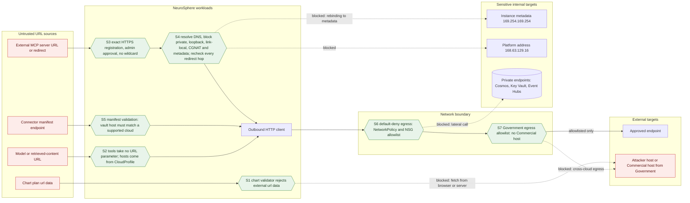

# DFD: server-side request forgery (SSRF)

Abuse case AC-3 in [`../threat-model.md`](../threat-model.md#ac-3-server-side-request-forgery).
Boundaries touched: B5, B6, B8 and the additional boundaries A4 (MCP) and A5 (deployment).

SSRF makes a NeuroSphere server fetch a URL the attacker chose, so the request carries the
server's network position and identity. High-value targets inside an Azure deployment are the
instance metadata service (169.254.169.254, which can mint managed-identity tokens), the platform
address 168.63.129.16, private endpoints (Cosmos, Key Vault, Event Hubs) and, for a Government
deployment, any Commercial endpoint. URL sources an attacker can influence:

- a chart plan from the copilot carrying external `url` data;
- a URL suggested by the model or planted in retrieved content;
- an administrator-registered external MCP server, or a redirect from it;
- connector manifest endpoints and deployment-scan hosts.

## Where each control sits

| Control | Boundary | Mechanism | Owner | State |
|---|---|---|---|---|
| S1 | B2, B6 | Vega-Lite subset: no `expr`, signals or external `url` data; `vega-interpreter` in a sandboxed iframe | PRP-19 | Planned |
| S2 | B5, B6, A5 | Hosts are frozen per-cloud facts in `packages/core/neurosphere_core/cloud/profile.py`; the resource scan builds its management host from the `CloudProfile` and sends a fixed query (`services/api/neurosphere_api/deploy/scan/graph.py`) | PRP-05, PRP-08 | In repo |
| S3, S4 | A4 | MCP client: explicit administrator registration of exact HTTPS URLs; block after DNS resolution (loopback, link-local including metadata, RFC 1918, unique local, CGNAT, 168.63.129.16, metadata hostnames); every redirect hop re-passes the check | PRP-22 | Planned |
| S5 | B8 | `connectors/sdk-python/neurosphere_connector/manifest.py` cross-field rule: vault host matches a supported cloud | PRP-09 | In repo |
| S6 | All egress | Helm NetworkPolicy default-deny egress with allowlist values; Bicep NSG and private endpoints (PRP-12 item 3) | PRP-12 | In progress |
| S7 | All egress (Government) | Government egress allowlist and no-Commercial-egress test | PRP-20 | Planned |

## Tests

- SSRF URL cases in the shared corpus: `tests/security/injection/` (PRP-12 item 4).
- MCP SSRF unit suite: `packages/core/tests/mcp/test_ssrf.py` (planned, owner PRP-22).
- Government no-Commercial-egress suite: `tests/security/egress/` (planned, owner PRP-20).
- Default-deny egress render test: `tests/security/network/test_networkpolicy_render.py` (PRP-12 item 3).
